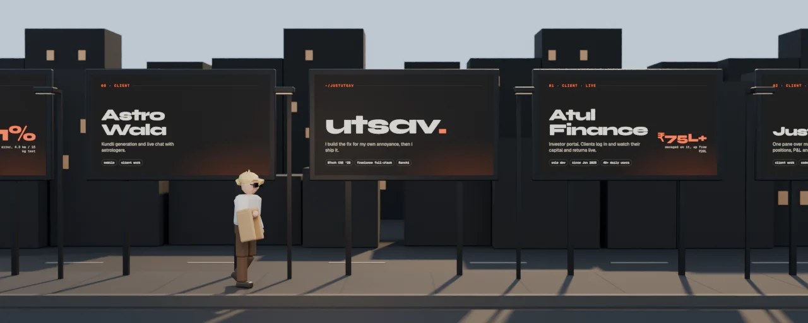
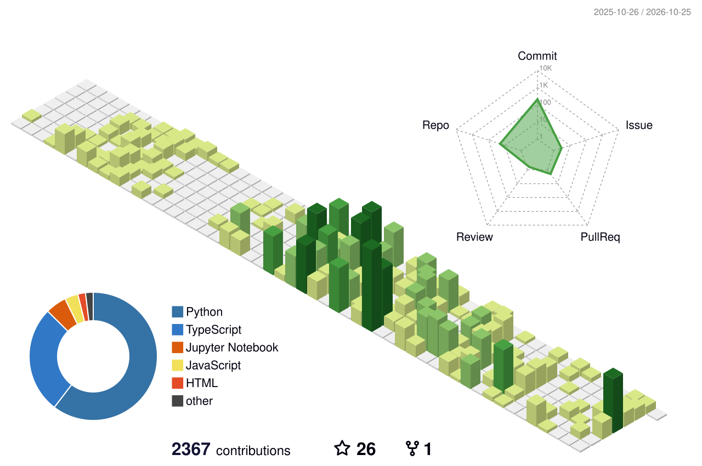

<p align="center">
  <a href="https://justutsav.com"></a>
  <a href="https://linkedin.com/in/justutsav"></a>
  <a href="https://youtube.com/@Blaze_Age"></a>
  <a href="mailto:justutsav.05@gmail.com"></a>
  <a href="https://play.google.com/store/apps/details?id=com.justmanager.app"></a>
</p>

## `> whoami`

3rd-year CS undergrad at **C.V. Raman Global University** (batch '28) running a freelance full-stack practice on the side, slowly turning it into an agency. Home is Ranchi; the laptop is an Ubuntu box I've broken and fixed more times than I'd like to admit.

Most of what's on this page started as a problem in my own flat or on my own laptop. I'd rather check the numbers than argue from vibes, and I stick around after launch.

- **3 businesses** run on my builds
- **Smart India Hackathon** internal winner, team lead
- currently on **SIH 2026 · PS 26097**, a voice assistant that maps livelihoods for SC communities to NSQF skilling
- learning web fundamentals properly, grinding LeetCode, getting friendly with pandas

## `> shipped`

The code is private. The results aren't. Most of these run real businesses with real money in them.

<table>
<tr>
<td width="50%" valign="top">

**Atul Finance** · [atulfinance.com ↗](https://www.atulfinance.com)<br>
Investor portal where clients log in and watch their capital and returns live, with PDF statements and automated comms. Managed capital grew from ₹20L to **₹75L+** on top of it; 40+ people use it daily.<br>
<sub>`sole dev` `since Jun 2025` `code private`</sub>

</td>
<td width="50%" valign="top">

**JustTrade** · *real money inside*<br>
One dashboard over multiple trading accounts: positions, P&L and strategy-level metrics in a single pane for an active trading desk.<br>
<sub>`client work` `code private`</sub>

</td>
</tr>
<tr>
<td width="50%" valign="top">

**Grit** · [Play Store ↗](https://play.google.com/store/apps/details?id=com.justmanager.app)<br>
Student productivity app, **23 releases** shipped solo. Snap a paper timetable and OCR turns it into a calendar; tasks and alarms take plain-language and voice commands.<br>
<sub>`TypeScript` `Capacitor` `Kotlin` `RevenueCat` `OneSignal`</sub>

</td>
<td width="50%" valign="top">

**SplitFree** · *on the Play Store, used daily*<br>
Built in rebellion against Splitwise's free-tier caps. My flat of five settles rent on it: one-tap UPI settle with proof, recurring rent/EMI splits, and reminders that do the awkward chasing.<br>
<sub>`Flutter` `Supabase` `Riverpod`</sub>

</td>
</tr>
<tr>
<td width="50%" valign="top">

**Astro Wala** · *client work*<br>
Astrology app for a client: kundli generation and live chat with astrologers.<br>
<sub>`mobile` `client work`</sub>

</td>
<td width="50%" valign="top">

**High-altitude drone digital twin** · *Avinya 2026*<br>
Drop two pins and a payload; physics says whether a heavy-lift drone makes the sortie before takeoff. Tested 4.3 km / 15 kg route: energy draw within **1%** of prediction.<br>
<sub>`ArduPilot SITL` `Gazebo` `QGroundControl`</sub>

</td>
</tr>
<tr>
<td colspan="2" valign="top">

**Old phone → 24/7 server**: a Micromax with a half-dead screen, now running full Linux and a self-hosted AI agent that filters my email, sends Telegram reminders and runs research jobs in the background.

</td>
</tr>
</table>

## `> open source`

<table>
<tr>
<td width="50%" valign="top">

[**claude-route**](https://github.com/justutsav/claude-route)<br>
Zero-token model router for Claude Code. A deterministic classifier picks the cheapest capable model per task, cutting a worked session's cost by ~46%.<br>
<sub>`Python` `Claude Code` `hooks`</sub>

</td>
<td width="50%" valign="top">

[**justWhisper**](https://github.com/justutsav/justWhisper)<br>
Fully local Wispr Flow clone for Linux: hold a key, talk, text lands in the focused window. Speaks Hinglish too. No cloud, no API bill.<br>
<sub>`Python` `faster-whisper` `Ollama`</sub>

</td>
</tr>
<tr>
<td width="50%" valign="top">

[**wpm-overlay**](https://github.com/justutsav/wpm-overlay)<br>
Floating real-time WPM overlay with 15/30/60s speeds, a live graph and colours that judge you. Born of a Monkeytype habit; one-click `.exe`.<br>
<sub>`Python` `Tkinter` `pynput`</sub>

</td>
<td width="50%" valign="top">

[**rubix-cube-097**](https://github.com/justutsav/rubix-cube-097)<br>
SIH 2026 build: a four-minute phone call in your own language becomes an NSQF qualification you're eligible for, plus a livelihood pathway for your district.<br>
<sub>`TypeScript` `IVR` `WhatsApp`</sub>

</td>
</tr>
<tr>
<td width="50%" valign="top">

[**Zentry-clone-Website**](https://github.com/justutsav/Zentry-clone-Website) · [live](https://zentry-clone-website-mu.vercel.app)<br>
Scroll-driven gaming site with cinematic video, bento grid and GSAP everywhere.<br>
<sub>`React` `GSAP` `Tailwind`</sub>

</td>
<td width="50%" valign="top">

[**GDrive-Folder-Size-Calculator**](https://github.com/justutsav/GDrive-Folder-Size-Calculator)<br>
Drive won't tell you how big a folder is. This walks the tree over the Drive API and does.<br>
<sub>`Python` `Drive API v3`</sub>

</td>
</tr>
</table>

<details>
<summary><b>more experiments</b></summary>
<br>

- [**Rubix-Cube-Project**](https://github.com/justutsav/Rubix-Cube-Project) · [live](https://rubix-cube-project.vercel.app): student life app balancing schedule, money and health with AI help
- [**getting-started-with-ubuntu**](https://github.com/justutsav/getting-started-with-ubuntu): one script from fresh Ubuntu install to usable machine
- [**ChatResizer**](https://github.com/justutsav/ChatResizer): Chrome extension that gives ChatGPT a wide mode
- [**Brain-Tumor-Scanning**](https://github.com/justutsav/Brain-Tumor-Scanning): block-thresholding MRI scans to localise tumour regions with OpenCV
- [**MLTraining**](https://github.com/justutsav/MLTraining): crop-yield prediction with a Random Forest on rainfall, temperature and pesticide data
- [**splitfree-privacy**](https://github.com/justutsav/splitfree-privacy): the Play-compliant privacy page behind SplitFree

</details>

## `> stack`

<p>
  
</p>

<sub>plus Capacitor · Riverpod · pgvector · RevenueCat · OneSignal · Razorpay · Claude Code · Ollama · OpenRouter · ESP32 · ArduPilot</sub>

## `> drag me`

My last year of commits as a 3D city, one tower per day. Grab it and spin it around.

<!--SKYLINE:START-->
```stl
solid skyline
facet normal 0 0 1
outer loop
vertex 0.1 1.1 1.1
vertex 0.9 1.1 1.1
vertex 0.9 1.9 1.1
endloop
endfacet
facet normal 0 0 1
outer loop
vertex 0.1 1.1 1.1
vertex 0.9 1.9 1.1
vertex 0.1 1.9 1.1
endloop
endfacet
facet normal 0 -1 0
outer loop
vertex 0.1 1.1 0
vertex 0.9 1.1 0
vertex 0.9 1.1 1.1
endloop
endfacet
facet normal 0 -1 0
outer loop
vertex 0.1 1.1 0
vertex 0.9 1.1 1.1
vertex 0.1 1.1 1.1
endloop
endfacet
facet normal 0 1 0
outer loop
vertex 0.9 1.9 0
vertex 0.1 1.9 0
vertex 0.1 1.9 1.1
endloop
endfacet
facet normal 0 1 0
outer loop
vertex 0.9 1.9 0
vertex 0.1 1.9 1.1
vertex 0.9 1.9 1.1
endloop
endfacet
facet normal -1 0 0
outer loop
vertex 0.1 1.9 0
vertex 0.1 1.1 0
vertex 0.1 1.1 1.1
endloop
endfacet
facet normal -1 0 0
outer loop
vertex 0.1 1.9 0
vertex 0.1 1.1 1.1
vertex 0.1 1.9 1.1
endloop
endfacet
facet normal 1 0 0
outer loop
vertex 0.9 1.1 0
vertex 0.9 1.9 0
vertex 0.9 1.9 1.1
endloop
endfacet
facet normal 1 0 0
outer loop
vertex 0.9 1.1 0
vertex 0.9 1.9 1.1
vertex 0.9 1.1 1.1
endloop
endfacet
facet normal 0 0 1
outer loop
vertex 3.1 0.1 1.1
vertex 3.9 0.1 1.1
vertex 3.9 0.9 1.1
endloop
endfacet
facet normal 0 0 1
outer loop
vertex 3.1 0.1 1.1
vertex 3.9 0.9 1.1
vertex 3.1 0.9 1.1
endloop
endfacet
facet normal 0 -1 0
outer loop
vertex 3.1 0.1 0
vertex 3.9 0.1 0
vertex 3.9 0.1 1.1
endloop
endfacet
facet normal 0 -1 0
outer loop
vertex 3.1 0.1 0
vertex 3.9 0.1 1.1
vertex 3.1 0.1 1.1
endloop
endfacet
facet normal 0 1 0
outer loop
vertex 3.9 0.9 0
vertex 3.1 0.9 0
vertex 3.1 0.9 1.1
endloop
endfacet
facet normal 0 1 0
outer loop
vertex 3.9 0.9 0
vertex 3.1 0.9 1.1
vertex 3.9 0.9 1.1
endloop
endfacet
facet normal -1 0 0
outer loop
vertex 3.1 0.9 0
vertex 3.1 0.1 0
vertex 3.1 0.1 1.1
endloop
endfacet
facet normal -1 0 0
outer loop
vertex 3.1 0.9 0
vertex 3.1 0.1 1.1
vertex 3.1 0.9 1.1
endloop
endfacet
facet normal 1 0 0
outer loop
vertex 3.9 0.1 0
vertex 3.9 0.9 0
vertex 3.9 0.9 1.1
endloop
endfacet
facet normal 1 0 0
outer loop
vertex 3.9 0.1 0
vertex 3.9 0.9 1.1
vertex 3.9 0.1 1.1
endloop
endfacet
facet normal 0 0 1
outer loop
vertex 4.1 2.1 1.1
vertex 4.9 2.1 1.1
vertex 4.9 2.9 1.1
endloop
endfacet
facet normal 0 0 1
outer loop
vertex 4.1 2.1 1.1
vertex 4.9 2.9 1.1
vertex 4.1 2.9 1.1
endloop
endfacet
facet normal 0 -1 0
outer loop
vertex 4.1 2.1 0
vertex 4.9 2.1 0
vertex 4.9 2.1 1.1
endloop
endfacet
facet normal 0 -1 0
outer loop
vertex 4.1 2.1 0
vertex 4.9 2.1 1.1
vertex 4.1 2.1 1.1
endloop
endfacet
facet normal 0 1 0
outer loop
vertex 4.9 2.9 0
vertex 4.1 2.9 0
vertex 4.1 2.9 1.1
endloop
endfacet
facet normal 0 1 0
outer loop
vertex 4.9 2.9 0
vertex 4.1 2.9 1.1
vertex 4.9 2.9 1.1
endloop
endfacet
facet normal -1 0 0
outer loop
vertex 4.1 2.9 0
vertex 4.1 2.1 0
vertex 4.1 2.1 1.1
endloop
endfacet
facet normal -1 0 0
outer loop
vertex 4.1 2.9 0
vertex 4.1 2.1 1.1
vertex 4.1 2.9 1.1
endloop
endfacet
facet normal 1 0 0
outer loop
vertex 4.9 2.1 0
vertex 4.9 2.9 0
vertex 4.9 2.9 1.1
endloop
endfacet
facet normal 1 0 0
outer loop
vertex 4.9 2.1 0
vertex 4.9 2.9 1.1
vertex 4.9 2.1 1.1
endloop
endfacet
facet normal 0 0 1
outer loop
vertex 4.1 1.1 2.2
vertex 4.9 1.1 2.2
vertex 4.9 1.9 2.2
endloop
endfacet
facet normal 0 0 1
outer loop
vertex 4.1 1.1 2.2
vertex 4.9 1.9 2.2
vertex 4.1 1.9 2.2
endloop
endfacet
facet normal 0 -1 0
outer loop
vertex 4.1 1.1 0
vertex 4.9 1.1 0
vertex 4.9 1.1 2.2
endloop
endfacet
facet normal 0 -1 0
outer loop
vertex 4.1 1.1 0
vertex 4.9 1.1 2.2
vertex 4.1 1.1 2.2
endloop
endfacet
facet normal 0 1 0
outer loop
vertex 4.9 1.9 0
vertex 4.1 1.9 0
vertex 4.1 1.9 2.2
endloop
endfacet
facet normal 0 1 0
outer loop
vertex 4.9 1.9 0
vertex 4.1 1.9 2.2
vertex 4.9 1.9 2.2
endloop
endfacet
facet normal -1 0 0
outer loop
vertex 4.1 1.9 0
vertex 4.1 1.1 0
vertex 4.1 1.1 2.2
endloop
endfacet
facet normal -1 0 0
outer loop
vertex 4.1 1.9 0
vertex 4.1 1.1 2.2
vertex 4.1 1.9 2.2
endloop
endfacet
facet normal 1 0 0
outer loop
vertex 4.9 1.1 0
vertex 4.9 1.9 0
vertex 4.9 1.9 2.2
endloop
endfacet
facet normal 1 0 0
outer loop
vertex 4.9 1.1 0
vertex 4.9 1.9 2.2
vertex 4.9 1.1 2.2
endloop
endfacet
facet normal 0 0 1
outer loop
vertex 4.1 0.1 2.9
vertex 4.9 0.1 2.9
vertex 4.9 0.9 2.9
endloop
endfacet
facet normal 0 0 1
outer loop
vertex 4.1 0.1 2.9
vertex 4.9 0.9 2.9
vertex 4.1 0.9 2.9
endloop
endfacet
facet normal 0 -1 0
outer loop
vertex 4.1 0.1 0
vertex 4.9 0.1 0
vertex 4.9 0.1 2.9
endloop
endfacet
facet normal 0 -1 0
outer loop
vertex 4.1 0.1 0
vertex 4.9 0.1 2.9
vertex 4.1 0.1 2.9
endloop
endfacet
facet normal 0 1 0
outer loop
vertex 4.9 0.9 0
vertex 4.1 0.9 0
vertex 4.1 0.9 2.9
endloop
endfacet
facet normal 0 1 0
outer loop
vertex 4.9 0.9 0
vertex 4.1 0.9 2.9
vertex 4.9 0.9 2.9
endloop
endfacet
facet normal -1 0 0
outer loop
vertex 4.1 0.9 0
vertex 4.1 0.1 0
vertex 4.1 0.1 2.9
endloop
endfacet
facet normal -1 0 0
outer loop
vertex 4.1 0.9 0
vertex 4.1 0.1 2.9
vertex 4.1 0.9 2.9
endloop
endfacet
facet normal 1 0 0
outer loop
vertex 4.9 0.1 0
vertex 4.9 0.9 0
vertex 4.9 0.9 2.9
endloop
endfacet
facet normal 1 0 0
outer loop
vertex 4.9 0.1 0
vertex 4.9 0.9 2.9
vertex 4.9 0.1 2.9
endloop
endfacet
facet normal 0 0 1
outer loop
vertex 5.1 5.1 1.5
vertex 5.9 5.1 1.5
vertex 5.9 5.9 1.5
endloop
endfacet
facet normal 0 0 1
outer loop
vertex 5.1 5.1 1.5
vertex 5.9 5.9 1.5
vertex 5.1 5.9 1.5
endloop
endfacet
facet normal 0 -1 0
outer loop
vertex 5.1 5.1 0
vertex 5.9 5.1 0
vertex 5.9 5.1 1.5
endloop
endfacet
facet normal 0 -1 0
outer loop
vertex 5.1 5.1 0
vertex 5.9 5.1 1.5
vertex 5.1 5.1 1.5
endloop
endfacet
facet normal 0 1 0
outer loop
vertex 5.9 5.9 0
vertex 5.1 5.9 0
vertex 5.1 5.9 1.5
endloop
endfacet
facet normal 0 1 0
outer loop
vertex 5.9 5.9 0
vertex 5.1 5.9 1.5
vertex 5.9 5.9 1.5
endloop
endfacet
facet normal -1 0 0
outer loop
vertex 5.1 5.9 0
vertex 5.1 5.1 0
vertex 5.1 5.1 1.5
endloop
endfacet
facet normal -1 0 0
outer loop
vertex 5.1 5.9 0
vertex 5.1 5.1 1.5
vertex 5.1 5.9 1.5
endloop
endfacet
facet normal 1 0 0
outer loop
vertex 5.9 5.1 0
vertex 5.9 5.9 0
vertex 5.9 5.9 1.5
endloop
endfacet
facet normal 1 0 0
outer loop
vertex 5.9 5.1 0
vertex 5.9 5.9 1.5
vertex 5.9 5.1 1.5
endloop
endfacet
facet normal 0 0 1
outer loop
vertex 5.1 4.1 2
vertex 5.9 4.1 2
vertex 5.9 4.9 2
endloop
endfacet
facet normal 0 0 1
outer loop
vertex 5.1 4.1 2
vertex 5.9 4.9 2
vertex 5.1 4.9 2
endloop
endfacet
facet normal 0 -1 0
outer loop
vertex 5.1 4.1 0
vertex 5.9 4.1 0
vertex 5.9 4.1 2
endloop
endfacet
facet normal 0 -1 0
outer loop
vertex 5.1 4.1 0
vertex 5.9 4.1 2
vertex 5.1 4.1 2
endloop
endfacet
facet normal 0 1 0
outer loop
vertex 5.9 4.9 0
vertex 5.1 4.9 0
vertex 5.1 4.9 2
endloop
endfacet
facet normal 0 1 0
outer loop
vertex 5.9 4.9 0
vertex 5.1 4.9 2
vertex 5.9 4.9 2
endloop
endfacet
facet normal -1 0 0
outer loop
vertex 5.1 4.9 0
vertex 5.1 4.1 0
vertex 5.1 4.1 2
endloop
endfacet
facet normal -1 0 0
outer loop
vertex 5.1 4.9 0
vertex 5.1 4.1 2
vertex 5.1 4.9 2
endloop
endfacet
facet normal 1 0 0
outer loop
vertex 5.9 4.1 0
vertex 5.9 4.9 0
vertex 5.9 4.9 2
endloop
endfacet
facet normal 1 0 0
outer loop
vertex 5.9 4.1 0
vertex 5.9 4.9 2
vertex 5.9 4.1 2
endloop
endfacet
facet normal 0 0 1
outer loop
vertex 5.1 3.1 1.7
vertex 5.9 3.1 1.7
vertex 5.9 3.9 1.7
endloop
endfacet
facet normal 0 0 1
outer loop
vertex 5.1 3.1 1.7
vertex 5.9 3.9 1.7
vertex 5.1 3.9 1.7
endloop
endfacet
facet normal 0 -1 0
outer loop
vertex 5.1 3.1 0
vertex 5.9 3.1 0
vertex 5.9 3.1 1.7
endloop
endfacet
facet normal 0 -1 0
outer loop
vertex 5.1 3.1 0
vertex 5.9 3.1 1.7
vertex 5.1 3.1 1.7
endloop
endfacet
facet normal 0 1 0
outer loop
vertex 5.9 3.9 0
vertex 5.1 3.9 0
vertex 5.1 3.9 1.7
endloop
endfacet
facet normal 0 1 0
outer loop
vertex 5.9 3.9 0
vertex 5.1 3.9 1.7
vertex 5.9 3.9 1.7
endloop
endfacet
facet normal -1 0 0
outer loop
vertex 5.1 3.9 0
vertex 5.1 3.1 0
vertex 5.1 3.1 1.7
endloop
endfacet
facet normal -1 0 0
outer loop
vertex 5.1 3.9 0
vertex 5.1 3.1 1.7
vertex 5.1 3.9 1.7
endloop
endfacet
facet normal 1 0 0
outer loop
vertex 5.9 3.1 0
vertex 5.9 3.9 0
vertex 5.9 3.9 1.7
endloop
endfacet
facet normal 1 0 0
outer loop
vertex 5.9 3.1 0
vertex 5.9 3.9 1.7
vertex 5.9 3.1 1.7
endloop
endfacet
facet normal 0 0 1
outer loop
vertex 5.1 2.1 1.1
vertex 5.9 2.1 1.1
vertex 5.9 2.9 1.1
endloop
endfacet
facet normal 0 0 1
outer loop
vertex 5.1 2.1 1.1
vertex 5.9 2.9 1.1
vertex 5.1 2.9 1.1
endloop
endfacet
facet normal 0 -1 0
outer loop
vertex 5.1 2.1 0
vertex 5.9 2.1 0
vertex 5.9 2.1 1.1
endloop
endfacet
facet normal 0 -1 0
outer loop
vertex 5.1 2.1 0
vertex 5.9 2.1 1.1
vertex 5.1 2.1 1.1
endloop
endfacet
facet normal 0 1 0
outer loop
vertex 5.9 2.9 0
vertex 5.1 2.9 0
vertex 5.1 2.9 1.1
endloop
endfacet
facet normal 0 1 0
outer loop
vertex 5.9 2.9 0
vertex 5.1 2.9 1.1
vertex 5.9 2.9 1.1
endloop
endfacet
facet normal -1 0 0
outer loop
vertex 5.1 2.9 0
vertex 5.1 2.1 0
vertex 5.1 2.1 1.1
endloop
endfacet
facet normal -1 0 0
outer loop
vertex 5.1 2.9 0
vertex 5.1 2.1 1.1
vertex 5.1 2.9 1.1
endloop
endfacet
facet normal 1 0 0
outer loop
vertex 5.9 2.1 0
vertex 5.9 2.9 0
vertex 5.9 2.9 1.1
endloop
endfacet
facet normal 1 0 0
outer loop
vertex 5.9 2.1 0
vertex 5.9 2.9 1.1
vertex 5.9 2.1 1.1
endloop
endfacet
facet normal 0 0 1
outer loop
vertex 5.1 1.1 1.1
vertex 5.9 1.1 1.1
vertex 5.9 1.9 1.1
endloop
endfacet
facet normal 0 0 1
outer loop
vertex 5.1 1.1 1.1
vertex 5.9 1.9 1.1
vertex 5.1 1.9 1.1
endloop
endfacet
facet normal 0 -1 0
outer loop
vertex 5.1 1.1 0
vertex 5.9 1.1 0
vertex 5.9 1.1 1.1
endloop
endfacet
facet normal 0 -1 0
outer loop
vertex 5.1 1.1 0
vertex 5.9 1.1 1.1
vertex 5.1 1.1 1.1
endloop
endfacet
facet normal 0 1 0
outer loop
vertex 5.9 1.9 0
vertex 5.1 1.9 0
vertex 5.1 1.9 1.1
endloop
endfacet
facet normal 0 1 0
outer loop
vertex 5.9 1.9 0
vertex 5.1 1.9 1.1
vertex 5.9 1.9 1.1
endloop
endfacet
facet normal -1 0 0
outer loop
vertex 5.1 1.9 0
vertex 5.1 1.1 0
vertex 5.1 1.1 1.1
endloop
endfacet
facet normal -1 0 0
outer loop
vertex 5.1 1.9 0
vertex 5.1 1.1 1.1
vertex 5.1 1.9 1.1
endloop
endfacet
facet normal 1 0 0
outer loop
vertex 5.9 1.1 0
vertex 5.9 1.9 0
vertex 5.9 1.9 1.1
endloop
endfacet
facet normal 1 0 0
outer loop
vertex 5.9 1.1 0
vertex 5.9 1.9 1.1
vertex 5.9 1.1 1.1
endloop
endfacet
facet normal 0 0 1
outer loop
vertex 6.1 5.1 1.5
vertex 6.9 5.1 1.5
vertex 6.9 5.9 1.5
endloop
endfacet
facet normal 0 0 1
outer loop
vertex 6.1 5.1 1.5
vertex 6.9 5.9 1.5
vertex 6.1 5.9 1.5
endloop
endfacet
facet normal 0 -1 0
outer loop
vertex 6.1 5.1 0
vertex 6.9 5.1 0
vertex 6.9 5.1 1.5
endloop
endfacet
facet normal 0 -1 0
outer loop
vertex 6.1 5.1 0
vertex 6.9 5.1 1.5
vertex 6.1 5.1 1.5
endloop
endfacet
facet normal 0 1 0
outer loop
vertex 6.9 5.9 0
vertex 6.1 5.9 0
vertex 6.1 5.9 1.5
endloop
endfacet
facet normal 0 1 0
outer loop
vertex 6.9 5.9 0
vertex 6.1 5.9 1.5
vertex 6.9 5.9 1.5
endloop
endfacet
facet normal -1 0 0
outer loop
vertex 6.1 5.9 0
vertex 6.1 5.1 0
vertex 6.1 5.1 1.5
endloop
endfacet
facet normal -1 0 0
outer loop
vertex 6.1 5.9 0
vertex 6.1 5.1 1.5
vertex 6.1 5.9 1.5
endloop
endfacet
facet normal 1 0 0
outer loop
vertex 6.9 5.1 0
vertex 6.9 5.9 0
vertex 6.9 5.9 1.5
endloop
endfacet
facet normal 1 0 0
outer loop
vertex 6.9 5.1 0
vertex 6.9 5.9 1.5
vertex 6.9 5.1 1.5
endloop
endfacet
facet normal 0 0 1
outer loop
vertex 6.1 3.1 1.1
vertex 6.9 3.1 1.1
vertex 6.9 3.9 1.1
endloop
endfacet
facet normal 0 0 1
outer loop
vertex 6.1 3.1 1.1
vertex 6.9 3.9 1.1
vertex 6.1 3.9 1.1
endloop
endfacet
facet normal 0 -1 0
outer loop
vertex 6.1 3.1 0
vertex 6.9 3.1 0
vertex 6.9 3.1 1.1
endloop
endfacet
facet normal 0 -1 0
outer loop
vertex 6.1 3.1 0
vertex 6.9 3.1 1.1
vertex 6.1 3.1 1.1
endloop
endfacet
facet normal 0 1 0
outer loop
vertex 6.9 3.9 0
vertex 6.1 3.9 0
vertex 6.1 3.9 1.1
endloop
endfacet
facet normal 0 1 0
outer loop
vertex 6.9 3.9 0
vertex 6.1 3.9 1.1
vertex 6.9 3.9 1.1
endloop
endfacet
facet normal -1 0 0
outer loop
vertex 6.1 3.9 0
vertex 6.1 3.1 0
vertex 6.1 3.1 1.1
endloop
endfacet
facet normal -1 0 0
outer loop
vertex 6.1 3.9 0
vertex 6.1 3.1 1.1
vertex 6.1 3.9 1.1
endloop
endfacet
facet normal 1 0 0
outer loop
vertex 6.9 3.1 0
vertex 6.9 3.9 0
vertex 6.9 3.9 1.1
endloop
endfacet
facet normal 1 0 0
outer loop
vertex 6.9 3.1 0
vertex 6.9 3.9 1.1
vertex 6.9 3.1 1.1
endloop
endfacet
facet normal 0 0 1
outer loop
vertex 6.1 1.1 1.1
vertex 6.9 1.1 1.1
vertex 6.9 1.9 1.1
endloop
endfacet
facet normal 0 0 1
outer loop
vertex 6.1 1.1 1.1
vertex 6.9 1.9 1.1
vertex 6.1 1.9 1.1
endloop
endfacet
facet normal 0 -1 0
outer loop
vertex 6.1 1.1 0
vertex 6.9 1.1 0
vertex 6.9 1.1 1.1
endloop
endfacet
facet normal 0 -1 0
outer loop
vertex 6.1 1.1 0
vertex 6.9 1.1 1.1
vertex 6.1 1.1 1.1
endloop
endfacet
facet normal 0 1 0
outer loop
vertex 6.9 1.9 0
vertex 6.1 1.9 0
vertex 6.1 1.9 1.1
endloop
endfacet
facet normal 0 1 0
outer loop
vertex 6.9 1.9 0
vertex 6.1 1.9 1.1
vertex 6.9 1.9 1.1
endloop
endfacet
facet normal -1 0 0
outer loop
vertex 6.1 1.9 0
vertex 6.1 1.1 0
vertex 6.1 1.1 1.1
endloop
endfacet
facet normal -1 0 0
outer loop
vertex 6.1 1.9 0
vertex 6.1 1.1 1.1
vertex 6.1 1.9 1.1
endloop
endfacet
facet normal 1 0 0
outer loop
vertex 6.9 1.1 0
vertex 6.9 1.9 0
vertex 6.9 1.9 1.1
endloop
endfacet
facet normal 1 0 0
outer loop
vertex 6.9 1.1 0
vertex 6.9 1.9 1.1
vertex 6.9 1.1 1.1
endloop
endfacet
facet normal 0 0 1
outer loop
vertex 6.1 0.1 2.5
vertex 6.9 0.1 2.5
vertex 6.9 0.9 2.5
endloop
endfacet
facet normal 0 0 1
outer loop
vertex 6.1 0.1 2.5
vertex 6.9 0.9 2.5
vertex 6.1 0.9 2.5
endloop
endfacet
facet normal 0 -1 0
outer loop
vertex 6.1 0.1 0
vertex 6.9 0.1 0
vertex 6.9 0.1 2.5
endloop
endfacet
facet normal 0 -1 0
outer loop
vertex 6.1 0.1 0
vertex 6.9 0.1 2.5
vertex 6.1 0.1 2.5
endloop
endfacet
facet normal 0 1 0
outer loop
vertex 6.9 0.9 0
vertex 6.1 0.9 0
vertex 6.1 0.9 2.5
endloop
endfacet
facet normal 0 1 0
outer loop
vertex 6.9 0.9 0
vertex 6.1 0.9 2.5
vertex 6.9 0.9 2.5
endloop
endfacet
facet normal -1 0 0
outer loop
vertex 6.1 0.9 0
vertex 6.1 0.1 0
vertex 6.1 0.1 2.5
endloop
endfacet
facet normal -1 0 0
outer loop
vertex 6.1 0.9 0
vertex 6.1 0.1 2.5
vertex 6.1 0.9 2.5
endloop
endfacet
facet normal 1 0 0
outer loop
vertex 6.9 0.1 0
vertex 6.9 0.9 0
vertex 6.9 0.9 2.5
endloop
endfacet
facet normal 1 0 0
outer loop
vertex 6.9 0.1 0
vertex 6.9 0.9 2.5
vertex 6.9 0.1 2.5
endloop
endfacet
facet normal 0 0 1
outer loop
vertex 7.1 6.1 1.1
vertex 7.9 6.1 1.1
vertex 7.9 6.9 1.1
endloop
endfacet
facet normal 0 0 1
outer loop
vertex 7.1 6.1 1.1
vertex 7.9 6.9 1.1
vertex 7.1 6.9 1.1
endloop
endfacet
facet normal 0 -1 0
outer loop
vertex 7.1 6.1 0
vertex 7.9 6.1 0
vertex 7.9 6.1 1.1
endloop
endfacet
facet normal 0 -1 0
outer loop
vertex 7.1 6.1 0
vertex 7.9 6.1 1.1
vertex 7.1 6.1 1.1
endloop
endfacet
facet normal 0 1 0
outer loop
vertex 7.9 6.9 0
vertex 7.1 6.9 0
vertex 7.1 6.9 1.1
endloop
endfacet
facet normal 0 1 0
outer loop
vertex 7.9 6.9 0
vertex 7.1 6.9 1.1
vertex 7.9 6.9 1.1
endloop
endfacet
facet normal -1 0 0
outer loop
vertex 7.1 6.9 0
vertex 7.1 6.1 0
vertex 7.1 6.1 1.1
endloop
endfacet
facet normal -1 0 0
outer loop
vertex 7.1 6.9 0
vertex 7.1 6.1 1.1
vertex 7.1 6.9 1.1
endloop
endfacet
facet normal 1 0 0
outer loop
vertex 7.9 6.1 0
vertex 7.9 6.9 0
vertex 7.9 6.9 1.1
endloop
endfacet
facet normal 1 0 0
outer loop
vertex 7.9 6.1 0
vertex 7.9 6.9 1.1
vertex 7.9 6.1 1.1
endloop
endfacet
facet normal 0 0 1
outer loop
vertex 7.1 5.1 1.1
vertex 7.9 5.1 1.1
vertex 7.9 5.9 1.1
endloop
endfacet
facet normal 0 0 1
outer loop
vertex 7.1 5.1 1.1
vertex 7.9 5.9 1.1
vertex 7.1 5.9 1.1
endloop
endfacet
facet normal 0 -1 0
outer loop
vertex 7.1 5.1 0
vertex 7.9 5.1 0
vertex 7.9 5.1 1.1
endloop
endfacet
facet normal 0 -1 0
outer loop
vertex 7.1 5.1 0
vertex 7.9 5.1 1.1
vertex 7.1 5.1 1.1
endloop
endfacet
facet normal 0 1 0
outer loop
vertex 7.9 5.9 0
vertex 7.1 5.9 0
vertex 7.1 5.9 1.1
endloop
endfacet
facet normal 0 1 0
outer loop
vertex 7.9 5.9 0
vertex 7.1 5.9 1.1
vertex 7.9 5.9 1.1
endloop
endfacet
facet normal -1 0 0
outer loop
vertex 7.1 5.9 0
vertex 7.1 5.1 0
vertex 7.1 5.1 1.1
endloop
endfacet
facet normal -1 0 0
outer loop
vertex 7.1 5.9 0
vertex 7.1 5.1 1.1
vertex 7.1 5.9 1.1
endloop
endfacet
facet normal 1 0 0
outer loop
vertex 7.9 5.1 0
vertex 7.9 5.9 0
vertex 7.9 5.9 1.1
endloop
endfacet
facet normal 1 0 0
outer loop
vertex 7.9 5.1 0
vertex 7.9 5.9 1.1
vertex 7.9 5.1 1.1
endloop
endfacet
facet normal 0 0 1
outer loop
vertex 7.1 4.1 2
vertex 7.9 4.1 2
vertex 7.9 4.9 2
endloop
endfacet
facet normal 0 0 1
outer loop
vertex 7.1 4.1 2
vertex 7.9 4.9 2
vertex 7.1 4.9 2
endloop
endfacet
facet normal 0 -1 0
outer loop
vertex 7.1 4.1 0
vertex 7.9 4.1 0
vertex 7.9 4.1 2
endloop
endfacet
facet normal 0 -1 0
outer loop
vertex 7.1 4.1 0
vertex 7.9 4.1 2
vertex 7.1 4.1 2
endloop
endfacet
facet normal 0 1 0
outer loop
vertex 7.9 4.9 0
vertex 7.1 4.9 0
vertex 7.1 4.9 2
endloop
endfacet
facet normal 0 1 0
outer loop
vertex 7.9 4.9 0
vertex 7.1 4.9 2
vertex 7.9 4.9 2
endloop
endfacet
facet normal -1 0 0
outer loop
vertex 7.1 4.9 0
vertex 7.1 4.1 0
vertex 7.1 4.1 2
endloop
endfacet
facet normal -1 0 0
outer loop
vertex 7.1 4.9 0
vertex 7.1 4.1 2
vertex 7.1 4.9 2
endloop
endfacet
facet normal 1 0 0
outer loop
vertex 7.9 4.1 0
vertex 7.9 4.9 0
vertex 7.9 4.9 2
endloop
endfacet
facet normal 1 0 0
outer loop
vertex 7.9 4.1 0
vertex 7.9 4.9 2
vertex 7.9 4.1 2
endloop
endfacet
facet normal 0 0 1
outer loop
vertex 7.1 3.1 2.2
vertex 7.9 3.1 2.2
vertex 7.9 3.9 2.2
endloop
endfacet
facet normal 0 0 1
outer loop
vertex 7.1 3.1 2.2
vertex 7.9 3.9 2.2
vertex 7.1 3.9 2.2
endloop
endfacet
facet normal 0 -1 0
outer loop
vertex 7.1 3.1 0
vertex 7.9 3.1 0
vertex 7.9 3.1 2.2
endloop
endfacet
facet normal 0 -1 0
outer loop
vertex 7.1 3.1 0
vertex 7.9 3.1 2.2
vertex 7.1 3.1 2.2
endloop
endfacet
facet normal 0 1 0
outer loop
vertex 7.9 3.9 0
vertex 7.1 3.9 0
vertex 7.1 3.9 2.2
endloop
endfacet
facet normal 0 1 0
outer loop
vertex 7.9 3.9 0
vertex 7.1 3.9 2.2
vertex 7.9 3.9 2.2
endloop
endfacet
facet normal -1 0 0
outer loop
vertex 7.1 3.9 0
vertex 7.1 3.1 0
vertex 7.1 3.1 2.2
endloop
endfacet
facet normal -1 0 0
outer loop
vertex 7.1 3.9 0
vertex 7.1 3.1 2.2
vertex 7.1 3.9 2.2
endloop
endfacet
facet normal 1 0 0
outer loop
vertex 7.9 3.1 0
vertex 7.9 3.9 0
vertex 7.9 3.9 2.2
endloop
endfacet
facet normal 1 0 0
outer loop
vertex 7.9 3.1 0
vertex 7.9 3.9 2.2
vertex 7.9 3.1 2.2
endloop
endfacet
facet normal 0 0 1
outer loop
vertex 7.1 1.1 1.5
vertex 7.9 1.1 1.5
vertex 7.9 1.9 1.5
endloop
endfacet
facet normal 0 0 1
outer loop
vertex 7.1 1.1 1.5
vertex 7.9 1.9 1.5
vertex 7.1 1.9 1.5
endloop
endfacet
facet normal 0 -1 0
outer loop
vertex 7.1 1.1 0
vertex 7.9 1.1 0
vertex 7.9 1.1 1.5
endloop
endfacet
facet normal 0 -1 0
outer loop
vertex 7.1 1.1 0
vertex 7.9 1.1 1.5
vertex 7.1 1.1 1.5
endloop
endfacet
facet normal 0 1 0
outer loop
vertex 7.9 1.9 0
vertex 7.1 1.9 0
vertex 7.1 1.9 1.5
endloop
endfacet
facet normal 0 1 0
outer loop
vertex 7.9 1.9 0
vertex 7.1 1.9 1.5
vertex 7.9 1.9 1.5
endloop
endfacet
facet normal -1 0 0
outer loop
vertex 7.1 1.9 0
vertex 7.1 1.1 0
vertex 7.1 1.1 1.5
endloop
endfacet
facet normal -1 0 0
outer loop
vertex 7.1 1.9 0
vertex 7.1 1.1 1.5
vertex 7.1 1.9 1.5
endloop
endfacet
facet normal 1 0 0
outer loop
vertex 7.9 1.1 0
vertex 7.9 1.9 0
vertex 7.9 1.9 1.5
endloop
endfacet
facet normal 1 0 0
outer loop
vertex 7.9 1.1 0
vertex 7.9 1.9 1.5
vertex 7.9 1.1 1.5
endloop
endfacet
facet normal 0 0 1
outer loop
vertex 7.1 0.1 1.5
vertex 7.9 0.1 1.5
vertex 7.9 0.9 1.5
endloop
endfacet
facet normal 0 0 1
outer loop
vertex 7.1 0.1 1.5
vertex 7.9 0.9 1.5
vertex 7.1 0.9 1.5
endloop
endfacet
facet normal 0 -1 0
outer loop
vertex 7.1 0.1 0
vertex 7.9 0.1 0
vertex 7.9 0.1 1.5
endloop
endfacet
facet normal 0 -1 0
outer loop
vertex 7.1 0.1 0
vertex 7.9 0.1 1.5
vertex 7.1 0.1 1.5
endloop
endfacet
facet normal 0 1 0
outer loop
vertex 7.9 0.9 0
vertex 7.1 0.9 0
vertex 7.1 0.9 1.5
endloop
endfacet
facet normal 0 1 0
outer loop
vertex 7.9 0.9 0
vertex 7.1 0.9 1.5
vertex 7.9 0.9 1.5
endloop
endfacet
facet normal -1 0 0
outer loop
vertex 7.1 0.9 0
vertex 7.1 0.1 0
vertex 7.1 0.1 1.5
endloop
endfacet
facet normal -1 0 0
outer loop
vertex 7.1 0.9 0
vertex 7.1 0.1 1.5
vertex 7.1 0.9 1.5
endloop
endfacet
facet normal 1 0 0
outer loop
vertex 7.9 0.1 0
vertex 7.9 0.9 0
vertex 7.9 0.9 1.5
endloop
endfacet
facet normal 1 0 0
outer loop
vertex 7.9 0.1 0
vertex 7.9 0.9 1.5
vertex 7.9 0.1 1.5
endloop
endfacet
facet normal 0 0 1
outer loop
vertex 8.1 6.1 1.1
vertex 8.9 6.1 1.1
vertex 8.9 6.9 1.1
endloop
endfacet
facet normal 0 0 1
outer loop
vertex 8.1 6.1 1.1
vertex 8.9 6.9 1.1
vertex 8.1 6.9 1.1
endloop
endfacet
facet normal 0 -1 0
outer loop
vertex 8.1 6.1 0
vertex 8.9 6.1 0
vertex 8.9 6.1 1.1
endloop
endfacet
facet normal 0 -1 0
outer loop
vertex 8.1 6.1 0
vertex 8.9 6.1 1.1
vertex 8.1 6.1 1.1
endloop
endfacet
facet normal 0 1 0
outer loop
vertex 8.9 6.9 0
vertex 8.1 6.9 0
vertex 8.1 6.9 1.1
endloop
endfacet
facet normal 0 1 0
outer loop
vertex 8.9 6.9 0
vertex 8.1 6.9 1.1
vertex 8.9 6.9 1.1
endloop
endfacet
facet normal -1 0 0
outer loop
vertex 8.1 6.9 0
vertex 8.1 6.1 0
vertex 8.1 6.1 1.1
endloop
endfacet
facet normal -1 0 0
outer loop
vertex 8.1 6.9 0
vertex 8.1 6.1 1.1
vertex 8.1 6.9 1.1
endloop
endfacet
facet normal 1 0 0
outer loop
vertex 8.9 6.1 0
vertex 8.9 6.9 0
vertex 8.9 6.9 1.1
endloop
endfacet
facet normal 1 0 0
outer loop
vertex 8.9 6.1 0
vertex 8.9 6.9 1.1
vertex 8.9 6.1 1.1
endloop
endfacet
facet normal 0 0 1
outer loop
vertex 8.1 5.1 1.1
vertex 8.9 5.1 1.1
vertex 8.9 5.9 1.1
endloop
endfacet
facet normal 0 0 1
outer loop
vertex 8.1 5.1 1.1
vertex 8.9 5.9 1.1
vertex 8.1 5.9 1.1
endloop
endfacet
facet normal 0 -1 0
outer loop
vertex 8.1 5.1 0
vertex 8.9 5.1 0
vertex 8.9 5.1 1.1
endloop
endfacet
facet normal 0 -1 0
outer loop
vertex 8.1 5.1 0
vertex 8.9 5.1 1.1
vertex 8.1 5.1 1.1
endloop
endfacet
facet normal 0 1 0
outer loop
vertex 8.9 5.9 0
vertex 8.1 5.9 0
vertex 8.1 5.9 1.1
endloop
endfacet
facet normal 0 1 0
outer loop
vertex 8.9 5.9 0
vertex 8.1 5.9 1.1
vertex 8.9 5.9 1.1
endloop
endfacet
facet normal -1 0 0
outer loop
vertex 8.1 5.9 0
vertex 8.1 5.1 0
vertex 8.1 5.1 1.1
endloop
endfacet
facet normal -1 0 0
outer loop
vertex 8.1 5.9 0
vertex 8.1 5.1 1.1
vertex 8.1 5.9 1.1
endloop
endfacet
facet normal 1 0 0
outer loop
vertex 8.9 5.1 0
vertex 8.9 5.9 0
vertex 8.9 5.9 1.1
endloop
endfacet
facet normal 1 0 0
outer loop
vertex 8.9 5.1 0
vertex 8.9 5.9 1.1
vertex 8.9 5.1 1.1
endloop
endfacet
facet normal 0 0 1
outer loop
vertex 8.1 3.1 1.1
vertex 8.9 3.1 1.1
vertex 8.9 3.9 1.1
endloop
endfacet
facet normal 0 0 1
outer loop
vertex 8.1 3.1 1.1
vertex 8.9 3.9 1.1
vertex 8.1 3.9 1.1
endloop
endfacet
facet normal 0 -1 0
outer loop
vertex 8.1 3.1 0
vertex 8.9 3.1 0
vertex 8.9 3.1 1.1
endloop
endfacet
facet normal 0 -1 0
outer loop
vertex 8.1 3.1 0
vertex 8.9 3.1 1.1
vertex 8.1 3.1 1.1
endloop
endfacet
facet normal 0 1 0
outer loop
vertex 8.9 3.9 0
vertex 8.1 3.9 0
vertex 8.1 3.9 1.1
endloop
endfacet
facet normal 0 1 0
outer loop
vertex 8.9 3.9 0
vertex 8.1 3.9 1.1
vertex 8.9 3.9 1.1
endloop
endfacet
facet normal -1 0 0
outer loop
vertex 8.1 3.9 0
vertex 8.1 3.1 0
vertex 8.1 3.1 1.1
endloop
endfacet
facet normal -1 0 0
outer loop
vertex 8.1 3.9 0
vertex 8.1 3.1 1.1
vertex 8.1 3.9 1.1
endloop
endfacet
facet normal 1 0 0
outer loop
vertex 8.9 3.1 0
vertex 8.9 3.9 0
vertex 8.9 3.9 1.1
endloop
endfacet
facet normal 1 0 0
outer loop
vertex 8.9 3.1 0
vertex 8.9 3.9 1.1
vertex 8.9 3.1 1.1
endloop
endfacet
facet normal 0 0 1
outer loop
vertex 8.1 2.1 2.2
vertex 8.9 2.1 2.2
vertex 8.9 2.9 2.2
endloop
endfacet
facet normal 0 0 1
outer loop
vertex 8.1 2.1 2.2
vertex 8.9 2.9 2.2
vertex 8.1 2.9 2.2
endloop
endfacet
facet normal 0 -1 0
outer loop
vertex 8.1 2.1 0
vertex 8.9 2.1 0
vertex 8.9 2.1 2.2
endloop
endfacet
facet normal 0 -1 0
outer loop
vertex 8.1 2.1 0
vertex 8.9 2.1 2.2
vertex 8.1 2.1 2.2
endloop
endfacet
facet normal 0 1 0
outer loop
vertex 8.9 2.9 0
vertex 8.1 2.9 0
vertex 8.1 2.9 2.2
endloop
endfacet
facet normal 0 1 0
outer loop
vertex 8.9 2.9 0
vertex 8.1 2.9 2.2
vertex 8.9 2.9 2.2
endloop
endfacet
facet normal -1 0 0
outer loop
vertex 8.1 2.9 0
vertex 8.1 2.1 0
vertex 8.1 2.1 2.2
endloop
endfacet
facet normal -1 0 0
outer loop
vertex 8.1 2.9 0
vertex 8.1 2.1 2.2
vertex 8.1 2.9 2.2
endloop
endfacet
facet normal 1 0 0
outer loop
vertex 8.9 2.1 0
vertex 8.9 2.9 0
vertex 8.9 2.9 2.2
endloop
endfacet
facet normal 1 0 0
outer loop
vertex 8.9 2.1 0
vertex 8.9 2.9 2.2
vertex 8.9 2.1 2.2
endloop
endfacet
facet normal 0 0 1
outer loop
vertex 8.1 1.1 2.6
vertex 8.9 1.1 2.6
vertex 8.9 1.9 2.6
endloop
endfacet
facet normal 0 0 1
outer loop
vertex 8.1 1.1 2.6
vertex 8.9 1.9 2.6
vertex 8.1 1.9 2.6
endloop
endfacet
facet normal 0 -1 0
outer loop
vertex 8.1 1.1 0
vertex 8.9 1.1 0
vertex 8.9 1.1 2.6
endloop
endfacet
facet normal 0 -1 0
outer loop
vertex 8.1 1.1 0
vertex 8.9 1.1 2.6
vertex 8.1 1.1 2.6
endloop
endfacet
facet normal 0 1 0
outer loop
vertex 8.9 1.9 0
vertex 8.1 1.9 0
vertex 8.1 1.9 2.6
endloop
endfacet
facet normal 0 1 0
outer loop
vertex 8.9 1.9 0
vertex 8.1 1.9 2.6
vertex 8.9 1.9 2.6
endloop
endfacet
facet normal -1 0 0
outer loop
vertex 8.1 1.9 0
vertex 8.1 1.1 0
vertex 8.1 1.1 2.6
endloop
endfacet
facet normal -1 0 0
outer loop
vertex 8.1 1.9 0
vertex 8.1 1.1 2.6
vertex 8.1 1.9 2.6
endloop
endfacet
facet normal 1 0 0
outer loop
vertex 8.9 1.1 0
vertex 8.9 1.9 0
vertex 8.9 1.9 2.6
endloop
endfacet
facet normal 1 0 0
outer loop
vertex 8.9 1.1 0
vertex 8.9 1.9 2.6
vertex 8.9 1.1 2.6
endloop
endfacet
facet normal 0 0 1
outer loop
vertex 8.1 0.1 1.3
vertex 8.9 0.1 1.3
vertex 8.9 0.9 1.3
endloop
endfacet
facet normal 0 0 1
outer loop
vertex 8.1 0.1 1.3
vertex 8.9 0.9 1.3
vertex 8.1 0.9 1.3
endloop
endfacet
facet normal 0 -1 0
outer loop
vertex 8.1 0.1 0
vertex 8.9 0.1 0
vertex 8.9 0.1 1.3
endloop
endfacet
facet normal 0 -1 0
outer loop
vertex 8.1 0.1 0
vertex 8.9 0.1 1.3
vertex 8.1 0.1 1.3
endloop
endfacet
facet normal 0 1 0
outer loop
vertex 8.9 0.9 0
vertex 8.1 0.9 0
vertex 8.1 0.9 1.3
endloop
endfacet
facet normal 0 1 0
outer loop
vertex 8.9 0.9 0
vertex 8.1 0.9 1.3
vertex 8.9 0.9 1.3
endloop
endfacet
facet normal -1 0 0
outer loop
vertex 8.1 0.9 0
vertex 8.1 0.1 0
vertex 8.1 0.1 1.3
endloop
endfacet
facet normal -1 0 0
outer loop
vertex 8.1 0.9 0
vertex 8.1 0.1 1.3
vertex 8.1 0.9 1.3
endloop
endfacet
facet normal 1 0 0
outer loop
vertex 8.9 0.1 0
vertex 8.9 0.9 0
vertex 8.9 0.9 1.3
endloop
endfacet
facet normal 1 0 0
outer loop
vertex 8.9 0.1 0
vertex 8.9 0.9 1.3
vertex 8.9 0.1 1.3
endloop
endfacet
facet normal 0 0 1
outer loop
vertex 9.1 6.1 1.9
vertex 9.9 6.1 1.9
vertex 9.9 6.9 1.9
endloop
endfacet
facet normal 0 0 1
outer loop
vertex 9.1 6.1 1.9
vertex 9.9 6.9 1.9
vertex 9.1 6.9 1.9
endloop
endfacet
facet normal 0 -1 0
outer loop
vertex 9.1 6.1 0
vertex 9.9 6.1 0
vertex 9.9 6.1 1.9
endloop
endfacet
facet normal 0 -1 0
outer loop
vertex 9.1 6.1 0
vertex 9.9 6.1 1.9
vertex 9.1 6.1 1.9
endloop
endfacet
facet normal 0 1 0
outer loop
vertex 9.9 6.9 0
vertex 9.1 6.9 0
vertex 9.1 6.9 1.9
endloop
endfacet
facet normal 0 1 0
outer loop
vertex 9.9 6.9 0
vertex 9.1 6.9 1.9
vertex 9.9 6.9 1.9
endloop
endfacet
facet normal -1 0 0
outer loop
vertex 9.1 6.9 0
vertex 9.1 6.1 0
vertex 9.1 6.1 1.9
endloop
endfacet
facet normal -1 0 0
outer loop
vertex 9.1 6.9 0
vertex 9.1 6.1 1.9
vertex 9.1 6.9 1.9
endloop
endfacet
facet normal 1 0 0
outer loop
vertex 9.9 6.1 0
vertex 9.9 6.9 0
vertex 9.9 6.9 1.9
endloop
endfacet
facet normal 1 0 0
outer loop
vertex 9.9 6.1 0
vertex 9.9 6.9 1.9
vertex 9.9 6.1 1.9
endloop
endfacet
facet normal 0 0 1
outer loop
vertex 9.1 5.1 2
vertex 9.9 5.1 2
vertex 9.9 5.9 2
endloop
endfacet
facet normal 0 0 1
outer loop
vertex 9.1 5.1 2
vertex 9.9 5.9 2
vertex 9.1 5.9 2
endloop
endfacet
facet normal 0 -1 0
outer loop
vertex 9.1 5.1 0
vertex 9.9 5.1 0
vertex 9.9 5.1 2
endloop
endfacet
facet normal 0 -1 0
outer loop
vertex 9.1 5.1 0
vertex 9.9 5.1 2
vertex 9.1 5.1 2
endloop
endfacet
facet normal 0 1 0
outer loop
vertex 9.9 5.9 0
vertex 9.1 5.9 0
vertex 9.1 5.9 2
endloop
endfacet
facet normal 0 1 0
outer loop
vertex 9.9 5.9 0
vertex 9.1 5.9 2
vertex 9.9 5.9 2
endloop
endfacet
facet normal -1 0 0
outer loop
vertex 9.1 5.9 0
vertex 9.1 5.1 0
vertex 9.1 5.1 2
endloop
endfacet
facet normal -1 0 0
outer loop
vertex 9.1 5.9 0
vertex 9.1 5.1 2
vertex 9.1 5.9 2
endloop
endfacet
facet normal 1 0 0
outer loop
vertex 9.9 5.1 0
vertex 9.9 5.9 0
vertex 9.9 5.9 2
endloop
endfacet
facet normal 1 0 0
outer loop
vertex 9.9 5.1 0
vertex 9.9 5.9 2
vertex 9.9 5.1 2
endloop
endfacet
facet normal 0 0 1
outer loop
vertex 9.1 4.1 2.1
vertex 9.9 4.1 2.1
vertex 9.9 4.9 2.1
endloop
endfacet
facet normal 0 0 1
outer loop
vertex 9.1 4.1 2.1
vertex 9.9 4.9 2.1
vertex 9.1 4.9 2.1
endloop
endfacet
facet normal 0 -1 0
outer loop
vertex 9.1 4.1 0
vertex 9.9 4.1 0
vertex 9.9 4.1 2.1
endloop
endfacet
facet normal 0 -1 0
outer loop
vertex 9.1 4.1 0
vertex 9.9 4.1 2.1
vertex 9.1 4.1 2.1
endloop
endfacet
facet normal 0 1 0
outer loop
vertex 9.9 4.9 0
vertex 9.1 4.9 0
vertex 9.1 4.9 2.1
endloop
endfacet
facet normal 0 1 0
outer loop
vertex 9.9 4.9 0
vertex 9.1 4.9 2.1
vertex 9.9 4.9 2.1
endloop
endfacet
facet normal -1 0 0
outer loop
vertex 9.1 4.9 0
vertex 9.1 4.1 0
vertex 9.1 4.1 2.1
endloop
endfacet
facet normal -1 0 0
outer loop
vertex 9.1 4.9 0
vertex 9.1 4.1 2.1
vertex 9.1 4.9 2.1
endloop
endfacet
facet normal 1 0 0
outer loop
vertex 9.9 4.1 0
vertex 9.9 4.9 0
vertex 9.9 4.9 2.1
endloop
endfacet
facet normal 1 0 0
outer loop
vertex 9.9 4.1 0
vertex 9.9 4.9 2.1
vertex 9.9 4.1 2.1
endloop
endfacet
facet normal 0 0 1
outer loop
vertex 9.1 3.1 1.9
vertex 9.9 3.1 1.9
vertex 9.9 3.9 1.9
endloop
endfacet
facet normal 0 0 1
outer loop
vertex 9.1 3.1 1.9
vertex 9.9 3.9 1.9
vertex 9.1 3.9 1.9
endloop
endfacet
facet normal 0 -1 0
outer loop
vertex 9.1 3.1 0
vertex 9.9 3.1 0
vertex 9.9 3.1 1.9
endloop
endfacet
facet normal 0 -1 0
outer loop
vertex 9.1 3.1 0
vertex 9.9 3.1 1.9
vertex 9.1 3.1 1.9
endloop
endfacet
facet normal 0 1 0
outer loop
vertex 9.9 3.9 0
vertex 9.1 3.9 0
vertex 9.1 3.9 1.9
endloop
endfacet
facet normal 0 1 0
outer loop
vertex 9.9 3.9 0
vertex 9.1 3.9 1.9
vertex 9.9 3.9 1.9
endloop
endfacet
facet normal -1 0 0
outer loop
vertex 9.1 3.9 0
vertex 9.1 3.1 0
vertex 9.1 3.1 1.9
endloop
endfacet
facet normal -1 0 0
outer loop
vertex 9.1 3.9 0
vertex 9.1 3.1 1.9
vertex 9.1 3.9 1.9
endloop
endfacet
facet normal 1 0 0
outer loop
vertex 9.9 3.1 0
vertex 9.9 3.9 0
vertex 9.9 3.9 1.9
endloop
endfacet
facet normal 1 0 0
outer loop
vertex 9.9 3.1 0
vertex 9.9 3.9 1.9
vertex 9.9 3.1 1.9
endloop
endfacet
facet normal 0 0 1
outer loop
vertex 9.1 2.1 1.1
vertex 9.9 2.1 1.1
vertex 9.9 2.9 1.1
endloop
endfacet
facet normal 0 0 1
outer loop
vertex 9.1 2.1 1.1
vertex 9.9 2.9 1.1
vertex 9.1 2.9 1.1
endloop
endfacet
facet normal 0 -1 0
outer loop
vertex 9.1 2.1 0
vertex 9.9 2.1 0
vertex 9.9 2.1 1.1
endloop
endfacet
facet normal 0 -1 0
outer loop
vertex 9.1 2.1 0
vertex 9.9 2.1 1.1
vertex 9.1 2.1 1.1
endloop
endfacet
facet normal 0 1 0
outer loop
vertex 9.9 2.9 0
vertex 9.1 2.9 0
vertex 9.1 2.9 1.1
endloop
endfacet
facet normal 0 1 0
outer loop
vertex 9.9 2.9 0
vertex 9.1 2.9 1.1
vertex 9.9 2.9 1.1
endloop
endfacet
facet normal -1 0 0
outer loop
vertex 9.1 2.9 0
vertex 9.1 2.1 0
vertex 9.1 2.1 1.1
endloop
endfacet
facet normal -1 0 0
outer loop
vertex 9.1 2.9 0
vertex 9.1 2.1 1.1
vertex 9.1 2.9 1.1
endloop
endfacet
facet normal 1 0 0
outer loop
vertex 9.9 2.1 0
vertex 9.9 2.9 0
vertex 9.9 2.9 1.1
endloop
endfacet
facet normal 1 0 0
outer loop
vertex 9.9 2.1 0
vertex 9.9 2.9 1.1
vertex 9.9 2.1 1.1
endloop
endfacet
facet normal 0 0 1
outer loop
vertex 9.1 1.1 1.5
vertex 9.9 1.1 1.5
vertex 9.9 1.9 1.5
endloop
endfacet
facet normal 0 0 1
outer loop
vertex 9.1 1.1 1.5
vertex 9.9 1.9 1.5
vertex 9.1 1.9 1.5
endloop
endfacet
facet normal 0 -1 0
outer loop
vertex 9.1 1.1 0
vertex 9.9 1.1 0
vertex 9.9 1.1 1.5
endloop
endfacet
facet normal 0 -1 0
outer loop
vertex 9.1 1.1 0
vertex 9.9 1.1 1.5
vertex 9.1 1.1 1.5
endloop
endfacet
facet normal 0 1 0
outer loop
vertex 9.9 1.9 0
vertex 9.1 1.9 0
vertex 9.1 1.9 1.5
endloop
endfacet
facet normal 0 1 0
outer loop
vertex 9.9 1.9 0
vertex 9.1 1.9 1.5
vertex 9.9 1.9 1.5
endloop
endfacet
facet normal -1 0 0
outer loop
vertex 9.1 1.9 0
vertex 9.1 1.1 0
vertex 9.1 1.1 1.5
endloop
endfacet
facet normal -1 0 0
outer loop
vertex 9.1 1.9 0
vertex 9.1 1.1 1.5
vertex 9.1 1.9 1.5
endloop
endfacet
facet normal 1 0 0
outer loop
vertex 9.9 1.1 0
vertex 9.9 1.9 0
vertex 9.9 1.9 1.5
endloop
endfacet
facet normal 1 0 0
outer loop
vertex 9.9 1.1 0
vertex 9.9 1.9 1.5
vertex 9.9 1.1 1.5
endloop
endfacet
facet normal 0 0 1
outer loop
vertex 9.1 0.1 1.9
vertex 9.9 0.1 1.9
vertex 9.9 0.9 1.9
endloop
endfacet
facet normal 0 0 1
outer loop
vertex 9.1 0.1 1.9
vertex 9.9 0.9 1.9
vertex 9.1 0.9 1.9
endloop
endfacet
facet normal 0 -1 0
outer loop
vertex 9.1 0.1 0
vertex 9.9 0.1 0
vertex 9.9 0.1 1.9
endloop
endfacet
facet normal 0 -1 0
outer loop
vertex 9.1 0.1 0
vertex 9.9 0.1 1.9
vertex 9.1 0.1 1.9
endloop
endfacet
facet normal 0 1 0
outer loop
vertex 9.9 0.9 0
vertex 9.1 0.9 0
vertex 9.1 0.9 1.9
endloop
endfacet
facet normal 0 1 0
outer loop
vertex 9.9 0.9 0
vertex 9.1 0.9 1.9
vertex 9.9 0.9 1.9
endloop
endfacet
facet normal -1 0 0
outer loop
vertex 9.1 0.9 0
vertex 9.1 0.1 0
vertex 9.1 0.1 1.9
endloop
endfacet
facet normal -1 0 0
outer loop
vertex 9.1 0.9 0
vertex 9.1 0.1 1.9
vertex 9.1 0.9 1.9
endloop
endfacet
facet normal 1 0 0
outer loop
vertex 9.9 0.1 0
vertex 9.9 0.9 0
vertex 9.9 0.9 1.9
endloop
endfacet
facet normal 1 0 0
outer loop
vertex 9.9 0.1 0
vertex 9.9 0.9 1.9
vertex 9.9 0.1 1.9
endloop
endfacet
facet normal 0 0 1
outer loop
vertex 10.1 6.1 1.5
vertex 10.9 6.1 1.5
vertex 10.9 6.9 1.5
endloop
endfacet
facet normal 0 0 1
outer loop
vertex 10.1 6.1 1.5
vertex 10.9 6.9 1.5
vertex 10.1 6.9 1.5
endloop
endfacet
facet normal 0 -1 0
outer loop
vertex 10.1 6.1 0
vertex 10.9 6.1 0
vertex 10.9 6.1 1.5
endloop
endfacet
facet normal 0 -1 0
outer loop
vertex 10.1 6.1 0
vertex 10.9 6.1 1.5
vertex 10.1 6.1 1.5
endloop
endfacet
facet normal 0 1 0
outer loop
vertex 10.9 6.9 0
vertex 10.1 6.9 0
vertex 10.1 6.9 1.5
endloop
endfacet
facet normal 0 1 0
outer loop
vertex 10.9 6.9 0
vertex 10.1 6.9 1.5
vertex 10.9 6.9 1.5
endloop
endfacet
facet normal -1 0 0
outer loop
vertex 10.1 6.9 0
vertex 10.1 6.1 0
vertex 10.1 6.1 1.5
endloop
endfacet
facet normal -1 0 0
outer loop
vertex 10.1 6.9 0
vertex 10.1 6.1 1.5
vertex 10.1 6.9 1.5
endloop
endfacet
facet normal 1 0 0
outer loop
vertex 10.9 6.1 0
vertex 10.9 6.9 0
vertex 10.9 6.9 1.5
endloop
endfacet
facet normal 1 0 0
outer loop
vertex 10.9 6.1 0
vertex 10.9 6.9 1.5
vertex 10.9 6.1 1.5
endloop
endfacet
facet normal 0 0 1
outer loop
vertex 10.1 5.1 1.7
vertex 10.9 5.1 1.7
vertex 10.9 5.9 1.7
endloop
endfacet
facet normal 0 0 1
outer loop
vertex 10.1 5.1 1.7
vertex 10.9 5.9 1.7
vertex 10.1 5.9 1.7
endloop
endfacet
facet normal 0 -1 0
outer loop
vertex 10.1 5.1 0
vertex 10.9 5.1 0
vertex 10.9 5.1 1.7
endloop
endfacet
facet normal 0 -1 0
outer loop
vertex 10.1 5.1 0
vertex 10.9 5.1 1.7
vertex 10.1 5.1 1.7
endloop
endfacet
facet normal 0 1 0
outer loop
vertex 10.9 5.9 0
vertex 10.1 5.9 0
vertex 10.1 5.9 1.7
endloop
endfacet
facet normal 0 1 0
outer loop
vertex 10.9 5.9 0
vertex 10.1 5.9 1.7
vertex 10.9 5.9 1.7
endloop
endfacet
facet normal -1 0 0
outer loop
vertex 10.1 5.9 0
vertex 10.1 5.1 0
vertex 10.1 5.1 1.7
endloop
endfacet
facet normal -1 0 0
outer loop
vertex 10.1 5.9 0
vertex 10.1 5.1 1.7
vertex 10.1 5.9 1.7
endloop
endfacet
facet normal 1 0 0
outer loop
vertex 10.9 5.1 0
vertex 10.9 5.9 0
vertex 10.9 5.9 1.7
endloop
endfacet
facet normal 1 0 0
outer loop
vertex 10.9 5.1 0
vertex 10.9 5.9 1.7
vertex 10.9 5.1 1.7
endloop
endfacet
facet normal 0 0 1
outer loop
vertex 10.1 3.1 1.3
vertex 10.9 3.1 1.3
vertex 10.9 3.9 1.3
endloop
endfacet
facet normal 0 0 1
outer loop
vertex 10.1 3.1 1.3
vertex 10.9 3.9 1.3
vertex 10.1 3.9 1.3
endloop
endfacet
facet normal 0 -1 0
outer loop
vertex 10.1 3.1 0
vertex 10.9 3.1 0
vertex 10.9 3.1 1.3
endloop
endfacet
facet normal 0 -1 0
outer loop
vertex 10.1 3.1 0
vertex 10.9 3.1 1.3
vertex 10.1 3.1 1.3
endloop
endfacet
facet normal 0 1 0
outer loop
vertex 10.9 3.9 0
vertex 10.1 3.9 0
vertex 10.1 3.9 1.3
endloop
endfacet
facet normal 0 1 0
outer loop
vertex 10.9 3.9 0
vertex 10.1 3.9 1.3
vertex 10.9 3.9 1.3
endloop
endfacet
facet normal -1 0 0
outer loop
vertex 10.1 3.9 0
vertex 10.1 3.1 0
vertex 10.1 3.1 1.3
endloop
endfacet
facet normal -1 0 0
outer loop
vertex 10.1 3.9 0
vertex 10.1 3.1 1.3
vertex 10.1 3.9 1.3
endloop
endfacet
facet normal 1 0 0
outer loop
vertex 10.9 3.1 0
vertex 10.9 3.9 0
vertex 10.9 3.9 1.3
endloop
endfacet
facet normal 1 0 0
outer loop
vertex 10.9 3.1 0
vertex 10.9 3.9 1.3
vertex 10.9 3.1 1.3
endloop
endfacet
facet normal 0 0 1
outer loop
vertex 10.1 2.1 1.5
vertex 10.9 2.1 1.5
vertex 10.9 2.9 1.5
endloop
endfacet
facet normal 0 0 1
outer loop
vertex 10.1 2.1 1.5
vertex 10.9 2.9 1.5
vertex 10.1 2.9 1.5
endloop
endfacet
facet normal 0 -1 0
outer loop
vertex 10.1 2.1 0
vertex 10.9 2.1 0
vertex 10.9 2.1 1.5
endloop
endfacet
facet normal 0 -1 0
outer loop
vertex 10.1 2.1 0
vertex 10.9 2.1 1.5
vertex 10.1 2.1 1.5
endloop
endfacet
facet normal 0 1 0
outer loop
vertex 10.9 2.9 0
vertex 10.1 2.9 0
vertex 10.1 2.9 1.5
endloop
endfacet
facet normal 0 1 0
outer loop
vertex 10.9 2.9 0
vertex 10.1 2.9 1.5
vertex 10.9 2.9 1.5
endloop
endfacet
facet normal -1 0 0
outer loop
vertex 10.1 2.9 0
vertex 10.1 2.1 0
vertex 10.1 2.1 1.5
endloop
endfacet
facet normal -1 0 0
outer loop
vertex 10.1 2.9 0
vertex 10.1 2.1 1.5
vertex 10.1 2.9 1.5
endloop
endfacet
facet normal 1 0 0
outer loop
vertex 10.9 2.1 0
vertex 10.9 2.9 0
vertex 10.9 2.9 1.5
endloop
endfacet
facet normal 1 0 0
outer loop
vertex 10.9 2.1 0
vertex 10.9 2.9 1.5
vertex 10.9 2.1 1.5
endloop
endfacet
facet normal 0 0 1
outer loop
vertex 11.1 6.1 1.9
vertex 11.9 6.1 1.9
vertex 11.9 6.9 1.9
endloop
endfacet
facet normal 0 0 1
outer loop
vertex 11.1 6.1 1.9
vertex 11.9 6.9 1.9
vertex 11.1 6.9 1.9
endloop
endfacet
facet normal 0 -1 0
outer loop
vertex 11.1 6.1 0
vertex 11.9 6.1 0
vertex 11.9 6.1 1.9
endloop
endfacet
facet normal 0 -1 0
outer loop
vertex 11.1 6.1 0
vertex 11.9 6.1 1.9
vertex 11.1 6.1 1.9
endloop
endfacet
facet normal 0 1 0
outer loop
vertex 11.9 6.9 0
vertex 11.1 6.9 0
vertex 11.1 6.9 1.9
endloop
endfacet
facet normal 0 1 0
outer loop
vertex 11.9 6.9 0
vertex 11.1 6.9 1.9
vertex 11.9 6.9 1.9
endloop
endfacet
facet normal -1 0 0
outer loop
vertex 11.1 6.9 0
vertex 11.1 6.1 0
vertex 11.1 6.1 1.9
endloop
endfacet
facet normal -1 0 0
outer loop
vertex 11.1 6.9 0
vertex 11.1 6.1 1.9
vertex 11.1 6.9 1.9
endloop
endfacet
facet normal 1 0 0
outer loop
vertex 11.9 6.1 0
vertex 11.9 6.9 0
vertex 11.9 6.9 1.9
endloop
endfacet
facet normal 1 0 0
outer loop
vertex 11.9 6.1 0
vertex 11.9 6.9 1.9
vertex 11.9 6.1 1.9
endloop
endfacet
facet normal 0 0 1
outer loop
vertex 11.1 3.1 1.1
vertex 11.9 3.1 1.1
vertex 11.9 3.9 1.1
endloop
endfacet
facet normal 0 0 1
outer loop
vertex 11.1 3.1 1.1
vertex 11.9 3.9 1.1
vertex 11.1 3.9 1.1
endloop
endfacet
facet normal 0 -1 0
outer loop
vertex 11.1 3.1 0
vertex 11.9 3.1 0
vertex 11.9 3.1 1.1
endloop
endfacet
facet normal 0 -1 0
outer loop
vertex 11.1 3.1 0
vertex 11.9 3.1 1.1
vertex 11.1 3.1 1.1
endloop
endfacet
facet normal 0 1 0
outer loop
vertex 11.9 3.9 0
vertex 11.1 3.9 0
vertex 11.1 3.9 1.1
endloop
endfacet
facet normal 0 1 0
outer loop
vertex 11.9 3.9 0
vertex 11.1 3.9 1.1
vertex 11.9 3.9 1.1
endloop
endfacet
facet normal -1 0 0
outer loop
vertex 11.1 3.9 0
vertex 11.1 3.1 0
vertex 11.1 3.1 1.1
endloop
endfacet
facet normal -1 0 0
outer loop
vertex 11.1 3.9 0
vertex 11.1 3.1 1.1
vertex 11.1 3.9 1.1
endloop
endfacet
facet normal 1 0 0
outer loop
vertex 11.9 3.1 0
vertex 11.9 3.9 0
vertex 11.9 3.9 1.1
endloop
endfacet
facet normal 1 0 0
outer loop
vertex 11.9 3.1 0
vertex 11.9 3.9 1.1
vertex 11.9 3.1 1.1
endloop
endfacet
facet normal 0 0 1
outer loop
vertex 11.1 0.1 1.7
vertex 11.9 0.1 1.7
vertex 11.9 0.9 1.7
endloop
endfacet
facet normal 0 0 1
outer loop
vertex 11.1 0.1 1.7
vertex 11.9 0.9 1.7
vertex 11.1 0.9 1.7
endloop
endfacet
facet normal 0 -1 0
outer loop
vertex 11.1 0.1 0
vertex 11.9 0.1 0
vertex 11.9 0.1 1.7
endloop
endfacet
facet normal 0 -1 0
outer loop
vertex 11.1 0.1 0
vertex 11.9 0.1 1.7
vertex 11.1 0.1 1.7
endloop
endfacet
facet normal 0 1 0
outer loop
vertex 11.9 0.9 0
vertex 11.1 0.9 0
vertex 11.1 0.9 1.7
endloop
endfacet
facet normal 0 1 0
outer loop
vertex 11.9 0.9 0
vertex 11.1 0.9 1.7
vertex 11.9 0.9 1.7
endloop
endfacet
facet normal -1 0 0
outer loop
vertex 11.1 0.9 0
vertex 11.1 0.1 0
vertex 11.1 0.1 1.7
endloop
endfacet
facet normal -1 0 0
outer loop
vertex 11.1 0.9 0
vertex 11.1 0.1 1.7
vertex 11.1 0.9 1.7
endloop
endfacet
facet normal 1 0 0
outer loop
vertex 11.9 0.1 0
vertex 11.9 0.9 0
vertex 11.9 0.9 1.7
endloop
endfacet
facet normal 1 0 0
outer loop
vertex 11.9 0.1 0
vertex 11.9 0.9 1.7
vertex 11.9 0.1 1.7
endloop
endfacet
facet normal 0 0 1
outer loop
vertex 12.1 6.1 1.3
vertex 12.9 6.1 1.3
vertex 12.9 6.9 1.3
endloop
endfacet
facet normal 0 0 1
outer loop
vertex 12.1 6.1 1.3
vertex 12.9 6.9 1.3
vertex 12.1 6.9 1.3
endloop
endfacet
facet normal 0 -1 0
outer loop
vertex 12.1 6.1 0
vertex 12.9 6.1 0
vertex 12.9 6.1 1.3
endloop
endfacet
facet normal 0 -1 0
outer loop
vertex 12.1 6.1 0
vertex 12.9 6.1 1.3
vertex 12.1 6.1 1.3
endloop
endfacet
facet normal 0 1 0
outer loop
vertex 12.9 6.9 0
vertex 12.1 6.9 0
vertex 12.1 6.9 1.3
endloop
endfacet
facet normal 0 1 0
outer loop
vertex 12.9 6.9 0
vertex 12.1 6.9 1.3
vertex 12.9 6.9 1.3
endloop
endfacet
facet normal -1 0 0
outer loop
vertex 12.1 6.9 0
vertex 12.1 6.1 0
vertex 12.1 6.1 1.3
endloop
endfacet
facet normal -1 0 0
outer loop
vertex 12.1 6.9 0
vertex 12.1 6.1 1.3
vertex 12.1 6.9 1.3
endloop
endfacet
facet normal 1 0 0
outer loop
vertex 12.9 6.1 0
vertex 12.9 6.9 0
vertex 12.9 6.9 1.3
endloop
endfacet
facet normal 1 0 0
outer loop
vertex 12.9 6.1 0
vertex 12.9 6.9 1.3
vertex 12.9 6.1 1.3
endloop
endfacet
facet normal 0 0 1
outer loop
vertex 12.1 1.1 1.3
vertex 12.9 1.1 1.3
vertex 12.9 1.9 1.3
endloop
endfacet
facet normal 0 0 1
outer loop
vertex 12.1 1.1 1.3
vertex 12.9 1.9 1.3
vertex 12.1 1.9 1.3
endloop
endfacet
facet normal 0 -1 0
outer loop
vertex 12.1 1.1 0
vertex 12.9 1.1 0
vertex 12.9 1.1 1.3
endloop
endfacet
facet normal 0 -1 0
outer loop
vertex 12.1 1.1 0
vertex 12.9 1.1 1.3
vertex 12.1 1.1 1.3
endloop
endfacet
facet normal 0 1 0
outer loop
vertex 12.9 1.9 0
vertex 12.1 1.9 0
vertex 12.1 1.9 1.3
endloop
endfacet
facet normal 0 1 0
outer loop
vertex 12.9 1.9 0
vertex 12.1 1.9 1.3
vertex 12.9 1.9 1.3
endloop
endfacet
facet normal -1 0 0
outer loop
vertex 12.1 1.9 0
vertex 12.1 1.1 0
vertex 12.1 1.1 1.3
endloop
endfacet
facet normal -1 0 0
outer loop
vertex 12.1 1.9 0
vertex 12.1 1.1 1.3
vertex 12.1 1.9 1.3
endloop
endfacet
facet normal 1 0 0
outer loop
vertex 12.9 1.1 0
vertex 12.9 1.9 0
vertex 12.9 1.9 1.3
endloop
endfacet
facet normal 1 0 0
outer loop
vertex 12.9 1.1 0
vertex 12.9 1.9 1.3
vertex 12.9 1.1 1.3
endloop
endfacet
facet normal 0 0 1
outer loop
vertex 13.1 6.1 1.3
vertex 13.9 6.1 1.3
vertex 13.9 6.9 1.3
endloop
endfacet
facet normal 0 0 1
outer loop
vertex 13.1 6.1 1.3
vertex 13.9 6.9 1.3
vertex 13.1 6.9 1.3
endloop
endfacet
facet normal 0 -1 0
outer loop
vertex 13.1 6.1 0
vertex 13.9 6.1 0
vertex 13.9 6.1 1.3
endloop
endfacet
facet normal 0 -1 0
outer loop
vertex 13.1 6.1 0
vertex 13.9 6.1 1.3
vertex 13.1 6.1 1.3
endloop
endfacet
facet normal 0 1 0
outer loop
vertex 13.9 6.9 0
vertex 13.1 6.9 0
vertex 13.1 6.9 1.3
endloop
endfacet
facet normal 0 1 0
outer loop
vertex 13.9 6.9 0
vertex 13.1 6.9 1.3
vertex 13.9 6.9 1.3
endloop
endfacet
facet normal -1 0 0
outer loop
vertex 13.1 6.9 0
vertex 13.1 6.1 0
vertex 13.1 6.1 1.3
endloop
endfacet
facet normal -1 0 0
outer loop
vertex 13.1 6.9 0
vertex 13.1 6.1 1.3
vertex 13.1 6.9 1.3
endloop
endfacet
facet normal 1 0 0
outer loop
vertex 13.9 6.1 0
vertex 13.9 6.9 0
vertex 13.9 6.9 1.3
endloop
endfacet
facet normal 1 0 0
outer loop
vertex 13.9 6.1 0
vertex 13.9 6.9 1.3
vertex 13.9 6.1 1.3
endloop
endfacet
facet normal 0 0 1
outer loop
vertex 17.1 4.1 1.1
vertex 17.9 4.1 1.1
vertex 17.9 4.9 1.1
endloop
endfacet
facet normal 0 0 1
outer loop
vertex 17.1 4.1 1.1
vertex 17.9 4.9 1.1
vertex 17.1 4.9 1.1
endloop
endfacet
facet normal 0 -1 0
outer loop
vertex 17.1 4.1 0
vertex 17.9 4.1 0
vertex 17.9 4.1 1.1
endloop
endfacet
facet normal 0 -1 0
outer loop
vertex 17.1 4.1 0
vertex 17.9 4.1 1.1
vertex 17.1 4.1 1.1
endloop
endfacet
facet normal 0 1 0
outer loop
vertex 17.9 4.9 0
vertex 17.1 4.9 0
vertex 17.1 4.9 1.1
endloop
endfacet
facet normal 0 1 0
outer loop
vertex 17.9 4.9 0
vertex 17.1 4.9 1.1
vertex 17.9 4.9 1.1
endloop
endfacet
facet normal -1 0 0
outer loop
vertex 17.1 4.9 0
vertex 17.1 4.1 0
vertex 17.1 4.1 1.1
endloop
endfacet
facet normal -1 0 0
outer loop
vertex 17.1 4.9 0
vertex 17.1 4.1 1.1
vertex 17.1 4.9 1.1
endloop
endfacet
facet normal 1 0 0
outer loop
vertex 17.9 4.1 0
vertex 17.9 4.9 0
vertex 17.9 4.9 1.1
endloop
endfacet
facet normal 1 0 0
outer loop
vertex 17.9 4.1 0
vertex 17.9 4.9 1.1
vertex 17.9 4.1 1.1
endloop
endfacet
facet normal 0 0 1
outer loop
vertex 17.1 3.1 1.1
vertex 17.9 3.1 1.1
vertex 17.9 3.9 1.1
endloop
endfacet
facet normal 0 0 1
outer loop
vertex 17.1 3.1 1.1
vertex 17.9 3.9 1.1
vertex 17.1 3.9 1.1
endloop
endfacet
facet normal 0 -1 0
outer loop
vertex 17.1 3.1 0
vertex 17.9 3.1 0
vertex 17.9 3.1 1.1
endloop
endfacet
facet normal 0 -1 0
outer loop
vertex 17.1 3.1 0
vertex 17.9 3.1 1.1
vertex 17.1 3.1 1.1
endloop
endfacet
facet normal 0 1 0
outer loop
vertex 17.9 3.9 0
vertex 17.1 3.9 0
vertex 17.1 3.9 1.1
endloop
endfacet
facet normal 0 1 0
outer loop
vertex 17.9 3.9 0
vertex 17.1 3.9 1.1
vertex 17.9 3.9 1.1
endloop
endfacet
facet normal -1 0 0
outer loop
vertex 17.1 3.9 0
vertex 17.1 3.1 0
vertex 17.1 3.1 1.1
endloop
endfacet
facet normal -1 0 0
outer loop
vertex 17.1 3.9 0
vertex 17.1 3.1 1.1
vertex 17.1 3.9 1.1
endloop
endfacet
facet normal 1 0 0
outer loop
vertex 17.9 3.1 0
vertex 17.9 3.9 0
vertex 17.9 3.9 1.1
endloop
endfacet
facet normal 1 0 0
outer loop
vertex 17.9 3.1 0
vertex 17.9 3.9 1.1
vertex 17.9 3.1 1.1
endloop
endfacet
facet normal 0 0 1
outer loop
vertex 17.1 1.1 1.5
vertex 17.9 1.1 1.5
vertex 17.9 1.9 1.5
endloop
endfacet
facet normal 0 0 1
outer loop
vertex 17.1 1.1 1.5
vertex 17.9 1.9 1.5
vertex 17.1 1.9 1.5
endloop
endfacet
facet normal 0 -1 0
outer loop
vertex 17.1 1.1 0
vertex 17.9 1.1 0
vertex 17.9 1.1 1.5
endloop
endfacet
facet normal 0 -1 0
outer loop
vertex 17.1 1.1 0
vertex 17.9 1.1 1.5
vertex 17.1 1.1 1.5
endloop
endfacet
facet normal 0 1 0
outer loop
vertex 17.9 1.9 0
vertex 17.1 1.9 0
vertex 17.1 1.9 1.5
endloop
endfacet
facet normal 0 1 0
outer loop
vertex 17.9 1.9 0
vertex 17.1 1.9 1.5
vertex 17.9 1.9 1.5
endloop
endfacet
facet normal -1 0 0
outer loop
vertex 17.1 1.9 0
vertex 17.1 1.1 0
vertex 17.1 1.1 1.5
endloop
endfacet
facet normal -1 0 0
outer loop
vertex 17.1 1.9 0
vertex 17.1 1.1 1.5
vertex 17.1 1.9 1.5
endloop
endfacet
facet normal 1 0 0
outer loop
vertex 17.9 1.1 0
vertex 17.9 1.9 0
vertex 17.9 1.9 1.5
endloop
endfacet
facet normal 1 0 0
outer loop
vertex 17.9 1.1 0
vertex 17.9 1.9 1.5
vertex 17.9 1.1 1.5
endloop
endfacet
facet normal 0 0 1
outer loop
vertex 18.1 5.1 1.1
vertex 18.9 5.1 1.1
vertex 18.9 5.9 1.1
endloop
endfacet
facet normal 0 0 1
outer loop
vertex 18.1 5.1 1.1
vertex 18.9 5.9 1.1
vertex 18.1 5.9 1.1
endloop
endfacet
facet normal 0 -1 0
outer loop
vertex 18.1 5.1 0
vertex 18.9 5.1 0
vertex 18.9 5.1 1.1
endloop
endfacet
facet normal 0 -1 0
outer loop
vertex 18.1 5.1 0
vertex 18.9 5.1 1.1
vertex 18.1 5.1 1.1
endloop
endfacet
facet normal 0 1 0
outer loop
vertex 18.9 5.9 0
vertex 18.1 5.9 0
vertex 18.1 5.9 1.1
endloop
endfacet
facet normal 0 1 0
outer loop
vertex 18.9 5.9 0
vertex 18.1 5.9 1.1
vertex 18.9 5.9 1.1
endloop
endfacet
facet normal -1 0 0
outer loop
vertex 18.1 5.9 0
vertex 18.1 5.1 0
vertex 18.1 5.1 1.1
endloop
endfacet
facet normal -1 0 0
outer loop
vertex 18.1 5.9 0
vertex 18.1 5.1 1.1
vertex 18.1 5.9 1.1
endloop
endfacet
facet normal 1 0 0
outer loop
vertex 18.9 5.1 0
vertex 18.9 5.9 0
vertex 18.9 5.9 1.1
endloop
endfacet
facet normal 1 0 0
outer loop
vertex 18.9 5.1 0
vertex 18.9 5.9 1.1
vertex 18.9 5.1 1.1
endloop
endfacet
facet normal 0 0 1
outer loop
vertex 18.1 4.1 1.1
vertex 18.9 4.1 1.1
vertex 18.9 4.9 1.1
endloop
endfacet
facet normal 0 0 1
outer loop
vertex 18.1 4.1 1.1
vertex 18.9 4.9 1.1
vertex 18.1 4.9 1.1
endloop
endfacet
facet normal 0 -1 0
outer loop
vertex 18.1 4.1 0
vertex 18.9 4.1 0
vertex 18.9 4.1 1.1
endloop
endfacet
facet normal 0 -1 0
outer loop
vertex 18.1 4.1 0
vertex 18.9 4.1 1.1
vertex 18.1 4.1 1.1
endloop
endfacet
facet normal 0 1 0
outer loop
vertex 18.9 4.9 0
vertex 18.1 4.9 0
vertex 18.1 4.9 1.1
endloop
endfacet
facet normal 0 1 0
outer loop
vertex 18.9 4.9 0
vertex 18.1 4.9 1.1
vertex 18.9 4.9 1.1
endloop
endfacet
facet normal -1 0 0
outer loop
vertex 18.1 4.9 0
vertex 18.1 4.1 0
vertex 18.1 4.1 1.1
endloop
endfacet
facet normal -1 0 0
outer loop
vertex 18.1 4.9 0
vertex 18.1 4.1 1.1
vertex 18.1 4.9 1.1
endloop
endfacet
facet normal 1 0 0
outer loop
vertex 18.9 4.1 0
vertex 18.9 4.9 0
vertex 18.9 4.9 1.1
endloop
endfacet
facet normal 1 0 0
outer loop
vertex 18.9 4.1 0
vertex 18.9 4.9 1.1
vertex 18.9 4.1 1.1
endloop
endfacet
facet normal 0 0 1
outer loop
vertex 19.1 3.1 1.1
vertex 19.9 3.1 1.1
vertex 19.9 3.9 1.1
endloop
endfacet
facet normal 0 0 1
outer loop
vertex 19.1 3.1 1.1
vertex 19.9 3.9 1.1
vertex 19.1 3.9 1.1
endloop
endfacet
facet normal 0 -1 0
outer loop
vertex 19.1 3.1 0
vertex 19.9 3.1 0
vertex 19.9 3.1 1.1
endloop
endfacet
facet normal 0 -1 0
outer loop
vertex 19.1 3.1 0
vertex 19.9 3.1 1.1
vertex 19.1 3.1 1.1
endloop
endfacet
facet normal 0 1 0
outer loop
vertex 19.9 3.9 0
vertex 19.1 3.9 0
vertex 19.1 3.9 1.1
endloop
endfacet
facet normal 0 1 0
outer loop
vertex 19.9 3.9 0
vertex 19.1 3.9 1.1
vertex 19.9 3.9 1.1
endloop
endfacet
facet normal -1 0 0
outer loop
vertex 19.1 3.9 0
vertex 19.1 3.1 0
vertex 19.1 3.1 1.1
endloop
endfacet
facet normal -1 0 0
outer loop
vertex 19.1 3.9 0
vertex 19.1 3.1 1.1
vertex 19.1 3.9 1.1
endloop
endfacet
facet normal 1 0 0
outer loop
vertex 19.9 3.1 0
vertex 19.9 3.9 0
vertex 19.9 3.9 1.1
endloop
endfacet
facet normal 1 0 0
outer loop
vertex 19.9 3.1 0
vertex 19.9 3.9 1.1
vertex 19.9 3.1 1.1
endloop
endfacet
facet normal 0 0 1
outer loop
vertex 19.1 1.1 3.7
vertex 19.9 1.1 3.7
vertex 19.9 1.9 3.7
endloop
endfacet
facet normal 0 0 1
outer loop
vertex 19.1 1.1 3.7
vertex 19.9 1.9 3.7
vertex 19.1 1.9 3.7
endloop
endfacet
facet normal 0 -1 0
outer loop
vertex 19.1 1.1 0
vertex 19.9 1.1 0
vertex 19.9 1.1 3.7
endloop
endfacet
facet normal 0 -1 0
outer loop
vertex 19.1 1.1 0
vertex 19.9 1.1 3.7
vertex 19.1 1.1 3.7
endloop
endfacet
facet normal 0 1 0
outer loop
vertex 19.9 1.9 0
vertex 19.1 1.9 0
vertex 19.1 1.9 3.7
endloop
endfacet
facet normal 0 1 0
outer loop
vertex 19.9 1.9 0
vertex 19.1 1.9 3.7
vertex 19.9 1.9 3.7
endloop
endfacet
facet normal -1 0 0
outer loop
vertex 19.1 1.9 0
vertex 19.1 1.1 0
vertex 19.1 1.1 3.7
endloop
endfacet
facet normal -1 0 0
outer loop
vertex 19.1 1.9 0
vertex 19.1 1.1 3.7
vertex 19.1 1.9 3.7
endloop
endfacet
facet normal 1 0 0
outer loop
vertex 19.9 1.1 0
vertex 19.9 1.9 0
vertex 19.9 1.9 3.7
endloop
endfacet
facet normal 1 0 0
outer loop
vertex 19.9 1.1 0
vertex 19.9 1.9 3.7
vertex 19.9 1.1 3.7
endloop
endfacet
facet normal 0 0 1
outer loop
vertex 19.1 0.1 2.7
vertex 19.9 0.1 2.7
vertex 19.9 0.9 2.7
endloop
endfacet
facet normal 0 0 1
outer loop
vertex 19.1 0.1 2.7
vertex 19.9 0.9 2.7
vertex 19.1 0.9 2.7
endloop
endfacet
facet normal 0 -1 0
outer loop
vertex 19.1 0.1 0
vertex 19.9 0.1 0
vertex 19.9 0.1 2.7
endloop
endfacet
facet normal 0 -1 0
outer loop
vertex 19.1 0.1 0
vertex 19.9 0.1 2.7
vertex 19.1 0.1 2.7
endloop
endfacet
facet normal 0 1 0
outer loop
vertex 19.9 0.9 0
vertex 19.1 0.9 0
vertex 19.1 0.9 2.7
endloop
endfacet
facet normal 0 1 0
outer loop
vertex 19.9 0.9 0
vertex 19.1 0.9 2.7
vertex 19.9 0.9 2.7
endloop
endfacet
facet normal -1 0 0
outer loop
vertex 19.1 0.9 0
vertex 19.1 0.1 0
vertex 19.1 0.1 2.7
endloop
endfacet
facet normal -1 0 0
outer loop
vertex 19.1 0.9 0
vertex 19.1 0.1 2.7
vertex 19.1 0.9 2.7
endloop
endfacet
facet normal 1 0 0
outer loop
vertex 19.9 0.1 0
vertex 19.9 0.9 0
vertex 19.9 0.9 2.7
endloop
endfacet
facet normal 1 0 0
outer loop
vertex 19.9 0.1 0
vertex 19.9 0.9 2.7
vertex 19.9 0.1 2.7
endloop
endfacet
facet normal 0 0 1
outer loop
vertex 20.1 5.1 2
vertex 20.9 5.1 2
vertex 20.9 5.9 2
endloop
endfacet
facet normal 0 0 1
outer loop
vertex 20.1 5.1 2
vertex 20.9 5.9 2
vertex 20.1 5.9 2
endloop
endfacet
facet normal 0 -1 0
outer loop
vertex 20.1 5.1 0
vertex 20.9 5.1 0
vertex 20.9 5.1 2
endloop
endfacet
facet normal 0 -1 0
outer loop
vertex 20.1 5.1 0
vertex 20.9 5.1 2
vertex 20.1 5.1 2
endloop
endfacet
facet normal 0 1 0
outer loop
vertex 20.9 5.9 0
vertex 20.1 5.9 0
vertex 20.1 5.9 2
endloop
endfacet
facet normal 0 1 0
outer loop
vertex 20.9 5.9 0
vertex 20.1 5.9 2
vertex 20.9 5.9 2
endloop
endfacet
facet normal -1 0 0
outer loop
vertex 20.1 5.9 0
vertex 20.1 5.1 0
vertex 20.1 5.1 2
endloop
endfacet
facet normal -1 0 0
outer loop
vertex 20.1 5.9 0
vertex 20.1 5.1 2
vertex 20.1 5.9 2
endloop
endfacet
facet normal 1 0 0
outer loop
vertex 20.9 5.1 0
vertex 20.9 5.9 0
vertex 20.9 5.9 2
endloop
endfacet
facet normal 1 0 0
outer loop
vertex 20.9 5.1 0
vertex 20.9 5.9 2
vertex 20.9 5.1 2
endloop
endfacet
facet normal 0 0 1
outer loop
vertex 20.1 3.1 2
vertex 20.9 3.1 2
vertex 20.9 3.9 2
endloop
endfacet
facet normal 0 0 1
outer loop
vertex 20.1 3.1 2
vertex 20.9 3.9 2
vertex 20.1 3.9 2
endloop
endfacet
facet normal 0 -1 0
outer loop
vertex 20.1 3.1 0
vertex 20.9 3.1 0
vertex 20.9 3.1 2
endloop
endfacet
facet normal 0 -1 0
outer loop
vertex 20.1 3.1 0
vertex 20.9 3.1 2
vertex 20.1 3.1 2
endloop
endfacet
facet normal 0 1 0
outer loop
vertex 20.9 3.9 0
vertex 20.1 3.9 0
vertex 20.1 3.9 2
endloop
endfacet
facet normal 0 1 0
outer loop
vertex 20.9 3.9 0
vertex 20.1 3.9 2
vertex 20.9 3.9 2
endloop
endfacet
facet normal -1 0 0
outer loop
vertex 20.1 3.9 0
vertex 20.1 3.1 0
vertex 20.1 3.1 2
endloop
endfacet
facet normal -1 0 0
outer loop
vertex 20.1 3.9 0
vertex 20.1 3.1 2
vertex 20.1 3.9 2
endloop
endfacet
facet normal 1 0 0
outer loop
vertex 20.9 3.1 0
vertex 20.9 3.9 0
vertex 20.9 3.9 2
endloop
endfacet
facet normal 1 0 0
outer loop
vertex 20.9 3.1 0
vertex 20.9 3.9 2
vertex 20.9 3.1 2
endloop
endfacet
facet normal 0 0 1
outer loop
vertex 20.1 0.1 2.5
vertex 20.9 0.1 2.5
vertex 20.9 0.9 2.5
endloop
endfacet
facet normal 0 0 1
outer loop
vertex 20.1 0.1 2.5
vertex 20.9 0.9 2.5
vertex 20.1 0.9 2.5
endloop
endfacet
facet normal 0 -1 0
outer loop
vertex 20.1 0.1 0
vertex 20.9 0.1 0
vertex 20.9 0.1 2.5
endloop
endfacet
facet normal 0 -1 0
outer loop
vertex 20.1 0.1 0
vertex 20.9 0.1 2.5
vertex 20.1 0.1 2.5
endloop
endfacet
facet normal 0 1 0
outer loop
vertex 20.9 0.9 0
vertex 20.1 0.9 0
vertex 20.1 0.9 2.5
endloop
endfacet
facet normal 0 1 0
outer loop
vertex 20.9 0.9 0
vertex 20.1 0.9 2.5
vertex 20.9 0.9 2.5
endloop
endfacet
facet normal -1 0 0
outer loop
vertex 20.1 0.9 0
vertex 20.1 0.1 0
vertex 20.1 0.1 2.5
endloop
endfacet
facet normal -1 0 0
outer loop
vertex 20.1 0.9 0
vertex 20.1 0.1 2.5
vertex 20.1 0.9 2.5
endloop
endfacet
facet normal 1 0 0
outer loop
vertex 20.9 0.1 0
vertex 20.9 0.9 0
vertex 20.9 0.9 2.5
endloop
endfacet
facet normal 1 0 0
outer loop
vertex 20.9 0.1 0
vertex 20.9 0.9 2.5
vertex 20.9 0.1 2.5
endloop
endfacet
facet normal 0 0 1
outer loop
vertex 23.1 3.1 3.8
vertex 23.9 3.1 3.8
vertex 23.9 3.9 3.8
endloop
endfacet
facet normal 0 0 1
outer loop
vertex 23.1 3.1 3.8
vertex 23.9 3.9 3.8
vertex 23.1 3.9 3.8
endloop
endfacet
facet normal 0 -1 0
outer loop
vertex 23.1 3.1 0
vertex 23.9 3.1 0
vertex 23.9 3.1 3.8
endloop
endfacet
facet normal 0 -1 0
outer loop
vertex 23.1 3.1 0
vertex 23.9 3.1 3.8
vertex 23.1 3.1 3.8
endloop
endfacet
facet normal 0 1 0
outer loop
vertex 23.9 3.9 0
vertex 23.1 3.9 0
vertex 23.1 3.9 3.8
endloop
endfacet
facet normal 0 1 0
outer loop
vertex 23.9 3.9 0
vertex 23.1 3.9 3.8
vertex 23.9 3.9 3.8
endloop
endfacet
facet normal -1 0 0
outer loop
vertex 23.1 3.9 0
vertex 23.1 3.1 0
vertex 23.1 3.1 3.8
endloop
endfacet
facet normal -1 0 0
outer loop
vertex 23.1 3.9 0
vertex 23.1 3.1 3.8
vertex 23.1 3.9 3.8
endloop
endfacet
facet normal 1 0 0
outer loop
vertex 23.9 3.1 0
vertex 23.9 3.9 0
vertex 23.9 3.9 3.8
endloop
endfacet
facet normal 1 0 0
outer loop
vertex 23.9 3.1 0
vertex 23.9 3.9 3.8
vertex 23.9 3.1 3.8
endloop
endfacet
facet normal 0 0 1
outer loop
vertex 23.1 0.1 4.5
vertex 23.9 0.1 4.5
vertex 23.9 0.9 4.5
endloop
endfacet
facet normal 0 0 1
outer loop
vertex 23.1 0.1 4.5
vertex 23.9 0.9 4.5
vertex 23.1 0.9 4.5
endloop
endfacet
facet normal 0 -1 0
outer loop
vertex 23.1 0.1 0
vertex 23.9 0.1 0
vertex 23.9 0.1 4.5
endloop
endfacet
facet normal 0 -1 0
outer loop
vertex 23.1 0.1 0
vertex 23.9 0.1 4.5
vertex 23.1 0.1 4.5
endloop
endfacet
facet normal 0 1 0
outer loop
vertex 23.9 0.9 0
vertex 23.1 0.9 0
vertex 23.1 0.9 4.5
endloop
endfacet
facet normal 0 1 0
outer loop
vertex 23.9 0.9 0
vertex 23.1 0.9 4.5
vertex 23.9 0.9 4.5
endloop
endfacet
facet normal -1 0 0
outer loop
vertex 23.1 0.9 0
vertex 23.1 0.1 0
vertex 23.1 0.1 4.5
endloop
endfacet
facet normal -1 0 0
outer loop
vertex 23.1 0.9 0
vertex 23.1 0.1 4.5
vertex 23.1 0.9 4.5
endloop
endfacet
facet normal 1 0 0
outer loop
vertex 23.9 0.1 0
vertex 23.9 0.9 0
vertex 23.9 0.9 4.5
endloop
endfacet
facet normal 1 0 0
outer loop
vertex 23.9 0.1 0
vertex 23.9 0.9 4.5
vertex 23.9 0.1 4.5
endloop
endfacet
facet normal 0 0 1
outer loop
vertex 24.1 5.1 4.7
vertex 24.9 5.1 4.7
vertex 24.9 5.9 4.7
endloop
endfacet
facet normal 0 0 1
outer loop
vertex 24.1 5.1 4.7
vertex 24.9 5.9 4.7
vertex 24.1 5.9 4.7
endloop
endfacet
facet normal 0 -1 0
outer loop
vertex 24.1 5.1 0
vertex 24.9 5.1 0
vertex 24.9 5.1 4.7
endloop
endfacet
facet normal 0 -1 0
outer loop
vertex 24.1 5.1 0
vertex 24.9 5.1 4.7
vertex 24.1 5.1 4.7
endloop
endfacet
facet normal 0 1 0
outer loop
vertex 24.9 5.9 0
vertex 24.1 5.9 0
vertex 24.1 5.9 4.7
endloop
endfacet
facet normal 0 1 0
outer loop
vertex 24.9 5.9 0
vertex 24.1 5.9 4.7
vertex 24.9 5.9 4.7
endloop
endfacet
facet normal -1 0 0
outer loop
vertex 24.1 5.9 0
vertex 24.1 5.1 0
vertex 24.1 5.1 4.7
endloop
endfacet
facet normal -1 0 0
outer loop
vertex 24.1 5.9 0
vertex 24.1 5.1 4.7
vertex 24.1 5.9 4.7
endloop
endfacet
facet normal 1 0 0
outer loop
vertex 24.9 5.1 0
vertex 24.9 5.9 0
vertex 24.9 5.9 4.7
endloop
endfacet
facet normal 1 0 0
outer loop
vertex 24.9 5.1 0
vertex 24.9 5.9 4.7
vertex 24.9 5.1 4.7
endloop
endfacet
facet normal 0 0 1
outer loop
vertex 24.1 4.1 2.4
vertex 24.9 4.1 2.4
vertex 24.9 4.9 2.4
endloop
endfacet
facet normal 0 0 1
outer loop
vertex 24.1 4.1 2.4
vertex 24.9 4.9 2.4
vertex 24.1 4.9 2.4
endloop
endfacet
facet normal 0 -1 0
outer loop
vertex 24.1 4.1 0
vertex 24.9 4.1 0
vertex 24.9 4.1 2.4
endloop
endfacet
facet normal 0 -1 0
outer loop
vertex 24.1 4.1 0
vertex 24.9 4.1 2.4
vertex 24.1 4.1 2.4
endloop
endfacet
facet normal 0 1 0
outer loop
vertex 24.9 4.9 0
vertex 24.1 4.9 0
vertex 24.1 4.9 2.4
endloop
endfacet
facet normal 0 1 0
outer loop
vertex 24.9 4.9 0
vertex 24.1 4.9 2.4
vertex 24.9 4.9 2.4
endloop
endfacet
facet normal -1 0 0
outer loop
vertex 24.1 4.9 0
vertex 24.1 4.1 0
vertex 24.1 4.1 2.4
endloop
endfacet
facet normal -1 0 0
outer loop
vertex 24.1 4.9 0
vertex 24.1 4.1 2.4
vertex 24.1 4.9 2.4
endloop
endfacet
facet normal 1 0 0
outer loop
vertex 24.9 4.1 0
vertex 24.9 4.9 0
vertex 24.9 4.9 2.4
endloop
endfacet
facet normal 1 0 0
outer loop
vertex 24.9 4.1 0
vertex 24.9 4.9 2.4
vertex 24.9 4.1 2.4
endloop
endfacet
facet normal 0 0 1
outer loop
vertex 24.1 3.1 5.4
vertex 24.9 3.1 5.4
vertex 24.9 3.9 5.4
endloop
endfacet
facet normal 0 0 1
outer loop
vertex 24.1 3.1 5.4
vertex 24.9 3.9 5.4
vertex 24.1 3.9 5.4
endloop
endfacet
facet normal 0 -1 0
outer loop
vertex 24.1 3.1 0
vertex 24.9 3.1 0
vertex 24.9 3.1 5.4
endloop
endfacet
facet normal 0 -1 0
outer loop
vertex 24.1 3.1 0
vertex 24.9 3.1 5.4
vertex 24.1 3.1 5.4
endloop
endfacet
facet normal 0 1 0
outer loop
vertex 24.9 3.9 0
vertex 24.1 3.9 0
vertex 24.1 3.9 5.4
endloop
endfacet
facet normal 0 1 0
outer loop
vertex 24.9 3.9 0
vertex 24.1 3.9 5.4
vertex 24.9 3.9 5.4
endloop
endfacet
facet normal -1 0 0
outer loop
vertex 24.1 3.9 0
vertex 24.1 3.1 0
vertex 24.1 3.1 5.4
endloop
endfacet
facet normal -1 0 0
outer loop
vertex 24.1 3.9 0
vertex 24.1 3.1 5.4
vertex 24.1 3.9 5.4
endloop
endfacet
facet normal 1 0 0
outer loop
vertex 24.9 3.1 0
vertex 24.9 3.9 0
vertex 24.9 3.9 5.4
endloop
endfacet
facet normal 1 0 0
outer loop
vertex 24.9 3.1 0
vertex 24.9 3.9 5.4
vertex 24.9 3.1 5.4
endloop
endfacet
facet normal 0 0 1
outer loop
vertex 24.1 1.1 2.2
vertex 24.9 1.1 2.2
vertex 24.9 1.9 2.2
endloop
endfacet
facet normal 0 0 1
outer loop
vertex 24.1 1.1 2.2
vertex 24.9 1.9 2.2
vertex 24.1 1.9 2.2
endloop
endfacet
facet normal 0 -1 0
outer loop
vertex 24.1 1.1 0
vertex 24.9 1.1 0
vertex 24.9 1.1 2.2
endloop
endfacet
facet normal 0 -1 0
outer loop
vertex 24.1 1.1 0
vertex 24.9 1.1 2.2
vertex 24.1 1.1 2.2
endloop
endfacet
facet normal 0 1 0
outer loop
vertex 24.9 1.9 0
vertex 24.1 1.9 0
vertex 24.1 1.9 2.2
endloop
endfacet
facet normal 0 1 0
outer loop
vertex 24.9 1.9 0
vertex 24.1 1.9 2.2
vertex 24.9 1.9 2.2
endloop
endfacet
facet normal -1 0 0
outer loop
vertex 24.1 1.9 0
vertex 24.1 1.1 0
vertex 24.1 1.1 2.2
endloop
endfacet
facet normal -1 0 0
outer loop
vertex 24.1 1.9 0
vertex 24.1 1.1 2.2
vertex 24.1 1.9 2.2
endloop
endfacet
facet normal 1 0 0
outer loop
vertex 24.9 1.1 0
vertex 24.9 1.9 0
vertex 24.9 1.9 2.2
endloop
endfacet
facet normal 1 0 0
outer loop
vertex 24.9 1.1 0
vertex 24.9 1.9 2.2
vertex 24.9 1.1 2.2
endloop
endfacet
facet normal 0 0 1
outer loop
vertex 24.1 0.1 1.5
vertex 24.9 0.1 1.5
vertex 24.9 0.9 1.5
endloop
endfacet
facet normal 0 0 1
outer loop
vertex 24.1 0.1 1.5
vertex 24.9 0.9 1.5
vertex 24.1 0.9 1.5
endloop
endfacet
facet normal 0 -1 0
outer loop
vertex 24.1 0.1 0
vertex 24.9 0.1 0
vertex 24.9 0.1 1.5
endloop
endfacet
facet normal 0 -1 0
outer loop
vertex 24.1 0.1 0
vertex 24.9 0.1 1.5
vertex 24.1 0.1 1.5
endloop
endfacet
facet normal 0 1 0
outer loop
vertex 24.9 0.9 0
vertex 24.1 0.9 0
vertex 24.1 0.9 1.5
endloop
endfacet
facet normal 0 1 0
outer loop
vertex 24.9 0.9 0
vertex 24.1 0.9 1.5
vertex 24.9 0.9 1.5
endloop
endfacet
facet normal -1 0 0
outer loop
vertex 24.1 0.9 0
vertex 24.1 0.1 0
vertex 24.1 0.1 1.5
endloop
endfacet
facet normal -1 0 0
outer loop
vertex 24.1 0.9 0
vertex 24.1 0.1 1.5
vertex 24.1 0.9 1.5
endloop
endfacet
facet normal 1 0 0
outer loop
vertex 24.9 0.1 0
vertex 24.9 0.9 0
vertex 24.9 0.9 1.5
endloop
endfacet
facet normal 1 0 0
outer loop
vertex 24.9 0.1 0
vertex 24.9 0.9 1.5
vertex 24.9 0.1 1.5
endloop
endfacet
facet normal 0 0 1
outer loop
vertex 25.1 4.1 2.8
vertex 25.9 4.1 2.8
vertex 25.9 4.9 2.8
endloop
endfacet
facet normal 0 0 1
outer loop
vertex 25.1 4.1 2.8
vertex 25.9 4.9 2.8
vertex 25.1 4.9 2.8
endloop
endfacet
facet normal 0 -1 0
outer loop
vertex 25.1 4.1 0
vertex 25.9 4.1 0
vertex 25.9 4.1 2.8
endloop
endfacet
facet normal 0 -1 0
outer loop
vertex 25.1 4.1 0
vertex 25.9 4.1 2.8
vertex 25.1 4.1 2.8
endloop
endfacet
facet normal 0 1 0
outer loop
vertex 25.9 4.9 0
vertex 25.1 4.9 0
vertex 25.1 4.9 2.8
endloop
endfacet
facet normal 0 1 0
outer loop
vertex 25.9 4.9 0
vertex 25.1 4.9 2.8
vertex 25.9 4.9 2.8
endloop
endfacet
facet normal -1 0 0
outer loop
vertex 25.1 4.9 0
vertex 25.1 4.1 0
vertex 25.1 4.1 2.8
endloop
endfacet
facet normal -1 0 0
outer loop
vertex 25.1 4.9 0
vertex 25.1 4.1 2.8
vertex 25.1 4.9 2.8
endloop
endfacet
facet normal 1 0 0
outer loop
vertex 25.9 4.1 0
vertex 25.9 4.9 0
vertex 25.9 4.9 2.8
endloop
endfacet
facet normal 1 0 0
outer loop
vertex 25.9 4.1 0
vertex 25.9 4.9 2.8
vertex 25.9 4.1 2.8
endloop
endfacet
facet normal 0 0 1
outer loop
vertex 25.1 3.1 3.1
vertex 25.9 3.1 3.1
vertex 25.9 3.9 3.1
endloop
endfacet
facet normal 0 0 1
outer loop
vertex 25.1 3.1 3.1
vertex 25.9 3.9 3.1
vertex 25.1 3.9 3.1
endloop
endfacet
facet normal 0 -1 0
outer loop
vertex 25.1 3.1 0
vertex 25.9 3.1 0
vertex 25.9 3.1 3.1
endloop
endfacet
facet normal 0 -1 0
outer loop
vertex 25.1 3.1 0
vertex 25.9 3.1 3.1
vertex 25.1 3.1 3.1
endloop
endfacet
facet normal 0 1 0
outer loop
vertex 25.9 3.9 0
vertex 25.1 3.9 0
vertex 25.1 3.9 3.1
endloop
endfacet
facet normal 0 1 0
outer loop
vertex 25.9 3.9 0
vertex 25.1 3.9 3.1
vertex 25.9 3.9 3.1
endloop
endfacet
facet normal -1 0 0
outer loop
vertex 25.1 3.9 0
vertex 25.1 3.1 0
vertex 25.1 3.1 3.1
endloop
endfacet
facet normal -1 0 0
outer loop
vertex 25.1 3.9 0
vertex 25.1 3.1 3.1
vertex 25.1 3.9 3.1
endloop
endfacet
facet normal 1 0 0
outer loop
vertex 25.9 3.1 0
vertex 25.9 3.9 0
vertex 25.9 3.9 3.1
endloop
endfacet
facet normal 1 0 0
outer loop
vertex 25.9 3.1 0
vertex 25.9 3.9 3.1
vertex 25.9 3.1 3.1
endloop
endfacet
facet normal 0 0 1
outer loop
vertex 25.1 1.1 3.8
vertex 25.9 1.1 3.8
vertex 25.9 1.9 3.8
endloop
endfacet
facet normal 0 0 1
outer loop
vertex 25.1 1.1 3.8
vertex 25.9 1.9 3.8
vertex 25.1 1.9 3.8
endloop
endfacet
facet normal 0 -1 0
outer loop
vertex 25.1 1.1 0
vertex 25.9 1.1 0
vertex 25.9 1.1 3.8
endloop
endfacet
facet normal 0 -1 0
outer loop
vertex 25.1 1.1 0
vertex 25.9 1.1 3.8
vertex 25.1 1.1 3.8
endloop
endfacet
facet normal 0 1 0
outer loop
vertex 25.9 1.9 0
vertex 25.1 1.9 0
vertex 25.1 1.9 3.8
endloop
endfacet
facet normal 0 1 0
outer loop
vertex 25.9 1.9 0
vertex 25.1 1.9 3.8
vertex 25.9 1.9 3.8
endloop
endfacet
facet normal -1 0 0
outer loop
vertex 25.1 1.9 0
vertex 25.1 1.1 0
vertex 25.1 1.1 3.8
endloop
endfacet
facet normal -1 0 0
outer loop
vertex 25.1 1.9 0
vertex 25.1 1.1 3.8
vertex 25.1 1.9 3.8
endloop
endfacet
facet normal 1 0 0
outer loop
vertex 25.9 1.1 0
vertex 25.9 1.9 0
vertex 25.9 1.9 3.8
endloop
endfacet
facet normal 1 0 0
outer loop
vertex 25.9 1.1 0
vertex 25.9 1.9 3.8
vertex 25.9 1.1 3.8
endloop
endfacet
facet normal 0 0 1
outer loop
vertex 25.1 0.1 3.9
vertex 25.9 0.1 3.9
vertex 25.9 0.9 3.9
endloop
endfacet
facet normal 0 0 1
outer loop
vertex 25.1 0.1 3.9
vertex 25.9 0.9 3.9
vertex 25.1 0.9 3.9
endloop
endfacet
facet normal 0 -1 0
outer loop
vertex 25.1 0.1 0
vertex 25.9 0.1 0
vertex 25.9 0.1 3.9
endloop
endfacet
facet normal 0 -1 0
outer loop
vertex 25.1 0.1 0
vertex 25.9 0.1 3.9
vertex 25.1 0.1 3.9
endloop
endfacet
facet normal 0 1 0
outer loop
vertex 25.9 0.9 0
vertex 25.1 0.9 0
vertex 25.1 0.9 3.9
endloop
endfacet
facet normal 0 1 0
outer loop
vertex 25.9 0.9 0
vertex 25.1 0.9 3.9
vertex 25.9 0.9 3.9
endloop
endfacet
facet normal -1 0 0
outer loop
vertex 25.1 0.9 0
vertex 25.1 0.1 0
vertex 25.1 0.1 3.9
endloop
endfacet
facet normal -1 0 0
outer loop
vertex 25.1 0.9 0
vertex 25.1 0.1 3.9
vertex 25.1 0.9 3.9
endloop
endfacet
facet normal 1 0 0
outer loop
vertex 25.9 0.1 0
vertex 25.9 0.9 0
vertex 25.9 0.9 3.9
endloop
endfacet
facet normal 1 0 0
outer loop
vertex 25.9 0.1 0
vertex 25.9 0.9 3.9
vertex 25.9 0.1 3.9
endloop
endfacet
facet normal 0 0 1
outer loop
vertex 26.1 6.1 3.9
vertex 26.9 6.1 3.9
vertex 26.9 6.9 3.9
endloop
endfacet
facet normal 0 0 1
outer loop
vertex 26.1 6.1 3.9
vertex 26.9 6.9 3.9
vertex 26.1 6.9 3.9
endloop
endfacet
facet normal 0 -1 0
outer loop
vertex 26.1 6.1 0
vertex 26.9 6.1 0
vertex 26.9 6.1 3.9
endloop
endfacet
facet normal 0 -1 0
outer loop
vertex 26.1 6.1 0
vertex 26.9 6.1 3.9
vertex 26.1 6.1 3.9
endloop
endfacet
facet normal 0 1 0
outer loop
vertex 26.9 6.9 0
vertex 26.1 6.9 0
vertex 26.1 6.9 3.9
endloop
endfacet
facet normal 0 1 0
outer loop
vertex 26.9 6.9 0
vertex 26.1 6.9 3.9
vertex 26.9 6.9 3.9
endloop
endfacet
facet normal -1 0 0
outer loop
vertex 26.1 6.9 0
vertex 26.1 6.1 0
vertex 26.1 6.1 3.9
endloop
endfacet
facet normal -1 0 0
outer loop
vertex 26.1 6.9 0
vertex 26.1 6.1 3.9
vertex 26.1 6.9 3.9
endloop
endfacet
facet normal 1 0 0
outer loop
vertex 26.9 6.1 0
vertex 26.9 6.9 0
vertex 26.9 6.9 3.9
endloop
endfacet
facet normal 1 0 0
outer loop
vertex 26.9 6.1 0
vertex 26.9 6.9 3.9
vertex 26.9 6.1 3.9
endloop
endfacet
facet normal 0 0 1
outer loop
vertex 26.1 5.1 1.3
vertex 26.9 5.1 1.3
vertex 26.9 5.9 1.3
endloop
endfacet
facet normal 0 0 1
outer loop
vertex 26.1 5.1 1.3
vertex 26.9 5.9 1.3
vertex 26.1 5.9 1.3
endloop
endfacet
facet normal 0 -1 0
outer loop
vertex 26.1 5.1 0
vertex 26.9 5.1 0
vertex 26.9 5.1 1.3
endloop
endfacet
facet normal 0 -1 0
outer loop
vertex 26.1 5.1 0
vertex 26.9 5.1 1.3
vertex 26.1 5.1 1.3
endloop
endfacet
facet normal 0 1 0
outer loop
vertex 26.9 5.9 0
vertex 26.1 5.9 0
vertex 26.1 5.9 1.3
endloop
endfacet
facet normal 0 1 0
outer loop
vertex 26.9 5.9 0
vertex 26.1 5.9 1.3
vertex 26.9 5.9 1.3
endloop
endfacet
facet normal -1 0 0
outer loop
vertex 26.1 5.9 0
vertex 26.1 5.1 0
vertex 26.1 5.1 1.3
endloop
endfacet
facet normal -1 0 0
outer loop
vertex 26.1 5.9 0
vertex 26.1 5.1 1.3
vertex 26.1 5.9 1.3
endloop
endfacet
facet normal 1 0 0
outer loop
vertex 26.9 5.1 0
vertex 26.9 5.9 0
vertex 26.9 5.9 1.3
endloop
endfacet
facet normal 1 0 0
outer loop
vertex 26.9 5.1 0
vertex 26.9 5.9 1.3
vertex 26.9 5.1 1.3
endloop
endfacet
facet normal 0 0 1
outer loop
vertex 26.1 4.1 2.4
vertex 26.9 4.1 2.4
vertex 26.9 4.9 2.4
endloop
endfacet
facet normal 0 0 1
outer loop
vertex 26.1 4.1 2.4
vertex 26.9 4.9 2.4
vertex 26.1 4.9 2.4
endloop
endfacet
facet normal 0 -1 0
outer loop
vertex 26.1 4.1 0
vertex 26.9 4.1 0
vertex 26.9 4.1 2.4
endloop
endfacet
facet normal 0 -1 0
outer loop
vertex 26.1 4.1 0
vertex 26.9 4.1 2.4
vertex 26.1 4.1 2.4
endloop
endfacet
facet normal 0 1 0
outer loop
vertex 26.9 4.9 0
vertex 26.1 4.9 0
vertex 26.1 4.9 2.4
endloop
endfacet
facet normal 0 1 0
outer loop
vertex 26.9 4.9 0
vertex 26.1 4.9 2.4
vertex 26.9 4.9 2.4
endloop
endfacet
facet normal -1 0 0
outer loop
vertex 26.1 4.9 0
vertex 26.1 4.1 0
vertex 26.1 4.1 2.4
endloop
endfacet
facet normal -1 0 0
outer loop
vertex 26.1 4.9 0
vertex 26.1 4.1 2.4
vertex 26.1 4.9 2.4
endloop
endfacet
facet normal 1 0 0
outer loop
vertex 26.9 4.1 0
vertex 26.9 4.9 0
vertex 26.9 4.9 2.4
endloop
endfacet
facet normal 1 0 0
outer loop
vertex 26.9 4.1 0
vertex 26.9 4.9 2.4
vertex 26.9 4.1 2.4
endloop
endfacet
facet normal 0 0 1
outer loop
vertex 26.1 3.1 3.4
vertex 26.9 3.1 3.4
vertex 26.9 3.9 3.4
endloop
endfacet
facet normal 0 0 1
outer loop
vertex 26.1 3.1 3.4
vertex 26.9 3.9 3.4
vertex 26.1 3.9 3.4
endloop
endfacet
facet normal 0 -1 0
outer loop
vertex 26.1 3.1 0
vertex 26.9 3.1 0
vertex 26.9 3.1 3.4
endloop
endfacet
facet normal 0 -1 0
outer loop
vertex 26.1 3.1 0
vertex 26.9 3.1 3.4
vertex 26.1 3.1 3.4
endloop
endfacet
facet normal 0 1 0
outer loop
vertex 26.9 3.9 0
vertex 26.1 3.9 0
vertex 26.1 3.9 3.4
endloop
endfacet
facet normal 0 1 0
outer loop
vertex 26.9 3.9 0
vertex 26.1 3.9 3.4
vertex 26.9 3.9 3.4
endloop
endfacet
facet normal -1 0 0
outer loop
vertex 26.1 3.9 0
vertex 26.1 3.1 0
vertex 26.1 3.1 3.4
endloop
endfacet
facet normal -1 0 0
outer loop
vertex 26.1 3.9 0
vertex 26.1 3.1 3.4
vertex 26.1 3.9 3.4
endloop
endfacet
facet normal 1 0 0
outer loop
vertex 26.9 3.1 0
vertex 26.9 3.9 0
vertex 26.9 3.9 3.4
endloop
endfacet
facet normal 1 0 0
outer loop
vertex 26.9 3.1 0
vertex 26.9 3.9 3.4
vertex 26.9 3.1 3.4
endloop
endfacet
facet normal 0 0 1
outer loop
vertex 26.1 2.1 5.2
vertex 26.9 2.1 5.2
vertex 26.9 2.9 5.2
endloop
endfacet
facet normal 0 0 1
outer loop
vertex 26.1 2.1 5.2
vertex 26.9 2.9 5.2
vertex 26.1 2.9 5.2
endloop
endfacet
facet normal 0 -1 0
outer loop
vertex 26.1 2.1 0
vertex 26.9 2.1 0
vertex 26.9 2.1 5.2
endloop
endfacet
facet normal 0 -1 0
outer loop
vertex 26.1 2.1 0
vertex 26.9 2.1 5.2
vertex 26.1 2.1 5.2
endloop
endfacet
facet normal 0 1 0
outer loop
vertex 26.9 2.9 0
vertex 26.1 2.9 0
vertex 26.1 2.9 5.2
endloop
endfacet
facet normal 0 1 0
outer loop
vertex 26.9 2.9 0
vertex 26.1 2.9 5.2
vertex 26.9 2.9 5.2
endloop
endfacet
facet normal -1 0 0
outer loop
vertex 26.1 2.9 0
vertex 26.1 2.1 0
vertex 26.1 2.1 5.2
endloop
endfacet
facet normal -1 0 0
outer loop
vertex 26.1 2.9 0
vertex 26.1 2.1 5.2
vertex 26.1 2.9 5.2
endloop
endfacet
facet normal 1 0 0
outer loop
vertex 26.9 2.1 0
vertex 26.9 2.9 0
vertex 26.9 2.9 5.2
endloop
endfacet
facet normal 1 0 0
outer loop
vertex 26.9 2.1 0
vertex 26.9 2.9 5.2
vertex 26.9 2.1 5.2
endloop
endfacet
facet normal 0 0 1
outer loop
vertex 26.1 1.1 4.3
vertex 26.9 1.1 4.3
vertex 26.9 1.9 4.3
endloop
endfacet
facet normal 0 0 1
outer loop
vertex 26.1 1.1 4.3
vertex 26.9 1.9 4.3
vertex 26.1 1.9 4.3
endloop
endfacet
facet normal 0 -1 0
outer loop
vertex 26.1 1.1 0
vertex 26.9 1.1 0
vertex 26.9 1.1 4.3
endloop
endfacet
facet normal 0 -1 0
outer loop
vertex 26.1 1.1 0
vertex 26.9 1.1 4.3
vertex 26.1 1.1 4.3
endloop
endfacet
facet normal 0 1 0
outer loop
vertex 26.9 1.9 0
vertex 26.1 1.9 0
vertex 26.1 1.9 4.3
endloop
endfacet
facet normal 0 1 0
outer loop
vertex 26.9 1.9 0
vertex 26.1 1.9 4.3
vertex 26.9 1.9 4.3
endloop
endfacet
facet normal -1 0 0
outer loop
vertex 26.1 1.9 0
vertex 26.1 1.1 0
vertex 26.1 1.1 4.3
endloop
endfacet
facet normal -1 0 0
outer loop
vertex 26.1 1.9 0
vertex 26.1 1.1 4.3
vertex 26.1 1.9 4.3
endloop
endfacet
facet normal 1 0 0
outer loop
vertex 26.9 1.1 0
vertex 26.9 1.9 0
vertex 26.9 1.9 4.3
endloop
endfacet
facet normal 1 0 0
outer loop
vertex 26.9 1.1 0
vertex 26.9 1.9 4.3
vertex 26.9 1.1 4.3
endloop
endfacet
facet normal 0 0 1
outer loop
vertex 26.1 0.1 5.4
vertex 26.9 0.1 5.4
vertex 26.9 0.9 5.4
endloop
endfacet
facet normal 0 0 1
outer loop
vertex 26.1 0.1 5.4
vertex 26.9 0.9 5.4
vertex 26.1 0.9 5.4
endloop
endfacet
facet normal 0 -1 0
outer loop
vertex 26.1 0.1 0
vertex 26.9 0.1 0
vertex 26.9 0.1 5.4
endloop
endfacet
facet normal 0 -1 0
outer loop
vertex 26.1 0.1 0
vertex 26.9 0.1 5.4
vertex 26.1 0.1 5.4
endloop
endfacet
facet normal 0 1 0
outer loop
vertex 26.9 0.9 0
vertex 26.1 0.9 0
vertex 26.1 0.9 5.4
endloop
endfacet
facet normal 0 1 0
outer loop
vertex 26.9 0.9 0
vertex 26.1 0.9 5.4
vertex 26.9 0.9 5.4
endloop
endfacet
facet normal -1 0 0
outer loop
vertex 26.1 0.9 0
vertex 26.1 0.1 0
vertex 26.1 0.1 5.4
endloop
endfacet
facet normal -1 0 0
outer loop
vertex 26.1 0.9 0
vertex 26.1 0.1 5.4
vertex 26.1 0.9 5.4
endloop
endfacet
facet normal 1 0 0
outer loop
vertex 26.9 0.1 0
vertex 26.9 0.9 0
vertex 26.9 0.9 5.4
endloop
endfacet
facet normal 1 0 0
outer loop
vertex 26.9 0.1 0
vertex 26.9 0.9 5.4
vertex 26.9 0.1 5.4
endloop
endfacet
facet normal 0 0 1
outer loop
vertex 27.1 5.1 6.2
vertex 27.9 5.1 6.2
vertex 27.9 5.9 6.2
endloop
endfacet
facet normal 0 0 1
outer loop
vertex 27.1 5.1 6.2
vertex 27.9 5.9 6.2
vertex 27.1 5.9 6.2
endloop
endfacet
facet normal 0 -1 0
outer loop
vertex 27.1 5.1 0
vertex 27.9 5.1 0
vertex 27.9 5.1 6.2
endloop
endfacet
facet normal 0 -1 0
outer loop
vertex 27.1 5.1 0
vertex 27.9 5.1 6.2
vertex 27.1 5.1 6.2
endloop
endfacet
facet normal 0 1 0
outer loop
vertex 27.9 5.9 0
vertex 27.1 5.9 0
vertex 27.1 5.9 6.2
endloop
endfacet
facet normal 0 1 0
outer loop
vertex 27.9 5.9 0
vertex 27.1 5.9 6.2
vertex 27.9 5.9 6.2
endloop
endfacet
facet normal -1 0 0
outer loop
vertex 27.1 5.9 0
vertex 27.1 5.1 0
vertex 27.1 5.1 6.2
endloop
endfacet
facet normal -1 0 0
outer loop
vertex 27.1 5.9 0
vertex 27.1 5.1 6.2
vertex 27.1 5.9 6.2
endloop
endfacet
facet normal 1 0 0
outer loop
vertex 27.9 5.1 0
vertex 27.9 5.9 0
vertex 27.9 5.9 6.2
endloop
endfacet
facet normal 1 0 0
outer loop
vertex 27.9 5.1 0
vertex 27.9 5.9 6.2
vertex 27.9 5.1 6.2
endloop
endfacet
facet normal 0 0 1
outer loop
vertex 27.1 4.1 5.7
vertex 27.9 4.1 5.7
vertex 27.9 4.9 5.7
endloop
endfacet
facet normal 0 0 1
outer loop
vertex 27.1 4.1 5.7
vertex 27.9 4.9 5.7
vertex 27.1 4.9 5.7
endloop
endfacet
facet normal 0 -1 0
outer loop
vertex 27.1 4.1 0
vertex 27.9 4.1 0
vertex 27.9 4.1 5.7
endloop
endfacet
facet normal 0 -1 0
outer loop
vertex 27.1 4.1 0
vertex 27.9 4.1 5.7
vertex 27.1 4.1 5.7
endloop
endfacet
facet normal 0 1 0
outer loop
vertex 27.9 4.9 0
vertex 27.1 4.9 0
vertex 27.1 4.9 5.7
endloop
endfacet
facet normal 0 1 0
outer loop
vertex 27.9 4.9 0
vertex 27.1 4.9 5.7
vertex 27.9 4.9 5.7
endloop
endfacet
facet normal -1 0 0
outer loop
vertex 27.1 4.9 0
vertex 27.1 4.1 0
vertex 27.1 4.1 5.7
endloop
endfacet
facet normal -1 0 0
outer loop
vertex 27.1 4.9 0
vertex 27.1 4.1 5.7
vertex 27.1 4.9 5.7
endloop
endfacet
facet normal 1 0 0
outer loop
vertex 27.9 4.1 0
vertex 27.9 4.9 0
vertex 27.9 4.9 5.7
endloop
endfacet
facet normal 1 0 0
outer loop
vertex 27.9 4.1 0
vertex 27.9 4.9 5.7
vertex 27.9 4.1 5.7
endloop
endfacet
facet normal 0 0 1
outer loop
vertex 27.1 3.1 4.2
vertex 27.9 3.1 4.2
vertex 27.9 3.9 4.2
endloop
endfacet
facet normal 0 0 1
outer loop
vertex 27.1 3.1 4.2
vertex 27.9 3.9 4.2
vertex 27.1 3.9 4.2
endloop
endfacet
facet normal 0 -1 0
outer loop
vertex 27.1 3.1 0
vertex 27.9 3.1 0
vertex 27.9 3.1 4.2
endloop
endfacet
facet normal 0 -1 0
outer loop
vertex 27.1 3.1 0
vertex 27.9 3.1 4.2
vertex 27.1 3.1 4.2
endloop
endfacet
facet normal 0 1 0
outer loop
vertex 27.9 3.9 0
vertex 27.1 3.9 0
vertex 27.1 3.9 4.2
endloop
endfacet
facet normal 0 1 0
outer loop
vertex 27.9 3.9 0
vertex 27.1 3.9 4.2
vertex 27.9 3.9 4.2
endloop
endfacet
facet normal -1 0 0
outer loop
vertex 27.1 3.9 0
vertex 27.1 3.1 0
vertex 27.1 3.1 4.2
endloop
endfacet
facet normal -1 0 0
outer loop
vertex 27.1 3.9 0
vertex 27.1 3.1 4.2
vertex 27.1 3.9 4.2
endloop
endfacet
facet normal 1 0 0
outer loop
vertex 27.9 3.1 0
vertex 27.9 3.9 0
vertex 27.9 3.9 4.2
endloop
endfacet
facet normal 1 0 0
outer loop
vertex 27.9 3.1 0
vertex 27.9 3.9 4.2
vertex 27.9 3.1 4.2
endloop
endfacet
facet normal 0 0 1
outer loop
vertex 27.1 1.1 2.8
vertex 27.9 1.1 2.8
vertex 27.9 1.9 2.8
endloop
endfacet
facet normal 0 0 1
outer loop
vertex 27.1 1.1 2.8
vertex 27.9 1.9 2.8
vertex 27.1 1.9 2.8
endloop
endfacet
facet normal 0 -1 0
outer loop
vertex 27.1 1.1 0
vertex 27.9 1.1 0
vertex 27.9 1.1 2.8
endloop
endfacet
facet normal 0 -1 0
outer loop
vertex 27.1 1.1 0
vertex 27.9 1.1 2.8
vertex 27.1 1.1 2.8
endloop
endfacet
facet normal 0 1 0
outer loop
vertex 27.9 1.9 0
vertex 27.1 1.9 0
vertex 27.1 1.9 2.8
endloop
endfacet
facet normal 0 1 0
outer loop
vertex 27.9 1.9 0
vertex 27.1 1.9 2.8
vertex 27.9 1.9 2.8
endloop
endfacet
facet normal -1 0 0
outer loop
vertex 27.1 1.9 0
vertex 27.1 1.1 0
vertex 27.1 1.1 2.8
endloop
endfacet
facet normal -1 0 0
outer loop
vertex 27.1 1.9 0
vertex 27.1 1.1 2.8
vertex 27.1 1.9 2.8
endloop
endfacet
facet normal 1 0 0
outer loop
vertex 27.9 1.1 0
vertex 27.9 1.9 0
vertex 27.9 1.9 2.8
endloop
endfacet
facet normal 1 0 0
outer loop
vertex 27.9 1.1 0
vertex 27.9 1.9 2.8
vertex 27.9 1.1 2.8
endloop
endfacet
facet normal 0 0 1
outer loop
vertex 27.1 0.1 2.8
vertex 27.9 0.1 2.8
vertex 27.9 0.9 2.8
endloop
endfacet
facet normal 0 0 1
outer loop
vertex 27.1 0.1 2.8
vertex 27.9 0.9 2.8
vertex 27.1 0.9 2.8
endloop
endfacet
facet normal 0 -1 0
outer loop
vertex 27.1 0.1 0
vertex 27.9 0.1 0
vertex 27.9 0.1 2.8
endloop
endfacet
facet normal 0 -1 0
outer loop
vertex 27.1 0.1 0
vertex 27.9 0.1 2.8
vertex 27.1 0.1 2.8
endloop
endfacet
facet normal 0 1 0
outer loop
vertex 27.9 0.9 0
vertex 27.1 0.9 0
vertex 27.1 0.9 2.8
endloop
endfacet
facet normal 0 1 0
outer loop
vertex 27.9 0.9 0
vertex 27.1 0.9 2.8
vertex 27.9 0.9 2.8
endloop
endfacet
facet normal -1 0 0
outer loop
vertex 27.1 0.9 0
vertex 27.1 0.1 0
vertex 27.1 0.1 2.8
endloop
endfacet
facet normal -1 0 0
outer loop
vertex 27.1 0.9 0
vertex 27.1 0.1 2.8
vertex 27.1 0.9 2.8
endloop
endfacet
facet normal 1 0 0
outer loop
vertex 27.9 0.1 0
vertex 27.9 0.9 0
vertex 27.9 0.9 2.8
endloop
endfacet
facet normal 1 0 0
outer loop
vertex 27.9 0.1 0
vertex 27.9 0.9 2.8
vertex 27.9 0.1 2.8
endloop
endfacet
facet normal 0 0 1
outer loop
vertex 28.1 6.1 4.3
vertex 28.9 6.1 4.3
vertex 28.9 6.9 4.3
endloop
endfacet
facet normal 0 0 1
outer loop
vertex 28.1 6.1 4.3
vertex 28.9 6.9 4.3
vertex 28.1 6.9 4.3
endloop
endfacet
facet normal 0 -1 0
outer loop
vertex 28.1 6.1 0
vertex 28.9 6.1 0
vertex 28.9 6.1 4.3
endloop
endfacet
facet normal 0 -1 0
outer loop
vertex 28.1 6.1 0
vertex 28.9 6.1 4.3
vertex 28.1 6.1 4.3
endloop
endfacet
facet normal 0 1 0
outer loop
vertex 28.9 6.9 0
vertex 28.1 6.9 0
vertex 28.1 6.9 4.3
endloop
endfacet
facet normal 0 1 0
outer loop
vertex 28.9 6.9 0
vertex 28.1 6.9 4.3
vertex 28.9 6.9 4.3
endloop
endfacet
facet normal -1 0 0
outer loop
vertex 28.1 6.9 0
vertex 28.1 6.1 0
vertex 28.1 6.1 4.3
endloop
endfacet
facet normal -1 0 0
outer loop
vertex 28.1 6.9 0
vertex 28.1 6.1 4.3
vertex 28.1 6.9 4.3
endloop
endfacet
facet normal 1 0 0
outer loop
vertex 28.9 6.1 0
vertex 28.9 6.9 0
vertex 28.9 6.9 4.3
endloop
endfacet
facet normal 1 0 0
outer loop
vertex 28.9 6.1 0
vertex 28.9 6.9 4.3
vertex 28.9 6.1 4.3
endloop
endfacet
facet normal 0 0 1
outer loop
vertex 28.1 4.1 2.1
vertex 28.9 4.1 2.1
vertex 28.9 4.9 2.1
endloop
endfacet
facet normal 0 0 1
outer loop
vertex 28.1 4.1 2.1
vertex 28.9 4.9 2.1
vertex 28.1 4.9 2.1
endloop
endfacet
facet normal 0 -1 0
outer loop
vertex 28.1 4.1 0
vertex 28.9 4.1 0
vertex 28.9 4.1 2.1
endloop
endfacet
facet normal 0 -1 0
outer loop
vertex 28.1 4.1 0
vertex 28.9 4.1 2.1
vertex 28.1 4.1 2.1
endloop
endfacet
facet normal 0 1 0
outer loop
vertex 28.9 4.9 0
vertex 28.1 4.9 0
vertex 28.1 4.9 2.1
endloop
endfacet
facet normal 0 1 0
outer loop
vertex 28.9 4.9 0
vertex 28.1 4.9 2.1
vertex 28.9 4.9 2.1
endloop
endfacet
facet normal -1 0 0
outer loop
vertex 28.1 4.9 0
vertex 28.1 4.1 0
vertex 28.1 4.1 2.1
endloop
endfacet
facet normal -1 0 0
outer loop
vertex 28.1 4.9 0
vertex 28.1 4.1 2.1
vertex 28.1 4.9 2.1
endloop
endfacet
facet normal 1 0 0
outer loop
vertex 28.9 4.1 0
vertex 28.9 4.9 0
vertex 28.9 4.9 2.1
endloop
endfacet
facet normal 1 0 0
outer loop
vertex 28.9 4.1 0
vertex 28.9 4.9 2.1
vertex 28.9 4.1 2.1
endloop
endfacet
facet normal 0 0 1
outer loop
vertex 28.1 3.1 2
vertex 28.9 3.1 2
vertex 28.9 3.9 2
endloop
endfacet
facet normal 0 0 1
outer loop
vertex 28.1 3.1 2
vertex 28.9 3.9 2
vertex 28.1 3.9 2
endloop
endfacet
facet normal 0 -1 0
outer loop
vertex 28.1 3.1 0
vertex 28.9 3.1 0
vertex 28.9 3.1 2
endloop
endfacet
facet normal 0 -1 0
outer loop
vertex 28.1 3.1 0
vertex 28.9 3.1 2
vertex 28.1 3.1 2
endloop
endfacet
facet normal 0 1 0
outer loop
vertex 28.9 3.9 0
vertex 28.1 3.9 0
vertex 28.1 3.9 2
endloop
endfacet
facet normal 0 1 0
outer loop
vertex 28.9 3.9 0
vertex 28.1 3.9 2
vertex 28.9 3.9 2
endloop
endfacet
facet normal -1 0 0
outer loop
vertex 28.1 3.9 0
vertex 28.1 3.1 0
vertex 28.1 3.1 2
endloop
endfacet
facet normal -1 0 0
outer loop
vertex 28.1 3.9 0
vertex 28.1 3.1 2
vertex 28.1 3.9 2
endloop
endfacet
facet normal 1 0 0
outer loop
vertex 28.9 3.1 0
vertex 28.9 3.9 0
vertex 28.9 3.9 2
endloop
endfacet
facet normal 1 0 0
outer loop
vertex 28.9 3.1 0
vertex 28.9 3.9 2
vertex 28.9 3.1 2
endloop
endfacet
facet normal 0 0 1
outer loop
vertex 28.1 1.1 2.4
vertex 28.9 1.1 2.4
vertex 28.9 1.9 2.4
endloop
endfacet
facet normal 0 0 1
outer loop
vertex 28.1 1.1 2.4
vertex 28.9 1.9 2.4
vertex 28.1 1.9 2.4
endloop
endfacet
facet normal 0 -1 0
outer loop
vertex 28.1 1.1 0
vertex 28.9 1.1 0
vertex 28.9 1.1 2.4
endloop
endfacet
facet normal 0 -1 0
outer loop
vertex 28.1 1.1 0
vertex 28.9 1.1 2.4
vertex 28.1 1.1 2.4
endloop
endfacet
facet normal 0 1 0
outer loop
vertex 28.9 1.9 0
vertex 28.1 1.9 0
vertex 28.1 1.9 2.4
endloop
endfacet
facet normal 0 1 0
outer loop
vertex 28.9 1.9 0
vertex 28.1 1.9 2.4
vertex 28.9 1.9 2.4
endloop
endfacet
facet normal -1 0 0
outer loop
vertex 28.1 1.9 0
vertex 28.1 1.1 0
vertex 28.1 1.1 2.4
endloop
endfacet
facet normal -1 0 0
outer loop
vertex 28.1 1.9 0
vertex 28.1 1.1 2.4
vertex 28.1 1.9 2.4
endloop
endfacet
facet normal 1 0 0
outer loop
vertex 28.9 1.1 0
vertex 28.9 1.9 0
vertex 28.9 1.9 2.4
endloop
endfacet
facet normal 1 0 0
outer loop
vertex 28.9 1.1 0
vertex 28.9 1.9 2.4
vertex 28.9 1.1 2.4
endloop
endfacet
facet normal 0 0 1
outer loop
vertex 29.1 4.1 4.2
vertex 29.9 4.1 4.2
vertex 29.9 4.9 4.2
endloop
endfacet
facet normal 0 0 1
outer loop
vertex 29.1 4.1 4.2
vertex 29.9 4.9 4.2
vertex 29.1 4.9 4.2
endloop
endfacet
facet normal 0 -1 0
outer loop
vertex 29.1 4.1 0
vertex 29.9 4.1 0
vertex 29.9 4.1 4.2
endloop
endfacet
facet normal 0 -1 0
outer loop
vertex 29.1 4.1 0
vertex 29.9 4.1 4.2
vertex 29.1 4.1 4.2
endloop
endfacet
facet normal 0 1 0
outer loop
vertex 29.9 4.9 0
vertex 29.1 4.9 0
vertex 29.1 4.9 4.2
endloop
endfacet
facet normal 0 1 0
outer loop
vertex 29.9 4.9 0
vertex 29.1 4.9 4.2
vertex 29.9 4.9 4.2
endloop
endfacet
facet normal -1 0 0
outer loop
vertex 29.1 4.9 0
vertex 29.1 4.1 0
vertex 29.1 4.1 4.2
endloop
endfacet
facet normal -1 0 0
outer loop
vertex 29.1 4.9 0
vertex 29.1 4.1 4.2
vertex 29.1 4.9 4.2
endloop
endfacet
facet normal 1 0 0
outer loop
vertex 29.9 4.1 0
vertex 29.9 4.9 0
vertex 29.9 4.9 4.2
endloop
endfacet
facet normal 1 0 0
outer loop
vertex 29.9 4.1 0
vertex 29.9 4.9 4.2
vertex 29.9 4.1 4.2
endloop
endfacet
facet normal 0 0 1
outer loop
vertex 29.1 3.1 4.9
vertex 29.9 3.1 4.9
vertex 29.9 3.9 4.9
endloop
endfacet
facet normal 0 0 1
outer loop
vertex 29.1 3.1 4.9
vertex 29.9 3.9 4.9
vertex 29.1 3.9 4.9
endloop
endfacet
facet normal 0 -1 0
outer loop
vertex 29.1 3.1 0
vertex 29.9 3.1 0
vertex 29.9 3.1 4.9
endloop
endfacet
facet normal 0 -1 0
outer loop
vertex 29.1 3.1 0
vertex 29.9 3.1 4.9
vertex 29.1 3.1 4.9
endloop
endfacet
facet normal 0 1 0
outer loop
vertex 29.9 3.9 0
vertex 29.1 3.9 0
vertex 29.1 3.9 4.9
endloop
endfacet
facet normal 0 1 0
outer loop
vertex 29.9 3.9 0
vertex 29.1 3.9 4.9
vertex 29.9 3.9 4.9
endloop
endfacet
facet normal -1 0 0
outer loop
vertex 29.1 3.9 0
vertex 29.1 3.1 0
vertex 29.1 3.1 4.9
endloop
endfacet
facet normal -1 0 0
outer loop
vertex 29.1 3.9 0
vertex 29.1 3.1 4.9
vertex 29.1 3.9 4.9
endloop
endfacet
facet normal 1 0 0
outer loop
vertex 29.9 3.1 0
vertex 29.9 3.9 0
vertex 29.9 3.9 4.9
endloop
endfacet
facet normal 1 0 0
outer loop
vertex 29.9 3.1 0
vertex 29.9 3.9 4.9
vertex 29.9 3.1 4.9
endloop
endfacet
facet normal 0 0 1
outer loop
vertex 29.1 2.1 2.7
vertex 29.9 2.1 2.7
vertex 29.9 2.9 2.7
endloop
endfacet
facet normal 0 0 1
outer loop
vertex 29.1 2.1 2.7
vertex 29.9 2.9 2.7
vertex 29.1 2.9 2.7
endloop
endfacet
facet normal 0 -1 0
outer loop
vertex 29.1 2.1 0
vertex 29.9 2.1 0
vertex 29.9 2.1 2.7
endloop
endfacet
facet normal 0 -1 0
outer loop
vertex 29.1 2.1 0
vertex 29.9 2.1 2.7
vertex 29.1 2.1 2.7
endloop
endfacet
facet normal 0 1 0
outer loop
vertex 29.9 2.9 0
vertex 29.1 2.9 0
vertex 29.1 2.9 2.7
endloop
endfacet
facet normal 0 1 0
outer loop
vertex 29.9 2.9 0
vertex 29.1 2.9 2.7
vertex 29.9 2.9 2.7
endloop
endfacet
facet normal -1 0 0
outer loop
vertex 29.1 2.9 0
vertex 29.1 2.1 0
vertex 29.1 2.1 2.7
endloop
endfacet
facet normal -1 0 0
outer loop
vertex 29.1 2.9 0
vertex 29.1 2.1 2.7
vertex 29.1 2.9 2.7
endloop
endfacet
facet normal 1 0 0
outer loop
vertex 29.9 2.1 0
vertex 29.9 2.9 0
vertex 29.9 2.9 2.7
endloop
endfacet
facet normal 1 0 0
outer loop
vertex 29.9 2.1 0
vertex 29.9 2.9 2.7
vertex 29.9 2.1 2.7
endloop
endfacet
facet normal 0 0 1
outer loop
vertex 29.1 1.1 3.5
vertex 29.9 1.1 3.5
vertex 29.9 1.9 3.5
endloop
endfacet
facet normal 0 0 1
outer loop
vertex 29.1 1.1 3.5
vertex 29.9 1.9 3.5
vertex 29.1 1.9 3.5
endloop
endfacet
facet normal 0 -1 0
outer loop
vertex 29.1 1.1 0
vertex 29.9 1.1 0
vertex 29.9 1.1 3.5
endloop
endfacet
facet normal 0 -1 0
outer loop
vertex 29.1 1.1 0
vertex 29.9 1.1 3.5
vertex 29.1 1.1 3.5
endloop
endfacet
facet normal 0 1 0
outer loop
vertex 29.9 1.9 0
vertex 29.1 1.9 0
vertex 29.1 1.9 3.5
endloop
endfacet
facet normal 0 1 0
outer loop
vertex 29.9 1.9 0
vertex 29.1 1.9 3.5
vertex 29.9 1.9 3.5
endloop
endfacet
facet normal -1 0 0
outer loop
vertex 29.1 1.9 0
vertex 29.1 1.1 0
vertex 29.1 1.1 3.5
endloop
endfacet
facet normal -1 0 0
outer loop
vertex 29.1 1.9 0
vertex 29.1 1.1 3.5
vertex 29.1 1.9 3.5
endloop
endfacet
facet normal 1 0 0
outer loop
vertex 29.9 1.1 0
vertex 29.9 1.9 0
vertex 29.9 1.9 3.5
endloop
endfacet
facet normal 1 0 0
outer loop
vertex 29.9 1.1 0
vertex 29.9 1.9 3.5
vertex 29.9 1.1 3.5
endloop
endfacet
facet normal 0 0 1
outer loop
vertex 29.1 0.1 5.1
vertex 29.9 0.1 5.1
vertex 29.9 0.9 5.1
endloop
endfacet
facet normal 0 0 1
outer loop
vertex 29.1 0.1 5.1
vertex 29.9 0.9 5.1
vertex 29.1 0.9 5.1
endloop
endfacet
facet normal 0 -1 0
outer loop
vertex 29.1 0.1 0
vertex 29.9 0.1 0
vertex 29.9 0.1 5.1
endloop
endfacet
facet normal 0 -1 0
outer loop
vertex 29.1 0.1 0
vertex 29.9 0.1 5.1
vertex 29.1 0.1 5.1
endloop
endfacet
facet normal 0 1 0
outer loop
vertex 29.9 0.9 0
vertex 29.1 0.9 0
vertex 29.1 0.9 5.1
endloop
endfacet
facet normal 0 1 0
outer loop
vertex 29.9 0.9 0
vertex 29.1 0.9 5.1
vertex 29.9 0.9 5.1
endloop
endfacet
facet normal -1 0 0
outer loop
vertex 29.1 0.9 0
vertex 29.1 0.1 0
vertex 29.1 0.1 5.1
endloop
endfacet
facet normal -1 0 0
outer loop
vertex 29.1 0.9 0
vertex 29.1 0.1 5.1
vertex 29.1 0.9 5.1
endloop
endfacet
facet normal 1 0 0
outer loop
vertex 29.9 0.1 0
vertex 29.9 0.9 0
vertex 29.9 0.9 5.1
endloop
endfacet
facet normal 1 0 0
outer loop
vertex 29.9 0.1 0
vertex 29.9 0.9 5.1
vertex 29.9 0.1 5.1
endloop
endfacet
facet normal 0 0 1
outer loop
vertex 30.1 6.1 2.4
vertex 30.9 6.1 2.4
vertex 30.9 6.9 2.4
endloop
endfacet
facet normal 0 0 1
outer loop
vertex 30.1 6.1 2.4
vertex 30.9 6.9 2.4
vertex 30.1 6.9 2.4
endloop
endfacet
facet normal 0 -1 0
outer loop
vertex 30.1 6.1 0
vertex 30.9 6.1 0
vertex 30.9 6.1 2.4
endloop
endfacet
facet normal 0 -1 0
outer loop
vertex 30.1 6.1 0
vertex 30.9 6.1 2.4
vertex 30.1 6.1 2.4
endloop
endfacet
facet normal 0 1 0
outer loop
vertex 30.9 6.9 0
vertex 30.1 6.9 0
vertex 30.1 6.9 2.4
endloop
endfacet
facet normal 0 1 0
outer loop
vertex 30.9 6.9 0
vertex 30.1 6.9 2.4
vertex 30.9 6.9 2.4
endloop
endfacet
facet normal -1 0 0
outer loop
vertex 30.1 6.9 0
vertex 30.1 6.1 0
vertex 30.1 6.1 2.4
endloop
endfacet
facet normal -1 0 0
outer loop
vertex 30.1 6.9 0
vertex 30.1 6.1 2.4
vertex 30.1 6.9 2.4
endloop
endfacet
facet normal 1 0 0
outer loop
vertex 30.9 6.1 0
vertex 30.9 6.9 0
vertex 30.9 6.9 2.4
endloop
endfacet
facet normal 1 0 0
outer loop
vertex 30.9 6.1 0
vertex 30.9 6.9 2.4
vertex 30.9 6.1 2.4
endloop
endfacet
facet normal 0 0 1
outer loop
vertex 30.1 4.1 2.6
vertex 30.9 4.1 2.6
vertex 30.9 4.9 2.6
endloop
endfacet
facet normal 0 0 1
outer loop
vertex 30.1 4.1 2.6
vertex 30.9 4.9 2.6
vertex 30.1 4.9 2.6
endloop
endfacet
facet normal 0 -1 0
outer loop
vertex 30.1 4.1 0
vertex 30.9 4.1 0
vertex 30.9 4.1 2.6
endloop
endfacet
facet normal 0 -1 0
outer loop
vertex 30.1 4.1 0
vertex 30.9 4.1 2.6
vertex 30.1 4.1 2.6
endloop
endfacet
facet normal 0 1 0
outer loop
vertex 30.9 4.9 0
vertex 30.1 4.9 0
vertex 30.1 4.9 2.6
endloop
endfacet
facet normal 0 1 0
outer loop
vertex 30.9 4.9 0
vertex 30.1 4.9 2.6
vertex 30.9 4.9 2.6
endloop
endfacet
facet normal -1 0 0
outer loop
vertex 30.1 4.9 0
vertex 30.1 4.1 0
vertex 30.1 4.1 2.6
endloop
endfacet
facet normal -1 0 0
outer loop
vertex 30.1 4.9 0
vertex 30.1 4.1 2.6
vertex 30.1 4.9 2.6
endloop
endfacet
facet normal 1 0 0
outer loop
vertex 30.9 4.1 0
vertex 30.9 4.9 0
vertex 30.9 4.9 2.6
endloop
endfacet
facet normal 1 0 0
outer loop
vertex 30.9 4.1 0
vertex 30.9 4.9 2.6
vertex 30.9 4.1 2.6
endloop
endfacet
facet normal 0 0 1
outer loop
vertex 30.1 2.1 1.3
vertex 30.9 2.1 1.3
vertex 30.9 2.9 1.3
endloop
endfacet
facet normal 0 0 1
outer loop
vertex 30.1 2.1 1.3
vertex 30.9 2.9 1.3
vertex 30.1 2.9 1.3
endloop
endfacet
facet normal 0 -1 0
outer loop
vertex 30.1 2.1 0
vertex 30.9 2.1 0
vertex 30.9 2.1 1.3
endloop
endfacet
facet normal 0 -1 0
outer loop
vertex 30.1 2.1 0
vertex 30.9 2.1 1.3
vertex 30.1 2.1 1.3
endloop
endfacet
facet normal 0 1 0
outer loop
vertex 30.9 2.9 0
vertex 30.1 2.9 0
vertex 30.1 2.9 1.3
endloop
endfacet
facet normal 0 1 0
outer loop
vertex 30.9 2.9 0
vertex 30.1 2.9 1.3
vertex 30.9 2.9 1.3
endloop
endfacet
facet normal -1 0 0
outer loop
vertex 30.1 2.9 0
vertex 30.1 2.1 0
vertex 30.1 2.1 1.3
endloop
endfacet
facet normal -1 0 0
outer loop
vertex 30.1 2.9 0
vertex 30.1 2.1 1.3
vertex 30.1 2.9 1.3
endloop
endfacet
facet normal 1 0 0
outer loop
vertex 30.9 2.1 0
vertex 30.9 2.9 0
vertex 30.9 2.9 1.3
endloop
endfacet
facet normal 1 0 0
outer loop
vertex 30.9 2.1 0
vertex 30.9 2.9 1.3
vertex 30.9 2.1 1.3
endloop
endfacet
facet normal 0 0 1
outer loop
vertex 30.1 1.1 1.5
vertex 30.9 1.1 1.5
vertex 30.9 1.9 1.5
endloop
endfacet
facet normal 0 0 1
outer loop
vertex 30.1 1.1 1.5
vertex 30.9 1.9 1.5
vertex 30.1 1.9 1.5
endloop
endfacet
facet normal 0 -1 0
outer loop
vertex 30.1 1.1 0
vertex 30.9 1.1 0
vertex 30.9 1.1 1.5
endloop
endfacet
facet normal 0 -1 0
outer loop
vertex 30.1 1.1 0
vertex 30.9 1.1 1.5
vertex 30.1 1.1 1.5
endloop
endfacet
facet normal 0 1 0
outer loop
vertex 30.9 1.9 0
vertex 30.1 1.9 0
vertex 30.1 1.9 1.5
endloop
endfacet
facet normal 0 1 0
outer loop
vertex 30.9 1.9 0
vertex 30.1 1.9 1.5
vertex 30.9 1.9 1.5
endloop
endfacet
facet normal -1 0 0
outer loop
vertex 30.1 1.9 0
vertex 30.1 1.1 0
vertex 30.1 1.1 1.5
endloop
endfacet
facet normal -1 0 0
outer loop
vertex 30.1 1.9 0
vertex 30.1 1.1 1.5
vertex 30.1 1.9 1.5
endloop
endfacet
facet normal 1 0 0
outer loop
vertex 30.9 1.1 0
vertex 30.9 1.9 0
vertex 30.9 1.9 1.5
endloop
endfacet
facet normal 1 0 0
outer loop
vertex 30.9 1.1 0
vertex 30.9 1.9 1.5
vertex 30.9 1.1 1.5
endloop
endfacet
facet normal 0 0 1
outer loop
vertex 31.1 6.1 3.2
vertex 31.9 6.1 3.2
vertex 31.9 6.9 3.2
endloop
endfacet
facet normal 0 0 1
outer loop
vertex 31.1 6.1 3.2
vertex 31.9 6.9 3.2
vertex 31.1 6.9 3.2
endloop
endfacet
facet normal 0 -1 0
outer loop
vertex 31.1 6.1 0
vertex 31.9 6.1 0
vertex 31.9 6.1 3.2
endloop
endfacet
facet normal 0 -1 0
outer loop
vertex 31.1 6.1 0
vertex 31.9 6.1 3.2
vertex 31.1 6.1 3.2
endloop
endfacet
facet normal 0 1 0
outer loop
vertex 31.9 6.9 0
vertex 31.1 6.9 0
vertex 31.1 6.9 3.2
endloop
endfacet
facet normal 0 1 0
outer loop
vertex 31.9 6.9 0
vertex 31.1 6.9 3.2
vertex 31.9 6.9 3.2
endloop
endfacet
facet normal -1 0 0
outer loop
vertex 31.1 6.9 0
vertex 31.1 6.1 0
vertex 31.1 6.1 3.2
endloop
endfacet
facet normal -1 0 0
outer loop
vertex 31.1 6.9 0
vertex 31.1 6.1 3.2
vertex 31.1 6.9 3.2
endloop
endfacet
facet normal 1 0 0
outer loop
vertex 31.9 6.1 0
vertex 31.9 6.9 0
vertex 31.9 6.9 3.2
endloop
endfacet
facet normal 1 0 0
outer loop
vertex 31.9 6.1 0
vertex 31.9 6.9 3.2
vertex 31.9 6.1 3.2
endloop
endfacet
facet normal 0 0 1
outer loop
vertex 31.1 5.1 2.2
vertex 31.9 5.1 2.2
vertex 31.9 5.9 2.2
endloop
endfacet
facet normal 0 0 1
outer loop
vertex 31.1 5.1 2.2
vertex 31.9 5.9 2.2
vertex 31.1 5.9 2.2
endloop
endfacet
facet normal 0 -1 0
outer loop
vertex 31.1 5.1 0
vertex 31.9 5.1 0
vertex 31.9 5.1 2.2
endloop
endfacet
facet normal 0 -1 0
outer loop
vertex 31.1 5.1 0
vertex 31.9 5.1 2.2
vertex 31.1 5.1 2.2
endloop
endfacet
facet normal 0 1 0
outer loop
vertex 31.9 5.9 0
vertex 31.1 5.9 0
vertex 31.1 5.9 2.2
endloop
endfacet
facet normal 0 1 0
outer loop
vertex 31.9 5.9 0
vertex 31.1 5.9 2.2
vertex 31.9 5.9 2.2
endloop
endfacet
facet normal -1 0 0
outer loop
vertex 31.1 5.9 0
vertex 31.1 5.1 0
vertex 31.1 5.1 2.2
endloop
endfacet
facet normal -1 0 0
outer loop
vertex 31.1 5.9 0
vertex 31.1 5.1 2.2
vertex 31.1 5.9 2.2
endloop
endfacet
facet normal 1 0 0
outer loop
vertex 31.9 5.1 0
vertex 31.9 5.9 0
vertex 31.9 5.9 2.2
endloop
endfacet
facet normal 1 0 0
outer loop
vertex 31.9 5.1 0
vertex 31.9 5.9 2.2
vertex 31.9 5.1 2.2
endloop
endfacet
facet normal 0 0 1
outer loop
vertex 31.1 4.1 2.1
vertex 31.9 4.1 2.1
vertex 31.9 4.9 2.1
endloop
endfacet
facet normal 0 0 1
outer loop
vertex 31.1 4.1 2.1
vertex 31.9 4.9 2.1
vertex 31.1 4.9 2.1
endloop
endfacet
facet normal 0 -1 0
outer loop
vertex 31.1 4.1 0
vertex 31.9 4.1 0
vertex 31.9 4.1 2.1
endloop
endfacet
facet normal 0 -1 0
outer loop
vertex 31.1 4.1 0
vertex 31.9 4.1 2.1
vertex 31.1 4.1 2.1
endloop
endfacet
facet normal 0 1 0
outer loop
vertex 31.9 4.9 0
vertex 31.1 4.9 0
vertex 31.1 4.9 2.1
endloop
endfacet
facet normal 0 1 0
outer loop
vertex 31.9 4.9 0
vertex 31.1 4.9 2.1
vertex 31.9 4.9 2.1
endloop
endfacet
facet normal -1 0 0
outer loop
vertex 31.1 4.9 0
vertex 31.1 4.1 0
vertex 31.1 4.1 2.1
endloop
endfacet
facet normal -1 0 0
outer loop
vertex 31.1 4.9 0
vertex 31.1 4.1 2.1
vertex 31.1 4.9 2.1
endloop
endfacet
facet normal 1 0 0
outer loop
vertex 31.9 4.1 0
vertex 31.9 4.9 0
vertex 31.9 4.9 2.1
endloop
endfacet
facet normal 1 0 0
outer loop
vertex 31.9 4.1 0
vertex 31.9 4.9 2.1
vertex 31.9 4.1 2.1
endloop
endfacet
facet normal 0 0 1
outer loop
vertex 31.1 2.1 1.3
vertex 31.9 2.1 1.3
vertex 31.9 2.9 1.3
endloop
endfacet
facet normal 0 0 1
outer loop
vertex 31.1 2.1 1.3
vertex 31.9 2.9 1.3
vertex 31.1 2.9 1.3
endloop
endfacet
facet normal 0 -1 0
outer loop
vertex 31.1 2.1 0
vertex 31.9 2.1 0
vertex 31.9 2.1 1.3
endloop
endfacet
facet normal 0 -1 0
outer loop
vertex 31.1 2.1 0
vertex 31.9 2.1 1.3
vertex 31.1 2.1 1.3
endloop
endfacet
facet normal 0 1 0
outer loop
vertex 31.9 2.9 0
vertex 31.1 2.9 0
vertex 31.1 2.9 1.3
endloop
endfacet
facet normal 0 1 0
outer loop
vertex 31.9 2.9 0
vertex 31.1 2.9 1.3
vertex 31.9 2.9 1.3
endloop
endfacet
facet normal -1 0 0
outer loop
vertex 31.1 2.9 0
vertex 31.1 2.1 0
vertex 31.1 2.1 1.3
endloop
endfacet
facet normal -1 0 0
outer loop
vertex 31.1 2.9 0
vertex 31.1 2.1 1.3
vertex 31.1 2.9 1.3
endloop
endfacet
facet normal 1 0 0
outer loop
vertex 31.9 2.1 0
vertex 31.9 2.9 0
vertex 31.9 2.9 1.3
endloop
endfacet
facet normal 1 0 0
outer loop
vertex 31.9 2.1 0
vertex 31.9 2.9 1.3
vertex 31.9 2.1 1.3
endloop
endfacet
facet normal 0 0 1
outer loop
vertex 31.1 1.1 3
vertex 31.9 1.1 3
vertex 31.9 1.9 3
endloop
endfacet
facet normal 0 0 1
outer loop
vertex 31.1 1.1 3
vertex 31.9 1.9 3
vertex 31.1 1.9 3
endloop
endfacet
facet normal 0 -1 0
outer loop
vertex 31.1 1.1 0
vertex 31.9 1.1 0
vertex 31.9 1.1 3
endloop
endfacet
facet normal 0 -1 0
outer loop
vertex 31.1 1.1 0
vertex 31.9 1.1 3
vertex 31.1 1.1 3
endloop
endfacet
facet normal 0 1 0
outer loop
vertex 31.9 1.9 0
vertex 31.1 1.9 0
vertex 31.1 1.9 3
endloop
endfacet
facet normal 0 1 0
outer loop
vertex 31.9 1.9 0
vertex 31.1 1.9 3
vertex 31.9 1.9 3
endloop
endfacet
facet normal -1 0 0
outer loop
vertex 31.1 1.9 0
vertex 31.1 1.1 0
vertex 31.1 1.1 3
endloop
endfacet
facet normal -1 0 0
outer loop
vertex 31.1 1.9 0
vertex 31.1 1.1 3
vertex 31.1 1.9 3
endloop
endfacet
facet normal 1 0 0
outer loop
vertex 31.9 1.1 0
vertex 31.9 1.9 0
vertex 31.9 1.9 3
endloop
endfacet
facet normal 1 0 0
outer loop
vertex 31.9 1.1 0
vertex 31.9 1.9 3
vertex 31.9 1.1 3
endloop
endfacet
facet normal 0 0 1
outer loop
vertex 31.1 0.1 2.4
vertex 31.9 0.1 2.4
vertex 31.9 0.9 2.4
endloop
endfacet
facet normal 0 0 1
outer loop
vertex 31.1 0.1 2.4
vertex 31.9 0.9 2.4
vertex 31.1 0.9 2.4
endloop
endfacet
facet normal 0 -1 0
outer loop
vertex 31.1 0.1 0
vertex 31.9 0.1 0
vertex 31.9 0.1 2.4
endloop
endfacet
facet normal 0 -1 0
outer loop
vertex 31.1 0.1 0
vertex 31.9 0.1 2.4
vertex 31.1 0.1 2.4
endloop
endfacet
facet normal 0 1 0
outer loop
vertex 31.9 0.9 0
vertex 31.1 0.9 0
vertex 31.1 0.9 2.4
endloop
endfacet
facet normal 0 1 0
outer loop
vertex 31.9 0.9 0
vertex 31.1 0.9 2.4
vertex 31.9 0.9 2.4
endloop
endfacet
facet normal -1 0 0
outer loop
vertex 31.1 0.9 0
vertex 31.1 0.1 0
vertex 31.1 0.1 2.4
endloop
endfacet
facet normal -1 0 0
outer loop
vertex 31.1 0.9 0
vertex 31.1 0.1 2.4
vertex 31.1 0.9 2.4
endloop
endfacet
facet normal 1 0 0
outer loop
vertex 31.9 0.1 0
vertex 31.9 0.9 0
vertex 31.9 0.9 2.4
endloop
endfacet
facet normal 1 0 0
outer loop
vertex 31.9 0.1 0
vertex 31.9 0.9 2.4
vertex 31.9 0.1 2.4
endloop
endfacet
facet normal 0 0 1
outer loop
vertex 32.1 5.1 3.3
vertex 32.9 5.1 3.3
vertex 32.9 5.9 3.3
endloop
endfacet
facet normal 0 0 1
outer loop
vertex 32.1 5.1 3.3
vertex 32.9 5.9 3.3
vertex 32.1 5.9 3.3
endloop
endfacet
facet normal 0 -1 0
outer loop
vertex 32.1 5.1 0
vertex 32.9 5.1 0
vertex 32.9 5.1 3.3
endloop
endfacet
facet normal 0 -1 0
outer loop
vertex 32.1 5.1 0
vertex 32.9 5.1 3.3
vertex 32.1 5.1 3.3
endloop
endfacet
facet normal 0 1 0
outer loop
vertex 32.9 5.9 0
vertex 32.1 5.9 0
vertex 32.1 5.9 3.3
endloop
endfacet
facet normal 0 1 0
outer loop
vertex 32.9 5.9 0
vertex 32.1 5.9 3.3
vertex 32.9 5.9 3.3
endloop
endfacet
facet normal -1 0 0
outer loop
vertex 32.1 5.9 0
vertex 32.1 5.1 0
vertex 32.1 5.1 3.3
endloop
endfacet
facet normal -1 0 0
outer loop
vertex 32.1 5.9 0
vertex 32.1 5.1 3.3
vertex 32.1 5.9 3.3
endloop
endfacet
facet normal 1 0 0
outer loop
vertex 32.9 5.1 0
vertex 32.9 5.9 0
vertex 32.9 5.9 3.3
endloop
endfacet
facet normal 1 0 0
outer loop
vertex 32.9 5.1 0
vertex 32.9 5.9 3.3
vertex 32.9 5.1 3.3
endloop
endfacet
facet normal 0 0 1
outer loop
vertex 32.1 3.1 1.3
vertex 32.9 3.1 1.3
vertex 32.9 3.9 1.3
endloop
endfacet
facet normal 0 0 1
outer loop
vertex 32.1 3.1 1.3
vertex 32.9 3.9 1.3
vertex 32.1 3.9 1.3
endloop
endfacet
facet normal 0 -1 0
outer loop
vertex 32.1 3.1 0
vertex 32.9 3.1 0
vertex 32.9 3.1 1.3
endloop
endfacet
facet normal 0 -1 0
outer loop
vertex 32.1 3.1 0
vertex 32.9 3.1 1.3
vertex 32.1 3.1 1.3
endloop
endfacet
facet normal 0 1 0
outer loop
vertex 32.9 3.9 0
vertex 32.1 3.9 0
vertex 32.1 3.9 1.3
endloop
endfacet
facet normal 0 1 0
outer loop
vertex 32.9 3.9 0
vertex 32.1 3.9 1.3
vertex 32.9 3.9 1.3
endloop
endfacet
facet normal -1 0 0
outer loop
vertex 32.1 3.9 0
vertex 32.1 3.1 0
vertex 32.1 3.1 1.3
endloop
endfacet
facet normal -1 0 0
outer loop
vertex 32.1 3.9 0
vertex 32.1 3.1 1.3
vertex 32.1 3.9 1.3
endloop
endfacet
facet normal 1 0 0
outer loop
vertex 32.9 3.1 0
vertex 32.9 3.9 0
vertex 32.9 3.9 1.3
endloop
endfacet
facet normal 1 0 0
outer loop
vertex 32.9 3.1 0
vertex 32.9 3.9 1.3
vertex 32.9 3.1 1.3
endloop
endfacet
facet normal 0 0 1
outer loop
vertex 32.1 2.1 1.3
vertex 32.9 2.1 1.3
vertex 32.9 2.9 1.3
endloop
endfacet
facet normal 0 0 1
outer loop
vertex 32.1 2.1 1.3
vertex 32.9 2.9 1.3
vertex 32.1 2.9 1.3
endloop
endfacet
facet normal 0 -1 0
outer loop
vertex 32.1 2.1 0
vertex 32.9 2.1 0
vertex 32.9 2.1 1.3
endloop
endfacet
facet normal 0 -1 0
outer loop
vertex 32.1 2.1 0
vertex 32.9 2.1 1.3
vertex 32.1 2.1 1.3
endloop
endfacet
facet normal 0 1 0
outer loop
vertex 32.9 2.9 0
vertex 32.1 2.9 0
vertex 32.1 2.9 1.3
endloop
endfacet
facet normal 0 1 0
outer loop
vertex 32.9 2.9 0
vertex 32.1 2.9 1.3
vertex 32.9 2.9 1.3
endloop
endfacet
facet normal -1 0 0
outer loop
vertex 32.1 2.9 0
vertex 32.1 2.1 0
vertex 32.1 2.1 1.3
endloop
endfacet
facet normal -1 0 0
outer loop
vertex 32.1 2.9 0
vertex 32.1 2.1 1.3
vertex 32.1 2.9 1.3
endloop
endfacet
facet normal 1 0 0
outer loop
vertex 32.9 2.1 0
vertex 32.9 2.9 0
vertex 32.9 2.9 1.3
endloop
endfacet
facet normal 1 0 0
outer loop
vertex 32.9 2.1 0
vertex 32.9 2.9 1.3
vertex 32.9 2.1 1.3
endloop
endfacet
facet normal 0 0 1
outer loop
vertex 32.1 1.1 6.2
vertex 32.9 1.1 6.2
vertex 32.9 1.9 6.2
endloop
endfacet
facet normal 0 0 1
outer loop
vertex 32.1 1.1 6.2
vertex 32.9 1.9 6.2
vertex 32.1 1.9 6.2
endloop
endfacet
facet normal 0 -1 0
outer loop
vertex 32.1 1.1 0
vertex 32.9 1.1 0
vertex 32.9 1.1 6.2
endloop
endfacet
facet normal 0 -1 0
outer loop
vertex 32.1 1.1 0
vertex 32.9 1.1 6.2
vertex 32.1 1.1 6.2
endloop
endfacet
facet normal 0 1 0
outer loop
vertex 32.9 1.9 0
vertex 32.1 1.9 0
vertex 32.1 1.9 6.2
endloop
endfacet
facet normal 0 1 0
outer loop
vertex 32.9 1.9 0
vertex 32.1 1.9 6.2
vertex 32.9 1.9 6.2
endloop
endfacet
facet normal -1 0 0
outer loop
vertex 32.1 1.9 0
vertex 32.1 1.1 0
vertex 32.1 1.1 6.2
endloop
endfacet
facet normal -1 0 0
outer loop
vertex 32.1 1.9 0
vertex 32.1 1.1 6.2
vertex 32.1 1.9 6.2
endloop
endfacet
facet normal 1 0 0
outer loop
vertex 32.9 1.1 0
vertex 32.9 1.9 0
vertex 32.9 1.9 6.2
endloop
endfacet
facet normal 1 0 0
outer loop
vertex 32.9 1.1 0
vertex 32.9 1.9 6.2
vertex 32.9 1.1 6.2
endloop
endfacet
facet normal 0 0 1
outer loop
vertex 32.1 0.1 9.4
vertex 32.9 0.1 9.4
vertex 32.9 0.9 9.4
endloop
endfacet
facet normal 0 0 1
outer loop
vertex 32.1 0.1 9.4
vertex 32.9 0.9 9.4
vertex 32.1 0.9 9.4
endloop
endfacet
facet normal 0 -1 0
outer loop
vertex 32.1 0.1 0
vertex 32.9 0.1 0
vertex 32.9 0.1 9.4
endloop
endfacet
facet normal 0 -1 0
outer loop
vertex 32.1 0.1 0
vertex 32.9 0.1 9.4
vertex 32.1 0.1 9.4
endloop
endfacet
facet normal 0 1 0
outer loop
vertex 32.9 0.9 0
vertex 32.1 0.9 0
vertex 32.1 0.9 9.4
endloop
endfacet
facet normal 0 1 0
outer loop
vertex 32.9 0.9 0
vertex 32.1 0.9 9.4
vertex 32.9 0.9 9.4
endloop
endfacet
facet normal -1 0 0
outer loop
vertex 32.1 0.9 0
vertex 32.1 0.1 0
vertex 32.1 0.1 9.4
endloop
endfacet
facet normal -1 0 0
outer loop
vertex 32.1 0.9 0
vertex 32.1 0.1 9.4
vertex 32.1 0.9 9.4
endloop
endfacet
facet normal 1 0 0
outer loop
vertex 32.9 0.1 0
vertex 32.9 0.9 0
vertex 32.9 0.9 9.4
endloop
endfacet
facet normal 1 0 0
outer loop
vertex 32.9 0.1 0
vertex 32.9 0.9 9.4
vertex 32.9 0.1 9.4
endloop
endfacet
facet normal 0 0 1
outer loop
vertex 33.1 6.1 2.8
vertex 33.9 6.1 2.8
vertex 33.9 6.9 2.8
endloop
endfacet
facet normal 0 0 1
outer loop
vertex 33.1 6.1 2.8
vertex 33.9 6.9 2.8
vertex 33.1 6.9 2.8
endloop
endfacet
facet normal 0 -1 0
outer loop
vertex 33.1 6.1 0
vertex 33.9 6.1 0
vertex 33.9 6.1 2.8
endloop
endfacet
facet normal 0 -1 0
outer loop
vertex 33.1 6.1 0
vertex 33.9 6.1 2.8
vertex 33.1 6.1 2.8
endloop
endfacet
facet normal 0 1 0
outer loop
vertex 33.9 6.9 0
vertex 33.1 6.9 0
vertex 33.1 6.9 2.8
endloop
endfacet
facet normal 0 1 0
outer loop
vertex 33.9 6.9 0
vertex 33.1 6.9 2.8
vertex 33.9 6.9 2.8
endloop
endfacet
facet normal -1 0 0
outer loop
vertex 33.1 6.9 0
vertex 33.1 6.1 0
vertex 33.1 6.1 2.8
endloop
endfacet
facet normal -1 0 0
outer loop
vertex 33.1 6.9 0
vertex 33.1 6.1 2.8
vertex 33.1 6.9 2.8
endloop
endfacet
facet normal 1 0 0
outer loop
vertex 33.9 6.1 0
vertex 33.9 6.9 0
vertex 33.9 6.9 2.8
endloop
endfacet
facet normal 1 0 0
outer loop
vertex 33.9 6.1 0
vertex 33.9 6.9 2.8
vertex 33.9 6.1 2.8
endloop
endfacet
facet normal 0 0 1
outer loop
vertex 33.1 5.1 2.8
vertex 33.9 5.1 2.8
vertex 33.9 5.9 2.8
endloop
endfacet
facet normal 0 0 1
outer loop
vertex 33.1 5.1 2.8
vertex 33.9 5.9 2.8
vertex 33.1 5.9 2.8
endloop
endfacet
facet normal 0 -1 0
outer loop
vertex 33.1 5.1 0
vertex 33.9 5.1 0
vertex 33.9 5.1 2.8
endloop
endfacet
facet normal 0 -1 0
outer loop
vertex 33.1 5.1 0
vertex 33.9 5.1 2.8
vertex 33.1 5.1 2.8
endloop
endfacet
facet normal 0 1 0
outer loop
vertex 33.9 5.9 0
vertex 33.1 5.9 0
vertex 33.1 5.9 2.8
endloop
endfacet
facet normal 0 1 0
outer loop
vertex 33.9 5.9 0
vertex 33.1 5.9 2.8
vertex 33.9 5.9 2.8
endloop
endfacet
facet normal -1 0 0
outer loop
vertex 33.1 5.9 0
vertex 33.1 5.1 0
vertex 33.1 5.1 2.8
endloop
endfacet
facet normal -1 0 0
outer loop
vertex 33.1 5.9 0
vertex 33.1 5.1 2.8
vertex 33.1 5.9 2.8
endloop
endfacet
facet normal 1 0 0
outer loop
vertex 33.9 5.1 0
vertex 33.9 5.9 0
vertex 33.9 5.9 2.8
endloop
endfacet
facet normal 1 0 0
outer loop
vertex 33.9 5.1 0
vertex 33.9 5.9 2.8
vertex 33.9 5.1 2.8
endloop
endfacet
facet normal 0 0 1
outer loop
vertex 33.1 4.1 4
vertex 33.9 4.1 4
vertex 33.9 4.9 4
endloop
endfacet
facet normal 0 0 1
outer loop
vertex 33.1 4.1 4
vertex 33.9 4.9 4
vertex 33.1 4.9 4
endloop
endfacet
facet normal 0 -1 0
outer loop
vertex 33.1 4.1 0
vertex 33.9 4.1 0
vertex 33.9 4.1 4
endloop
endfacet
facet normal 0 -1 0
outer loop
vertex 33.1 4.1 0
vertex 33.9 4.1 4
vertex 33.1 4.1 4
endloop
endfacet
facet normal 0 1 0
outer loop
vertex 33.9 4.9 0
vertex 33.1 4.9 0
vertex 33.1 4.9 4
endloop
endfacet
facet normal 0 1 0
outer loop
vertex 33.9 4.9 0
vertex 33.1 4.9 4
vertex 33.9 4.9 4
endloop
endfacet
facet normal -1 0 0
outer loop
vertex 33.1 4.9 0
vertex 33.1 4.1 0
vertex 33.1 4.1 4
endloop
endfacet
facet normal -1 0 0
outer loop
vertex 33.1 4.9 0
vertex 33.1 4.1 4
vertex 33.1 4.9 4
endloop
endfacet
facet normal 1 0 0
outer loop
vertex 33.9 4.1 0
vertex 33.9 4.9 0
vertex 33.9 4.9 4
endloop
endfacet
facet normal 1 0 0
outer loop
vertex 33.9 4.1 0
vertex 33.9 4.9 4
vertex 33.9 4.1 4
endloop
endfacet
facet normal 0 0 1
outer loop
vertex 33.1 3.1 3.4
vertex 33.9 3.1 3.4
vertex 33.9 3.9 3.4
endloop
endfacet
facet normal 0 0 1
outer loop
vertex 33.1 3.1 3.4
vertex 33.9 3.9 3.4
vertex 33.1 3.9 3.4
endloop
endfacet
facet normal 0 -1 0
outer loop
vertex 33.1 3.1 0
vertex 33.9 3.1 0
vertex 33.9 3.1 3.4
endloop
endfacet
facet normal 0 -1 0
outer loop
vertex 33.1 3.1 0
vertex 33.9 3.1 3.4
vertex 33.1 3.1 3.4
endloop
endfacet
facet normal 0 1 0
outer loop
vertex 33.9 3.9 0
vertex 33.1 3.9 0
vertex 33.1 3.9 3.4
endloop
endfacet
facet normal 0 1 0
outer loop
vertex 33.9 3.9 0
vertex 33.1 3.9 3.4
vertex 33.9 3.9 3.4
endloop
endfacet
facet normal -1 0 0
outer loop
vertex 33.1 3.9 0
vertex 33.1 3.1 0
vertex 33.1 3.1 3.4
endloop
endfacet
facet normal -1 0 0
outer loop
vertex 33.1 3.9 0
vertex 33.1 3.1 3.4
vertex 33.1 3.9 3.4
endloop
endfacet
facet normal 1 0 0
outer loop
vertex 33.9 3.1 0
vertex 33.9 3.9 0
vertex 33.9 3.9 3.4
endloop
endfacet
facet normal 1 0 0
outer loop
vertex 33.9 3.1 0
vertex 33.9 3.9 3.4
vertex 33.9 3.1 3.4
endloop
endfacet
facet normal 0 0 1
outer loop
vertex 33.1 2.1 2.9
vertex 33.9 2.1 2.9
vertex 33.9 2.9 2.9
endloop
endfacet
facet normal 0 0 1
outer loop
vertex 33.1 2.1 2.9
vertex 33.9 2.9 2.9
vertex 33.1 2.9 2.9
endloop
endfacet
facet normal 0 -1 0
outer loop
vertex 33.1 2.1 0
vertex 33.9 2.1 0
vertex 33.9 2.1 2.9
endloop
endfacet
facet normal 0 -1 0
outer loop
vertex 33.1 2.1 0
vertex 33.9 2.1 2.9
vertex 33.1 2.1 2.9
endloop
endfacet
facet normal 0 1 0
outer loop
vertex 33.9 2.9 0
vertex 33.1 2.9 0
vertex 33.1 2.9 2.9
endloop
endfacet
facet normal 0 1 0
outer loop
vertex 33.9 2.9 0
vertex 33.1 2.9 2.9
vertex 33.9 2.9 2.9
endloop
endfacet
facet normal -1 0 0
outer loop
vertex 33.1 2.9 0
vertex 33.1 2.1 0
vertex 33.1 2.1 2.9
endloop
endfacet
facet normal -1 0 0
outer loop
vertex 33.1 2.9 0
vertex 33.1 2.1 2.9
vertex 33.1 2.9 2.9
endloop
endfacet
facet normal 1 0 0
outer loop
vertex 33.9 2.1 0
vertex 33.9 2.9 0
vertex 33.9 2.9 2.9
endloop
endfacet
facet normal 1 0 0
outer loop
vertex 33.9 2.1 0
vertex 33.9 2.9 2.9
vertex 33.9 2.1 2.9
endloop
endfacet
facet normal 0 0 1
outer loop
vertex 33.1 1.1 2
vertex 33.9 1.1 2
vertex 33.9 1.9 2
endloop
endfacet
facet normal 0 0 1
outer loop
vertex 33.1 1.1 2
vertex 33.9 1.9 2
vertex 33.1 1.9 2
endloop
endfacet
facet normal 0 -1 0
outer loop
vertex 33.1 1.1 0
vertex 33.9 1.1 0
vertex 33.9 1.1 2
endloop
endfacet
facet normal 0 -1 0
outer loop
vertex 33.1 1.1 0
vertex 33.9 1.1 2
vertex 33.1 1.1 2
endloop
endfacet
facet normal 0 1 0
outer loop
vertex 33.9 1.9 0
vertex 33.1 1.9 0
vertex 33.1 1.9 2
endloop
endfacet
facet normal 0 1 0
outer loop
vertex 33.9 1.9 0
vertex 33.1 1.9 2
vertex 33.9 1.9 2
endloop
endfacet
facet normal -1 0 0
outer loop
vertex 33.1 1.9 0
vertex 33.1 1.1 0
vertex 33.1 1.1 2
endloop
endfacet
facet normal -1 0 0
outer loop
vertex 33.1 1.9 0
vertex 33.1 1.1 2
vertex 33.1 1.9 2
endloop
endfacet
facet normal 1 0 0
outer loop
vertex 33.9 1.1 0
vertex 33.9 1.9 0
vertex 33.9 1.9 2
endloop
endfacet
facet normal 1 0 0
outer loop
vertex 33.9 1.1 0
vertex 33.9 1.9 2
vertex 33.9 1.1 2
endloop
endfacet
facet normal 0 0 1
outer loop
vertex 34.1 6.1 2
vertex 34.9 6.1 2
vertex 34.9 6.9 2
endloop
endfacet
facet normal 0 0 1
outer loop
vertex 34.1 6.1 2
vertex 34.9 6.9 2
vertex 34.1 6.9 2
endloop
endfacet
facet normal 0 -1 0
outer loop
vertex 34.1 6.1 0
vertex 34.9 6.1 0
vertex 34.9 6.1 2
endloop
endfacet
facet normal 0 -1 0
outer loop
vertex 34.1 6.1 0
vertex 34.9 6.1 2
vertex 34.1 6.1 2
endloop
endfacet
facet normal 0 1 0
outer loop
vertex 34.9 6.9 0
vertex 34.1 6.9 0
vertex 34.1 6.9 2
endloop
endfacet
facet normal 0 1 0
outer loop
vertex 34.9 6.9 0
vertex 34.1 6.9 2
vertex 34.9 6.9 2
endloop
endfacet
facet normal -1 0 0
outer loop
vertex 34.1 6.9 0
vertex 34.1 6.1 0
vertex 34.1 6.1 2
endloop
endfacet
facet normal -1 0 0
outer loop
vertex 34.1 6.9 0
vertex 34.1 6.1 2
vertex 34.1 6.9 2
endloop
endfacet
facet normal 1 0 0
outer loop
vertex 34.9 6.1 0
vertex 34.9 6.9 0
vertex 34.9 6.9 2
endloop
endfacet
facet normal 1 0 0
outer loop
vertex 34.9 6.1 0
vertex 34.9 6.9 2
vertex 34.9 6.1 2
endloop
endfacet
facet normal 0 0 1
outer loop
vertex 34.1 5.1 4
vertex 34.9 5.1 4
vertex 34.9 5.9 4
endloop
endfacet
facet normal 0 0 1
outer loop
vertex 34.1 5.1 4
vertex 34.9 5.9 4
vertex 34.1 5.9 4
endloop
endfacet
facet normal 0 -1 0
outer loop
vertex 34.1 5.1 0
vertex 34.9 5.1 0
vertex 34.9 5.1 4
endloop
endfacet
facet normal 0 -1 0
outer loop
vertex 34.1 5.1 0
vertex 34.9 5.1 4
vertex 34.1 5.1 4
endloop
endfacet
facet normal 0 1 0
outer loop
vertex 34.9 5.9 0
vertex 34.1 5.9 0
vertex 34.1 5.9 4
endloop
endfacet
facet normal 0 1 0
outer loop
vertex 34.9 5.9 0
vertex 34.1 5.9 4
vertex 34.9 5.9 4
endloop
endfacet
facet normal -1 0 0
outer loop
vertex 34.1 5.9 0
vertex 34.1 5.1 0
vertex 34.1 5.1 4
endloop
endfacet
facet normal -1 0 0
outer loop
vertex 34.1 5.9 0
vertex 34.1 5.1 4
vertex 34.1 5.9 4
endloop
endfacet
facet normal 1 0 0
outer loop
vertex 34.9 5.1 0
vertex 34.9 5.9 0
vertex 34.9 5.9 4
endloop
endfacet
facet normal 1 0 0
outer loop
vertex 34.9 5.1 0
vertex 34.9 5.9 4
vertex 34.9 5.1 4
endloop
endfacet
facet normal 0 0 1
outer loop
vertex 34.1 4.1 2.2
vertex 34.9 4.1 2.2
vertex 34.9 4.9 2.2
endloop
endfacet
facet normal 0 0 1
outer loop
vertex 34.1 4.1 2.2
vertex 34.9 4.9 2.2
vertex 34.1 4.9 2.2
endloop
endfacet
facet normal 0 -1 0
outer loop
vertex 34.1 4.1 0
vertex 34.9 4.1 0
vertex 34.9 4.1 2.2
endloop
endfacet
facet normal 0 -1 0
outer loop
vertex 34.1 4.1 0
vertex 34.9 4.1 2.2
vertex 34.1 4.1 2.2
endloop
endfacet
facet normal 0 1 0
outer loop
vertex 34.9 4.9 0
vertex 34.1 4.9 0
vertex 34.1 4.9 2.2
endloop
endfacet
facet normal 0 1 0
outer loop
vertex 34.9 4.9 0
vertex 34.1 4.9 2.2
vertex 34.9 4.9 2.2
endloop
endfacet
facet normal -1 0 0
outer loop
vertex 34.1 4.9 0
vertex 34.1 4.1 0
vertex 34.1 4.1 2.2
endloop
endfacet
facet normal -1 0 0
outer loop
vertex 34.1 4.9 0
vertex 34.1 4.1 2.2
vertex 34.1 4.9 2.2
endloop
endfacet
facet normal 1 0 0
outer loop
vertex 34.9 4.1 0
vertex 34.9 4.9 0
vertex 34.9 4.9 2.2
endloop
endfacet
facet normal 1 0 0
outer loop
vertex 34.9 4.1 0
vertex 34.9 4.9 2.2
vertex 34.9 4.1 2.2
endloop
endfacet
facet normal 0 0 1
outer loop
vertex 34.1 2.1 2.1
vertex 34.9 2.1 2.1
vertex 34.9 2.9 2.1
endloop
endfacet
facet normal 0 0 1
outer loop
vertex 34.1 2.1 2.1
vertex 34.9 2.9 2.1
vertex 34.1 2.9 2.1
endloop
endfacet
facet normal 0 -1 0
outer loop
vertex 34.1 2.1 0
vertex 34.9 2.1 0
vertex 34.9 2.1 2.1
endloop
endfacet
facet normal 0 -1 0
outer loop
vertex 34.1 2.1 0
vertex 34.9 2.1 2.1
vertex 34.1 2.1 2.1
endloop
endfacet
facet normal 0 1 0
outer loop
vertex 34.9 2.9 0
vertex 34.1 2.9 0
vertex 34.1 2.9 2.1
endloop
endfacet
facet normal 0 1 0
outer loop
vertex 34.9 2.9 0
vertex 34.1 2.9 2.1
vertex 34.9 2.9 2.1
endloop
endfacet
facet normal -1 0 0
outer loop
vertex 34.1 2.9 0
vertex 34.1 2.1 0
vertex 34.1 2.1 2.1
endloop
endfacet
facet normal -1 0 0
outer loop
vertex 34.1 2.9 0
vertex 34.1 2.1 2.1
vertex 34.1 2.9 2.1
endloop
endfacet
facet normal 1 0 0
outer loop
vertex 34.9 2.1 0
vertex 34.9 2.9 0
vertex 34.9 2.9 2.1
endloop
endfacet
facet normal 1 0 0
outer loop
vertex 34.9 2.1 0
vertex 34.9 2.9 2.1
vertex 34.9 2.1 2.1
endloop
endfacet
facet normal 0 0 1
outer loop
vertex 34.1 1.1 2
vertex 34.9 1.1 2
vertex 34.9 1.9 2
endloop
endfacet
facet normal 0 0 1
outer loop
vertex 34.1 1.1 2
vertex 34.9 1.9 2
vertex 34.1 1.9 2
endloop
endfacet
facet normal 0 -1 0
outer loop
vertex 34.1 1.1 0
vertex 34.9 1.1 0
vertex 34.9 1.1 2
endloop
endfacet
facet normal 0 -1 0
outer loop
vertex 34.1 1.1 0
vertex 34.9 1.1 2
vertex 34.1 1.1 2
endloop
endfacet
facet normal 0 1 0
outer loop
vertex 34.9 1.9 0
vertex 34.1 1.9 0
vertex 34.1 1.9 2
endloop
endfacet
facet normal 0 1 0
outer loop
vertex 34.9 1.9 0
vertex 34.1 1.9 2
vertex 34.9 1.9 2
endloop
endfacet
facet normal -1 0 0
outer loop
vertex 34.1 1.9 0
vertex 34.1 1.1 0
vertex 34.1 1.1 2
endloop
endfacet
facet normal -1 0 0
outer loop
vertex 34.1 1.9 0
vertex 34.1 1.1 2
vertex 34.1 1.9 2
endloop
endfacet
facet normal 1 0 0
outer loop
vertex 34.9 1.1 0
vertex 34.9 1.9 0
vertex 34.9 1.9 2
endloop
endfacet
facet normal 1 0 0
outer loop
vertex 34.9 1.1 0
vertex 34.9 1.9 2
vertex 34.9 1.1 2
endloop
endfacet
facet normal 0 0 1
outer loop
vertex 35.1 5.1 1.1
vertex 35.9 5.1 1.1
vertex 35.9 5.9 1.1
endloop
endfacet
facet normal 0 0 1
outer loop
vertex 35.1 5.1 1.1
vertex 35.9 5.9 1.1
vertex 35.1 5.9 1.1
endloop
endfacet
facet normal 0 -1 0
outer loop
vertex 35.1 5.1 0
vertex 35.9 5.1 0
vertex 35.9 5.1 1.1
endloop
endfacet
facet normal 0 -1 0
outer loop
vertex 35.1 5.1 0
vertex 35.9 5.1 1.1
vertex 35.1 5.1 1.1
endloop
endfacet
facet normal 0 1 0
outer loop
vertex 35.9 5.9 0
vertex 35.1 5.9 0
vertex 35.1 5.9 1.1
endloop
endfacet
facet normal 0 1 0
outer loop
vertex 35.9 5.9 0
vertex 35.1 5.9 1.1
vertex 35.9 5.9 1.1
endloop
endfacet
facet normal -1 0 0
outer loop
vertex 35.1 5.9 0
vertex 35.1 5.1 0
vertex 35.1 5.1 1.1
endloop
endfacet
facet normal -1 0 0
outer loop
vertex 35.1 5.9 0
vertex 35.1 5.1 1.1
vertex 35.1 5.9 1.1
endloop
endfacet
facet normal 1 0 0
outer loop
vertex 35.9 5.1 0
vertex 35.9 5.9 0
vertex 35.9 5.9 1.1
endloop
endfacet
facet normal 1 0 0
outer loop
vertex 35.9 5.1 0
vertex 35.9 5.9 1.1
vertex 35.9 5.1 1.1
endloop
endfacet
facet normal 0 0 1
outer loop
vertex 35.1 2.1 3.8
vertex 35.9 2.1 3.8
vertex 35.9 2.9 3.8
endloop
endfacet
facet normal 0 0 1
outer loop
vertex 35.1 2.1 3.8
vertex 35.9 2.9 3.8
vertex 35.1 2.9 3.8
endloop
endfacet
facet normal 0 -1 0
outer loop
vertex 35.1 2.1 0
vertex 35.9 2.1 0
vertex 35.9 2.1 3.8
endloop
endfacet
facet normal 0 -1 0
outer loop
vertex 35.1 2.1 0
vertex 35.9 2.1 3.8
vertex 35.1 2.1 3.8
endloop
endfacet
facet normal 0 1 0
outer loop
vertex 35.9 2.9 0
vertex 35.1 2.9 0
vertex 35.1 2.9 3.8
endloop
endfacet
facet normal 0 1 0
outer loop
vertex 35.9 2.9 0
vertex 35.1 2.9 3.8
vertex 35.9 2.9 3.8
endloop
endfacet
facet normal -1 0 0
outer loop
vertex 35.1 2.9 0
vertex 35.1 2.1 0
vertex 35.1 2.1 3.8
endloop
endfacet
facet normal -1 0 0
outer loop
vertex 35.1 2.9 0
vertex 35.1 2.1 3.8
vertex 35.1 2.9 3.8
endloop
endfacet
facet normal 1 0 0
outer loop
vertex 35.9 2.1 0
vertex 35.9 2.9 0
vertex 35.9 2.9 3.8
endloop
endfacet
facet normal 1 0 0
outer loop
vertex 35.9 2.1 0
vertex 35.9 2.9 3.8
vertex 35.9 2.1 3.8
endloop
endfacet
facet normal 0 0 1
outer loop
vertex 35.1 1.1 1.9
vertex 35.9 1.1 1.9
vertex 35.9 1.9 1.9
endloop
endfacet
facet normal 0 0 1
outer loop
vertex 35.1 1.1 1.9
vertex 35.9 1.9 1.9
vertex 35.1 1.9 1.9
endloop
endfacet
facet normal 0 -1 0
outer loop
vertex 35.1 1.1 0
vertex 35.9 1.1 0
vertex 35.9 1.1 1.9
endloop
endfacet
facet normal 0 -1 0
outer loop
vertex 35.1 1.1 0
vertex 35.9 1.1 1.9
vertex 35.1 1.1 1.9
endloop
endfacet
facet normal 0 1 0
outer loop
vertex 35.9 1.9 0
vertex 35.1 1.9 0
vertex 35.1 1.9 1.9
endloop
endfacet
facet normal 0 1 0
outer loop
vertex 35.9 1.9 0
vertex 35.1 1.9 1.9
vertex 35.9 1.9 1.9
endloop
endfacet
facet normal -1 0 0
outer loop
vertex 35.1 1.9 0
vertex 35.1 1.1 0
vertex 35.1 1.1 1.9
endloop
endfacet
facet normal -1 0 0
outer loop
vertex 35.1 1.9 0
vertex 35.1 1.1 1.9
vertex 35.1 1.9 1.9
endloop
endfacet
facet normal 1 0 0
outer loop
vertex 35.9 1.1 0
vertex 35.9 1.9 0
vertex 35.9 1.9 1.9
endloop
endfacet
facet normal 1 0 0
outer loop
vertex 35.9 1.1 0
vertex 35.9 1.9 1.9
vertex 35.9 1.1 1.9
endloop
endfacet
facet normal 0 0 1
outer loop
vertex 35.1 0.1 3.1
vertex 35.9 0.1 3.1
vertex 35.9 0.9 3.1
endloop
endfacet
facet normal 0 0 1
outer loop
vertex 35.1 0.1 3.1
vertex 35.9 0.9 3.1
vertex 35.1 0.9 3.1
endloop
endfacet
facet normal 0 -1 0
outer loop
vertex 35.1 0.1 0
vertex 35.9 0.1 0
vertex 35.9 0.1 3.1
endloop
endfacet
facet normal 0 -1 0
outer loop
vertex 35.1 0.1 0
vertex 35.9 0.1 3.1
vertex 35.1 0.1 3.1
endloop
endfacet
facet normal 0 1 0
outer loop
vertex 35.9 0.9 0
vertex 35.1 0.9 0
vertex 35.1 0.9 3.1
endloop
endfacet
facet normal 0 1 0
outer loop
vertex 35.9 0.9 0
vertex 35.1 0.9 3.1
vertex 35.9 0.9 3.1
endloop
endfacet
facet normal -1 0 0
outer loop
vertex 35.1 0.9 0
vertex 35.1 0.1 0
vertex 35.1 0.1 3.1
endloop
endfacet
facet normal -1 0 0
outer loop
vertex 35.1 0.9 0
vertex 35.1 0.1 3.1
vertex 35.1 0.9 3.1
endloop
endfacet
facet normal 1 0 0
outer loop
vertex 35.9 0.1 0
vertex 35.9 0.9 0
vertex 35.9 0.9 3.1
endloop
endfacet
facet normal 1 0 0
outer loop
vertex 35.9 0.1 0
vertex 35.9 0.9 3.1
vertex 35.9 0.1 3.1
endloop
endfacet
facet normal 0 0 1
outer loop
vertex 36.1 6.1 1.1
vertex 36.9 6.1 1.1
vertex 36.9 6.9 1.1
endloop
endfacet
facet normal 0 0 1
outer loop
vertex 36.1 6.1 1.1
vertex 36.9 6.9 1.1
vertex 36.1 6.9 1.1
endloop
endfacet
facet normal 0 -1 0
outer loop
vertex 36.1 6.1 0
vertex 36.9 6.1 0
vertex 36.9 6.1 1.1
endloop
endfacet
facet normal 0 -1 0
outer loop
vertex 36.1 6.1 0
vertex 36.9 6.1 1.1
vertex 36.1 6.1 1.1
endloop
endfacet
facet normal 0 1 0
outer loop
vertex 36.9 6.9 0
vertex 36.1 6.9 0
vertex 36.1 6.9 1.1
endloop
endfacet
facet normal 0 1 0
outer loop
vertex 36.9 6.9 0
vertex 36.1 6.9 1.1
vertex 36.9 6.9 1.1
endloop
endfacet
facet normal -1 0 0
outer loop
vertex 36.1 6.9 0
vertex 36.1 6.1 0
vertex 36.1 6.1 1.1
endloop
endfacet
facet normal -1 0 0
outer loop
vertex 36.1 6.9 0
vertex 36.1 6.1 1.1
vertex 36.1 6.9 1.1
endloop
endfacet
facet normal 1 0 0
outer loop
vertex 36.9 6.1 0
vertex 36.9 6.9 0
vertex 36.9 6.9 1.1
endloop
endfacet
facet normal 1 0 0
outer loop
vertex 36.9 6.1 0
vertex 36.9 6.9 1.1
vertex 36.9 6.1 1.1
endloop
endfacet
facet normal 0 0 1
outer loop
vertex 36.1 3.1 1.3
vertex 36.9 3.1 1.3
vertex 36.9 3.9 1.3
endloop
endfacet
facet normal 0 0 1
outer loop
vertex 36.1 3.1 1.3
vertex 36.9 3.9 1.3
vertex 36.1 3.9 1.3
endloop
endfacet
facet normal 0 -1 0
outer loop
vertex 36.1 3.1 0
vertex 36.9 3.1 0
vertex 36.9 3.1 1.3
endloop
endfacet
facet normal 0 -1 0
outer loop
vertex 36.1 3.1 0
vertex 36.9 3.1 1.3
vertex 36.1 3.1 1.3
endloop
endfacet
facet normal 0 1 0
outer loop
vertex 36.9 3.9 0
vertex 36.1 3.9 0
vertex 36.1 3.9 1.3
endloop
endfacet
facet normal 0 1 0
outer loop
vertex 36.9 3.9 0
vertex 36.1 3.9 1.3
vertex 36.9 3.9 1.3
endloop
endfacet
facet normal -1 0 0
outer loop
vertex 36.1 3.9 0
vertex 36.1 3.1 0
vertex 36.1 3.1 1.3
endloop
endfacet
facet normal -1 0 0
outer loop
vertex 36.1 3.9 0
vertex 36.1 3.1 1.3
vertex 36.1 3.9 1.3
endloop
endfacet
facet normal 1 0 0
outer loop
vertex 36.9 3.1 0
vertex 36.9 3.9 0
vertex 36.9 3.9 1.3
endloop
endfacet
facet normal 1 0 0
outer loop
vertex 36.9 3.1 0
vertex 36.9 3.9 1.3
vertex 36.9 3.1 1.3
endloop
endfacet
facet normal 0 0 1
outer loop
vertex 36.1 2.1 1.7
vertex 36.9 2.1 1.7
vertex 36.9 2.9 1.7
endloop
endfacet
facet normal 0 0 1
outer loop
vertex 36.1 2.1 1.7
vertex 36.9 2.9 1.7
vertex 36.1 2.9 1.7
endloop
endfacet
facet normal 0 -1 0
outer loop
vertex 36.1 2.1 0
vertex 36.9 2.1 0
vertex 36.9 2.1 1.7
endloop
endfacet
facet normal 0 -1 0
outer loop
vertex 36.1 2.1 0
vertex 36.9 2.1 1.7
vertex 36.1 2.1 1.7
endloop
endfacet
facet normal 0 1 0
outer loop
vertex 36.9 2.9 0
vertex 36.1 2.9 0
vertex 36.1 2.9 1.7
endloop
endfacet
facet normal 0 1 0
outer loop
vertex 36.9 2.9 0
vertex 36.1 2.9 1.7
vertex 36.9 2.9 1.7
endloop
endfacet
facet normal -1 0 0
outer loop
vertex 36.1 2.9 0
vertex 36.1 2.1 0
vertex 36.1 2.1 1.7
endloop
endfacet
facet normal -1 0 0
outer loop
vertex 36.1 2.9 0
vertex 36.1 2.1 1.7
vertex 36.1 2.9 1.7
endloop
endfacet
facet normal 1 0 0
outer loop
vertex 36.9 2.1 0
vertex 36.9 2.9 0
vertex 36.9 2.9 1.7
endloop
endfacet
facet normal 1 0 0
outer loop
vertex 36.9 2.1 0
vertex 36.9 2.9 1.7
vertex 36.9 2.1 1.7
endloop
endfacet
facet normal 0 0 1
outer loop
vertex 36.1 1.1 4
vertex 36.9 1.1 4
vertex 36.9 1.9 4
endloop
endfacet
facet normal 0 0 1
outer loop
vertex 36.1 1.1 4
vertex 36.9 1.9 4
vertex 36.1 1.9 4
endloop
endfacet
facet normal 0 -1 0
outer loop
vertex 36.1 1.1 0
vertex 36.9 1.1 0
vertex 36.9 1.1 4
endloop
endfacet
facet normal 0 -1 0
outer loop
vertex 36.1 1.1 0
vertex 36.9 1.1 4
vertex 36.1 1.1 4
endloop
endfacet
facet normal 0 1 0
outer loop
vertex 36.9 1.9 0
vertex 36.1 1.9 0
vertex 36.1 1.9 4
endloop
endfacet
facet normal 0 1 0
outer loop
vertex 36.9 1.9 0
vertex 36.1 1.9 4
vertex 36.9 1.9 4
endloop
endfacet
facet normal -1 0 0
outer loop
vertex 36.1 1.9 0
vertex 36.1 1.1 0
vertex 36.1 1.1 4
endloop
endfacet
facet normal -1 0 0
outer loop
vertex 36.1 1.9 0
vertex 36.1 1.1 4
vertex 36.1 1.9 4
endloop
endfacet
facet normal 1 0 0
outer loop
vertex 36.9 1.1 0
vertex 36.9 1.9 0
vertex 36.9 1.9 4
endloop
endfacet
facet normal 1 0 0
outer loop
vertex 36.9 1.1 0
vertex 36.9 1.9 4
vertex 36.9 1.1 4
endloop
endfacet
facet normal 0 0 1
outer loop
vertex 36.1 0.1 2.1
vertex 36.9 0.1 2.1
vertex 36.9 0.9 2.1
endloop
endfacet
facet normal 0 0 1
outer loop
vertex 36.1 0.1 2.1
vertex 36.9 0.9 2.1
vertex 36.1 0.9 2.1
endloop
endfacet
facet normal 0 -1 0
outer loop
vertex 36.1 0.1 0
vertex 36.9 0.1 0
vertex 36.9 0.1 2.1
endloop
endfacet
facet normal 0 -1 0
outer loop
vertex 36.1 0.1 0
vertex 36.9 0.1 2.1
vertex 36.1 0.1 2.1
endloop
endfacet
facet normal 0 1 0
outer loop
vertex 36.9 0.9 0
vertex 36.1 0.9 0
vertex 36.1 0.9 2.1
endloop
endfacet
facet normal 0 1 0
outer loop
vertex 36.9 0.9 0
vertex 36.1 0.9 2.1
vertex 36.9 0.9 2.1
endloop
endfacet
facet normal -1 0 0
outer loop
vertex 36.1 0.9 0
vertex 36.1 0.1 0
vertex 36.1 0.1 2.1
endloop
endfacet
facet normal -1 0 0
outer loop
vertex 36.1 0.9 0
vertex 36.1 0.1 2.1
vertex 36.1 0.9 2.1
endloop
endfacet
facet normal 1 0 0
outer loop
vertex 36.9 0.1 0
vertex 36.9 0.9 0
vertex 36.9 0.9 2.1
endloop
endfacet
facet normal 1 0 0
outer loop
vertex 36.9 0.1 0
vertex 36.9 0.9 2.1
vertex 36.9 0.1 2.1
endloop
endfacet
facet normal 0 0 1
outer loop
vertex 37.1 6.1 2.4
vertex 37.9 6.1 2.4
vertex 37.9 6.9 2.4
endloop
endfacet
facet normal 0 0 1
outer loop
vertex 37.1 6.1 2.4
vertex 37.9 6.9 2.4
vertex 37.1 6.9 2.4
endloop
endfacet
facet normal 0 -1 0
outer loop
vertex 37.1 6.1 0
vertex 37.9 6.1 0
vertex 37.9 6.1 2.4
endloop
endfacet
facet normal 0 -1 0
outer loop
vertex 37.1 6.1 0
vertex 37.9 6.1 2.4
vertex 37.1 6.1 2.4
endloop
endfacet
facet normal 0 1 0
outer loop
vertex 37.9 6.9 0
vertex 37.1 6.9 0
vertex 37.1 6.9 2.4
endloop
endfacet
facet normal 0 1 0
outer loop
vertex 37.9 6.9 0
vertex 37.1 6.9 2.4
vertex 37.9 6.9 2.4
endloop
endfacet
facet normal -1 0 0
outer loop
vertex 37.1 6.9 0
vertex 37.1 6.1 0
vertex 37.1 6.1 2.4
endloop
endfacet
facet normal -1 0 0
outer loop
vertex 37.1 6.9 0
vertex 37.1 6.1 2.4
vertex 37.1 6.9 2.4
endloop
endfacet
facet normal 1 0 0
outer loop
vertex 37.9 6.1 0
vertex 37.9 6.9 0
vertex 37.9 6.9 2.4
endloop
endfacet
facet normal 1 0 0
outer loop
vertex 37.9 6.1 0
vertex 37.9 6.9 2.4
vertex 37.9 6.1 2.4
endloop
endfacet
facet normal 0 0 1
outer loop
vertex 37.1 5.1 1.5
vertex 37.9 5.1 1.5
vertex 37.9 5.9 1.5
endloop
endfacet
facet normal 0 0 1
outer loop
vertex 37.1 5.1 1.5
vertex 37.9 5.9 1.5
vertex 37.1 5.9 1.5
endloop
endfacet
facet normal 0 -1 0
outer loop
vertex 37.1 5.1 0
vertex 37.9 5.1 0
vertex 37.9 5.1 1.5
endloop
endfacet
facet normal 0 -1 0
outer loop
vertex 37.1 5.1 0
vertex 37.9 5.1 1.5
vertex 37.1 5.1 1.5
endloop
endfacet
facet normal 0 1 0
outer loop
vertex 37.9 5.9 0
vertex 37.1 5.9 0
vertex 37.1 5.9 1.5
endloop
endfacet
facet normal 0 1 0
outer loop
vertex 37.9 5.9 0
vertex 37.1 5.9 1.5
vertex 37.9 5.9 1.5
endloop
endfacet
facet normal -1 0 0
outer loop
vertex 37.1 5.9 0
vertex 37.1 5.1 0
vertex 37.1 5.1 1.5
endloop
endfacet
facet normal -1 0 0
outer loop
vertex 37.1 5.9 0
vertex 37.1 5.1 1.5
vertex 37.1 5.9 1.5
endloop
endfacet
facet normal 1 0 0
outer loop
vertex 37.9 5.1 0
vertex 37.9 5.9 0
vertex 37.9 5.9 1.5
endloop
endfacet
facet normal 1 0 0
outer loop
vertex 37.9 5.1 0
vertex 37.9 5.9 1.5
vertex 37.9 5.1 1.5
endloop
endfacet
facet normal 0 0 1
outer loop
vertex 37.1 4.1 2.5
vertex 37.9 4.1 2.5
vertex 37.9 4.9 2.5
endloop
endfacet
facet normal 0 0 1
outer loop
vertex 37.1 4.1 2.5
vertex 37.9 4.9 2.5
vertex 37.1 4.9 2.5
endloop
endfacet
facet normal 0 -1 0
outer loop
vertex 37.1 4.1 0
vertex 37.9 4.1 0
vertex 37.9 4.1 2.5
endloop
endfacet
facet normal 0 -1 0
outer loop
vertex 37.1 4.1 0
vertex 37.9 4.1 2.5
vertex 37.1 4.1 2.5
endloop
endfacet
facet normal 0 1 0
outer loop
vertex 37.9 4.9 0
vertex 37.1 4.9 0
vertex 37.1 4.9 2.5
endloop
endfacet
facet normal 0 1 0
outer loop
vertex 37.9 4.9 0
vertex 37.1 4.9 2.5
vertex 37.9 4.9 2.5
endloop
endfacet
facet normal -1 0 0
outer loop
vertex 37.1 4.9 0
vertex 37.1 4.1 0
vertex 37.1 4.1 2.5
endloop
endfacet
facet normal -1 0 0
outer loop
vertex 37.1 4.9 0
vertex 37.1 4.1 2.5
vertex 37.1 4.9 2.5
endloop
endfacet
facet normal 1 0 0
outer loop
vertex 37.9 4.1 0
vertex 37.9 4.9 0
vertex 37.9 4.9 2.5
endloop
endfacet
facet normal 1 0 0
outer loop
vertex 37.9 4.1 0
vertex 37.9 4.9 2.5
vertex 37.9 4.1 2.5
endloop
endfacet
facet normal 0 0 1
outer loop
vertex 37.1 2.1 1.5
vertex 37.9 2.1 1.5
vertex 37.9 2.9 1.5
endloop
endfacet
facet normal 0 0 1
outer loop
vertex 37.1 2.1 1.5
vertex 37.9 2.9 1.5
vertex 37.1 2.9 1.5
endloop
endfacet
facet normal 0 -1 0
outer loop
vertex 37.1 2.1 0
vertex 37.9 2.1 0
vertex 37.9 2.1 1.5
endloop
endfacet
facet normal 0 -1 0
outer loop
vertex 37.1 2.1 0
vertex 37.9 2.1 1.5
vertex 37.1 2.1 1.5
endloop
endfacet
facet normal 0 1 0
outer loop
vertex 37.9 2.9 0
vertex 37.1 2.9 0
vertex 37.1 2.9 1.5
endloop
endfacet
facet normal 0 1 0
outer loop
vertex 37.9 2.9 0
vertex 37.1 2.9 1.5
vertex 37.9 2.9 1.5
endloop
endfacet
facet normal -1 0 0
outer loop
vertex 37.1 2.9 0
vertex 37.1 2.1 0
vertex 37.1 2.1 1.5
endloop
endfacet
facet normal -1 0 0
outer loop
vertex 37.1 2.9 0
vertex 37.1 2.1 1.5
vertex 37.1 2.9 1.5
endloop
endfacet
facet normal 1 0 0
outer loop
vertex 37.9 2.1 0
vertex 37.9 2.9 0
vertex 37.9 2.9 1.5
endloop
endfacet
facet normal 1 0 0
outer loop
vertex 37.9 2.1 0
vertex 37.9 2.9 1.5
vertex 37.9 2.1 1.5
endloop
endfacet
facet normal 0 0 1
outer loop
vertex 37.1 1.1 4.4
vertex 37.9 1.1 4.4
vertex 37.9 1.9 4.4
endloop
endfacet
facet normal 0 0 1
outer loop
vertex 37.1 1.1 4.4
vertex 37.9 1.9 4.4
vertex 37.1 1.9 4.4
endloop
endfacet
facet normal 0 -1 0
outer loop
vertex 37.1 1.1 0
vertex 37.9 1.1 0
vertex 37.9 1.1 4.4
endloop
endfacet
facet normal 0 -1 0
outer loop
vertex 37.1 1.1 0
vertex 37.9 1.1 4.4
vertex 37.1 1.1 4.4
endloop
endfacet
facet normal 0 1 0
outer loop
vertex 37.9 1.9 0
vertex 37.1 1.9 0
vertex 37.1 1.9 4.4
endloop
endfacet
facet normal 0 1 0
outer loop
vertex 37.9 1.9 0
vertex 37.1 1.9 4.4
vertex 37.9 1.9 4.4
endloop
endfacet
facet normal -1 0 0
outer loop
vertex 37.1 1.9 0
vertex 37.1 1.1 0
vertex 37.1 1.1 4.4
endloop
endfacet
facet normal -1 0 0
outer loop
vertex 37.1 1.9 0
vertex 37.1 1.1 4.4
vertex 37.1 1.9 4.4
endloop
endfacet
facet normal 1 0 0
outer loop
vertex 37.9 1.1 0
vertex 37.9 1.9 0
vertex 37.9 1.9 4.4
endloop
endfacet
facet normal 1 0 0
outer loop
vertex 37.9 1.1 0
vertex 37.9 1.9 4.4
vertex 37.9 1.1 4.4
endloop
endfacet
facet normal 0 0 1
outer loop
vertex 38.1 6.1 2.5
vertex 38.9 6.1 2.5
vertex 38.9 6.9 2.5
endloop
endfacet
facet normal 0 0 1
outer loop
vertex 38.1 6.1 2.5
vertex 38.9 6.9 2.5
vertex 38.1 6.9 2.5
endloop
endfacet
facet normal 0 -1 0
outer loop
vertex 38.1 6.1 0
vertex 38.9 6.1 0
vertex 38.9 6.1 2.5
endloop
endfacet
facet normal 0 -1 0
outer loop
vertex 38.1 6.1 0
vertex 38.9 6.1 2.5
vertex 38.1 6.1 2.5
endloop
endfacet
facet normal 0 1 0
outer loop
vertex 38.9 6.9 0
vertex 38.1 6.9 0
vertex 38.1 6.9 2.5
endloop
endfacet
facet normal 0 1 0
outer loop
vertex 38.9 6.9 0
vertex 38.1 6.9 2.5
vertex 38.9 6.9 2.5
endloop
endfacet
facet normal -1 0 0
outer loop
vertex 38.1 6.9 0
vertex 38.1 6.1 0
vertex 38.1 6.1 2.5
endloop
endfacet
facet normal -1 0 0
outer loop
vertex 38.1 6.9 0
vertex 38.1 6.1 2.5
vertex 38.1 6.9 2.5
endloop
endfacet
facet normal 1 0 0
outer loop
vertex 38.9 6.1 0
vertex 38.9 6.9 0
vertex 38.9 6.9 2.5
endloop
endfacet
facet normal 1 0 0
outer loop
vertex 38.9 6.1 0
vertex 38.9 6.9 2.5
vertex 38.9 6.1 2.5
endloop
endfacet
facet normal 0 0 1
outer loop
vertex 38.1 5.1 2.2
vertex 38.9 5.1 2.2
vertex 38.9 5.9 2.2
endloop
endfacet
facet normal 0 0 1
outer loop
vertex 38.1 5.1 2.2
vertex 38.9 5.9 2.2
vertex 38.1 5.9 2.2
endloop
endfacet
facet normal 0 -1 0
outer loop
vertex 38.1 5.1 0
vertex 38.9 5.1 0
vertex 38.9 5.1 2.2
endloop
endfacet
facet normal 0 -1 0
outer loop
vertex 38.1 5.1 0
vertex 38.9 5.1 2.2
vertex 38.1 5.1 2.2
endloop
endfacet
facet normal 0 1 0
outer loop
vertex 38.9 5.9 0
vertex 38.1 5.9 0
vertex 38.1 5.9 2.2
endloop
endfacet
facet normal 0 1 0
outer loop
vertex 38.9 5.9 0
vertex 38.1 5.9 2.2
vertex 38.9 5.9 2.2
endloop
endfacet
facet normal -1 0 0
outer loop
vertex 38.1 5.9 0
vertex 38.1 5.1 0
vertex 38.1 5.1 2.2
endloop
endfacet
facet normal -1 0 0
outer loop
vertex 38.1 5.9 0
vertex 38.1 5.1 2.2
vertex 38.1 5.9 2.2
endloop
endfacet
facet normal 1 0 0
outer loop
vertex 38.9 5.1 0
vertex 38.9 5.9 0
vertex 38.9 5.9 2.2
endloop
endfacet
facet normal 1 0 0
outer loop
vertex 38.9 5.1 0
vertex 38.9 5.9 2.2
vertex 38.9 5.1 2.2
endloop
endfacet
facet normal 0 0 1
outer loop
vertex 38.1 4.1 3.5
vertex 38.9 4.1 3.5
vertex 38.9 4.9 3.5
endloop
endfacet
facet normal 0 0 1
outer loop
vertex 38.1 4.1 3.5
vertex 38.9 4.9 3.5
vertex 38.1 4.9 3.5
endloop
endfacet
facet normal 0 -1 0
outer loop
vertex 38.1 4.1 0
vertex 38.9 4.1 0
vertex 38.9 4.1 3.5
endloop
endfacet
facet normal 0 -1 0
outer loop
vertex 38.1 4.1 0
vertex 38.9 4.1 3.5
vertex 38.1 4.1 3.5
endloop
endfacet
facet normal 0 1 0
outer loop
vertex 38.9 4.9 0
vertex 38.1 4.9 0
vertex 38.1 4.9 3.5
endloop
endfacet
facet normal 0 1 0
outer loop
vertex 38.9 4.9 0
vertex 38.1 4.9 3.5
vertex 38.9 4.9 3.5
endloop
endfacet
facet normal -1 0 0
outer loop
vertex 38.1 4.9 0
vertex 38.1 4.1 0
vertex 38.1 4.1 3.5
endloop
endfacet
facet normal -1 0 0
outer loop
vertex 38.1 4.9 0
vertex 38.1 4.1 3.5
vertex 38.1 4.9 3.5
endloop
endfacet
facet normal 1 0 0
outer loop
vertex 38.9 4.1 0
vertex 38.9 4.9 0
vertex 38.9 4.9 3.5
endloop
endfacet
facet normal 1 0 0
outer loop
vertex 38.9 4.1 0
vertex 38.9 4.9 3.5
vertex 38.9 4.1 3.5
endloop
endfacet
facet normal 0 0 1
outer loop
vertex 38.1 3.1 3.2
vertex 38.9 3.1 3.2
vertex 38.9 3.9 3.2
endloop
endfacet
facet normal 0 0 1
outer loop
vertex 38.1 3.1 3.2
vertex 38.9 3.9 3.2
vertex 38.1 3.9 3.2
endloop
endfacet
facet normal 0 -1 0
outer loop
vertex 38.1 3.1 0
vertex 38.9 3.1 0
vertex 38.9 3.1 3.2
endloop
endfacet
facet normal 0 -1 0
outer loop
vertex 38.1 3.1 0
vertex 38.9 3.1 3.2
vertex 38.1 3.1 3.2
endloop
endfacet
facet normal 0 1 0
outer loop
vertex 38.9 3.9 0
vertex 38.1 3.9 0
vertex 38.1 3.9 3.2
endloop
endfacet
facet normal 0 1 0
outer loop
vertex 38.9 3.9 0
vertex 38.1 3.9 3.2
vertex 38.9 3.9 3.2
endloop
endfacet
facet normal -1 0 0
outer loop
vertex 38.1 3.9 0
vertex 38.1 3.1 0
vertex 38.1 3.1 3.2
endloop
endfacet
facet normal -1 0 0
outer loop
vertex 38.1 3.9 0
vertex 38.1 3.1 3.2
vertex 38.1 3.9 3.2
endloop
endfacet
facet normal 1 0 0
outer loop
vertex 38.9 3.1 0
vertex 38.9 3.9 0
vertex 38.9 3.9 3.2
endloop
endfacet
facet normal 1 0 0
outer loop
vertex 38.9 3.1 0
vertex 38.9 3.9 3.2
vertex 38.9 3.1 3.2
endloop
endfacet
facet normal 0 0 1
outer loop
vertex 38.1 2.1 2.2
vertex 38.9 2.1 2.2
vertex 38.9 2.9 2.2
endloop
endfacet
facet normal 0 0 1
outer loop
vertex 38.1 2.1 2.2
vertex 38.9 2.9 2.2
vertex 38.1 2.9 2.2
endloop
endfacet
facet normal 0 -1 0
outer loop
vertex 38.1 2.1 0
vertex 38.9 2.1 0
vertex 38.9 2.1 2.2
endloop
endfacet
facet normal 0 -1 0
outer loop
vertex 38.1 2.1 0
vertex 38.9 2.1 2.2
vertex 38.1 2.1 2.2
endloop
endfacet
facet normal 0 1 0
outer loop
vertex 38.9 2.9 0
vertex 38.1 2.9 0
vertex 38.1 2.9 2.2
endloop
endfacet
facet normal 0 1 0
outer loop
vertex 38.9 2.9 0
vertex 38.1 2.9 2.2
vertex 38.9 2.9 2.2
endloop
endfacet
facet normal -1 0 0
outer loop
vertex 38.1 2.9 0
vertex 38.1 2.1 0
vertex 38.1 2.1 2.2
endloop
endfacet
facet normal -1 0 0
outer loop
vertex 38.1 2.9 0
vertex 38.1 2.1 2.2
vertex 38.1 2.9 2.2
endloop
endfacet
facet normal 1 0 0
outer loop
vertex 38.9 2.1 0
vertex 38.9 2.9 0
vertex 38.9 2.9 2.2
endloop
endfacet
facet normal 1 0 0
outer loop
vertex 38.9 2.1 0
vertex 38.9 2.9 2.2
vertex 38.9 2.1 2.2
endloop
endfacet
facet normal 0 0 1
outer loop
vertex 38.1 1.1 4
vertex 38.9 1.1 4
vertex 38.9 1.9 4
endloop
endfacet
facet normal 0 0 1
outer loop
vertex 38.1 1.1 4
vertex 38.9 1.9 4
vertex 38.1 1.9 4
endloop
endfacet
facet normal 0 -1 0
outer loop
vertex 38.1 1.1 0
vertex 38.9 1.1 0
vertex 38.9 1.1 4
endloop
endfacet
facet normal 0 -1 0
outer loop
vertex 38.1 1.1 0
vertex 38.9 1.1 4
vertex 38.1 1.1 4
endloop
endfacet
facet normal 0 1 0
outer loop
vertex 38.9 1.9 0
vertex 38.1 1.9 0
vertex 38.1 1.9 4
endloop
endfacet
facet normal 0 1 0
outer loop
vertex 38.9 1.9 0
vertex 38.1 1.9 4
vertex 38.9 1.9 4
endloop
endfacet
facet normal -1 0 0
outer loop
vertex 38.1 1.9 0
vertex 38.1 1.1 0
vertex 38.1 1.1 4
endloop
endfacet
facet normal -1 0 0
outer loop
vertex 38.1 1.9 0
vertex 38.1 1.1 4
vertex 38.1 1.9 4
endloop
endfacet
facet normal 1 0 0
outer loop
vertex 38.9 1.1 0
vertex 38.9 1.9 0
vertex 38.9 1.9 4
endloop
endfacet
facet normal 1 0 0
outer loop
vertex 38.9 1.1 0
vertex 38.9 1.9 4
vertex 38.9 1.1 4
endloop
endfacet
facet normal 0 0 1
outer loop
vertex 39.1 5.1 3.2
vertex 39.9 5.1 3.2
vertex 39.9 5.9 3.2
endloop
endfacet
facet normal 0 0 1
outer loop
vertex 39.1 5.1 3.2
vertex 39.9 5.9 3.2
vertex 39.1 5.9 3.2
endloop
endfacet
facet normal 0 -1 0
outer loop
vertex 39.1 5.1 0
vertex 39.9 5.1 0
vertex 39.9 5.1 3.2
endloop
endfacet
facet normal 0 -1 0
outer loop
vertex 39.1 5.1 0
vertex 39.9 5.1 3.2
vertex 39.1 5.1 3.2
endloop
endfacet
facet normal 0 1 0
outer loop
vertex 39.9 5.9 0
vertex 39.1 5.9 0
vertex 39.1 5.9 3.2
endloop
endfacet
facet normal 0 1 0
outer loop
vertex 39.9 5.9 0
vertex 39.1 5.9 3.2
vertex 39.9 5.9 3.2
endloop
endfacet
facet normal -1 0 0
outer loop
vertex 39.1 5.9 0
vertex 39.1 5.1 0
vertex 39.1 5.1 3.2
endloop
endfacet
facet normal -1 0 0
outer loop
vertex 39.1 5.9 0
vertex 39.1 5.1 3.2
vertex 39.1 5.9 3.2
endloop
endfacet
facet normal 1 0 0
outer loop
vertex 39.9 5.1 0
vertex 39.9 5.9 0
vertex 39.9 5.9 3.2
endloop
endfacet
facet normal 1 0 0
outer loop
vertex 39.9 5.1 0
vertex 39.9 5.9 3.2
vertex 39.9 5.1 3.2
endloop
endfacet
facet normal 0 0 1
outer loop
vertex 39.1 4.1 2.8
vertex 39.9 4.1 2.8
vertex 39.9 4.9 2.8
endloop
endfacet
facet normal 0 0 1
outer loop
vertex 39.1 4.1 2.8
vertex 39.9 4.9 2.8
vertex 39.1 4.9 2.8
endloop
endfacet
facet normal 0 -1 0
outer loop
vertex 39.1 4.1 0
vertex 39.9 4.1 0
vertex 39.9 4.1 2.8
endloop
endfacet
facet normal 0 -1 0
outer loop
vertex 39.1 4.1 0
vertex 39.9 4.1 2.8
vertex 39.1 4.1 2.8
endloop
endfacet
facet normal 0 1 0
outer loop
vertex 39.9 4.9 0
vertex 39.1 4.9 0
vertex 39.1 4.9 2.8
endloop
endfacet
facet normal 0 1 0
outer loop
vertex 39.9 4.9 0
vertex 39.1 4.9 2.8
vertex 39.9 4.9 2.8
endloop
endfacet
facet normal -1 0 0
outer loop
vertex 39.1 4.9 0
vertex 39.1 4.1 0
vertex 39.1 4.1 2.8
endloop
endfacet
facet normal -1 0 0
outer loop
vertex 39.1 4.9 0
vertex 39.1 4.1 2.8
vertex 39.1 4.9 2.8
endloop
endfacet
facet normal 1 0 0
outer loop
vertex 39.9 4.1 0
vertex 39.9 4.9 0
vertex 39.9 4.9 2.8
endloop
endfacet
facet normal 1 0 0
outer loop
vertex 39.9 4.1 0
vertex 39.9 4.9 2.8
vertex 39.9 4.1 2.8
endloop
endfacet
facet normal 0 0 1
outer loop
vertex 39.1 3.1 3.1
vertex 39.9 3.1 3.1
vertex 39.9 3.9 3.1
endloop
endfacet
facet normal 0 0 1
outer loop
vertex 39.1 3.1 3.1
vertex 39.9 3.9 3.1
vertex 39.1 3.9 3.1
endloop
endfacet
facet normal 0 -1 0
outer loop
vertex 39.1 3.1 0
vertex 39.9 3.1 0
vertex 39.9 3.1 3.1
endloop
endfacet
facet normal 0 -1 0
outer loop
vertex 39.1 3.1 0
vertex 39.9 3.1 3.1
vertex 39.1 3.1 3.1
endloop
endfacet
facet normal 0 1 0
outer loop
vertex 39.9 3.9 0
vertex 39.1 3.9 0
vertex 39.1 3.9 3.1
endloop
endfacet
facet normal 0 1 0
outer loop
vertex 39.9 3.9 0
vertex 39.1 3.9 3.1
vertex 39.9 3.9 3.1
endloop
endfacet
facet normal -1 0 0
outer loop
vertex 39.1 3.9 0
vertex 39.1 3.1 0
vertex 39.1 3.1 3.1
endloop
endfacet
facet normal -1 0 0
outer loop
vertex 39.1 3.9 0
vertex 39.1 3.1 3.1
vertex 39.1 3.9 3.1
endloop
endfacet
facet normal 1 0 0
outer loop
vertex 39.9 3.1 0
vertex 39.9 3.9 0
vertex 39.9 3.9 3.1
endloop
endfacet
facet normal 1 0 0
outer loop
vertex 39.9 3.1 0
vertex 39.9 3.9 3.1
vertex 39.9 3.1 3.1
endloop
endfacet
facet normal 0 0 1
outer loop
vertex 39.1 2.1 1.1
vertex 39.9 2.1 1.1
vertex 39.9 2.9 1.1
endloop
endfacet
facet normal 0 0 1
outer loop
vertex 39.1 2.1 1.1
vertex 39.9 2.9 1.1
vertex 39.1 2.9 1.1
endloop
endfacet
facet normal 0 -1 0
outer loop
vertex 39.1 2.1 0
vertex 39.9 2.1 0
vertex 39.9 2.1 1.1
endloop
endfacet
facet normal 0 -1 0
outer loop
vertex 39.1 2.1 0
vertex 39.9 2.1 1.1
vertex 39.1 2.1 1.1
endloop
endfacet
facet normal 0 1 0
outer loop
vertex 39.9 2.9 0
vertex 39.1 2.9 0
vertex 39.1 2.9 1.1
endloop
endfacet
facet normal 0 1 0
outer loop
vertex 39.9 2.9 0
vertex 39.1 2.9 1.1
vertex 39.9 2.9 1.1
endloop
endfacet
facet normal -1 0 0
outer loop
vertex 39.1 2.9 0
vertex 39.1 2.1 0
vertex 39.1 2.1 1.1
endloop
endfacet
facet normal -1 0 0
outer loop
vertex 39.1 2.9 0
vertex 39.1 2.1 1.1
vertex 39.1 2.9 1.1
endloop
endfacet
facet normal 1 0 0
outer loop
vertex 39.9 2.1 0
vertex 39.9 2.9 0
vertex 39.9 2.9 1.1
endloop
endfacet
facet normal 1 0 0
outer loop
vertex 39.9 2.1 0
vertex 39.9 2.9 1.1
vertex 39.9 2.1 1.1
endloop
endfacet
facet normal 0 0 1
outer loop
vertex 39.1 1.1 2.2
vertex 39.9 1.1 2.2
vertex 39.9 1.9 2.2
endloop
endfacet
facet normal 0 0 1
outer loop
vertex 39.1 1.1 2.2
vertex 39.9 1.9 2.2
vertex 39.1 1.9 2.2
endloop
endfacet
facet normal 0 -1 0
outer loop
vertex 39.1 1.1 0
vertex 39.9 1.1 0
vertex 39.9 1.1 2.2
endloop
endfacet
facet normal 0 -1 0
outer loop
vertex 39.1 1.1 0
vertex 39.9 1.1 2.2
vertex 39.1 1.1 2.2
endloop
endfacet
facet normal 0 1 0
outer loop
vertex 39.9 1.9 0
vertex 39.1 1.9 0
vertex 39.1 1.9 2.2
endloop
endfacet
facet normal 0 1 0
outer loop
vertex 39.9 1.9 0
vertex 39.1 1.9 2.2
vertex 39.9 1.9 2.2
endloop
endfacet
facet normal -1 0 0
outer loop
vertex 39.1 1.9 0
vertex 39.1 1.1 0
vertex 39.1 1.1 2.2
endloop
endfacet
facet normal -1 0 0
outer loop
vertex 39.1 1.9 0
vertex 39.1 1.1 2.2
vertex 39.1 1.9 2.2
endloop
endfacet
facet normal 1 0 0
outer loop
vertex 39.9 1.1 0
vertex 39.9 1.9 0
vertex 39.9 1.9 2.2
endloop
endfacet
facet normal 1 0 0
outer loop
vertex 39.9 1.1 0
vertex 39.9 1.9 2.2
vertex 39.9 1.1 2.2
endloop
endfacet
facet normal 0 0 1
outer loop
vertex 39.1 0.1 2.4
vertex 39.9 0.1 2.4
vertex 39.9 0.9 2.4
endloop
endfacet
facet normal 0 0 1
outer loop
vertex 39.1 0.1 2.4
vertex 39.9 0.9 2.4
vertex 39.1 0.9 2.4
endloop
endfacet
facet normal 0 -1 0
outer loop
vertex 39.1 0.1 0
vertex 39.9 0.1 0
vertex 39.9 0.1 2.4
endloop
endfacet
facet normal 0 -1 0
outer loop
vertex 39.1 0.1 0
vertex 39.9 0.1 2.4
vertex 39.1 0.1 2.4
endloop
endfacet
facet normal 0 1 0
outer loop
vertex 39.9 0.9 0
vertex 39.1 0.9 0
vertex 39.1 0.9 2.4
endloop
endfacet
facet normal 0 1 0
outer loop
vertex 39.9 0.9 0
vertex 39.1 0.9 2.4
vertex 39.9 0.9 2.4
endloop
endfacet
facet normal -1 0 0
outer loop
vertex 39.1 0.9 0
vertex 39.1 0.1 0
vertex 39.1 0.1 2.4
endloop
endfacet
facet normal -1 0 0
outer loop
vertex 39.1 0.9 0
vertex 39.1 0.1 2.4
vertex 39.1 0.9 2.4
endloop
endfacet
facet normal 1 0 0
outer loop
vertex 39.9 0.1 0
vertex 39.9 0.9 0
vertex 39.9 0.9 2.4
endloop
endfacet
facet normal 1 0 0
outer loop
vertex 39.9 0.1 0
vertex 39.9 0.9 2.4
vertex 39.9 0.1 2.4
endloop
endfacet
facet normal 0 0 1
outer loop
vertex 40.1 6.1 1.1
vertex 40.9 6.1 1.1
vertex 40.9 6.9 1.1
endloop
endfacet
facet normal 0 0 1
outer loop
vertex 40.1 6.1 1.1
vertex 40.9 6.9 1.1
vertex 40.1 6.9 1.1
endloop
endfacet
facet normal 0 -1 0
outer loop
vertex 40.1 6.1 0
vertex 40.9 6.1 0
vertex 40.9 6.1 1.1
endloop
endfacet
facet normal 0 -1 0
outer loop
vertex 40.1 6.1 0
vertex 40.9 6.1 1.1
vertex 40.1 6.1 1.1
endloop
endfacet
facet normal 0 1 0
outer loop
vertex 40.9 6.9 0
vertex 40.1 6.9 0
vertex 40.1 6.9 1.1
endloop
endfacet
facet normal 0 1 0
outer loop
vertex 40.9 6.9 0
vertex 40.1 6.9 1.1
vertex 40.9 6.9 1.1
endloop
endfacet
facet normal -1 0 0
outer loop
vertex 40.1 6.9 0
vertex 40.1 6.1 0
vertex 40.1 6.1 1.1
endloop
endfacet
facet normal -1 0 0
outer loop
vertex 40.1 6.9 0
vertex 40.1 6.1 1.1
vertex 40.1 6.9 1.1
endloop
endfacet
facet normal 1 0 0
outer loop
vertex 40.9 6.1 0
vertex 40.9 6.9 0
vertex 40.9 6.9 1.1
endloop
endfacet
facet normal 1 0 0
outer loop
vertex 40.9 6.1 0
vertex 40.9 6.9 1.1
vertex 40.9 6.1 1.1
endloop
endfacet
facet normal 0 0 1
outer loop
vertex 40.1 3.1 2
vertex 40.9 3.1 2
vertex 40.9 3.9 2
endloop
endfacet
facet normal 0 0 1
outer loop
vertex 40.1 3.1 2
vertex 40.9 3.9 2
vertex 40.1 3.9 2
endloop
endfacet
facet normal 0 -1 0
outer loop
vertex 40.1 3.1 0
vertex 40.9 3.1 0
vertex 40.9 3.1 2
endloop
endfacet
facet normal 0 -1 0
outer loop
vertex 40.1 3.1 0
vertex 40.9 3.1 2
vertex 40.1 3.1 2
endloop
endfacet
facet normal 0 1 0
outer loop
vertex 40.9 3.9 0
vertex 40.1 3.9 0
vertex 40.1 3.9 2
endloop
endfacet
facet normal 0 1 0
outer loop
vertex 40.9 3.9 0
vertex 40.1 3.9 2
vertex 40.9 3.9 2
endloop
endfacet
facet normal -1 0 0
outer loop
vertex 40.1 3.9 0
vertex 40.1 3.1 0
vertex 40.1 3.1 2
endloop
endfacet
facet normal -1 0 0
outer loop
vertex 40.1 3.9 0
vertex 40.1 3.1 2
vertex 40.1 3.9 2
endloop
endfacet
facet normal 1 0 0
outer loop
vertex 40.9 3.1 0
vertex 40.9 3.9 0
vertex 40.9 3.9 2
endloop
endfacet
facet normal 1 0 0
outer loop
vertex 40.9 3.1 0
vertex 40.9 3.9 2
vertex 40.9 3.1 2
endloop
endfacet
facet normal 0 0 1
outer loop
vertex 40.1 2.1 3.8
vertex 40.9 2.1 3.8
vertex 40.9 2.9 3.8
endloop
endfacet
facet normal 0 0 1
outer loop
vertex 40.1 2.1 3.8
vertex 40.9 2.9 3.8
vertex 40.1 2.9 3.8
endloop
endfacet
facet normal 0 -1 0
outer loop
vertex 40.1 2.1 0
vertex 40.9 2.1 0
vertex 40.9 2.1 3.8
endloop
endfacet
facet normal 0 -1 0
outer loop
vertex 40.1 2.1 0
vertex 40.9 2.1 3.8
vertex 40.1 2.1 3.8
endloop
endfacet
facet normal 0 1 0
outer loop
vertex 40.9 2.9 0
vertex 40.1 2.9 0
vertex 40.1 2.9 3.8
endloop
endfacet
facet normal 0 1 0
outer loop
vertex 40.9 2.9 0
vertex 40.1 2.9 3.8
vertex 40.9 2.9 3.8
endloop
endfacet
facet normal -1 0 0
outer loop
vertex 40.1 2.9 0
vertex 40.1 2.1 0
vertex 40.1 2.1 3.8
endloop
endfacet
facet normal -1 0 0
outer loop
vertex 40.1 2.9 0
vertex 40.1 2.1 3.8
vertex 40.1 2.9 3.8
endloop
endfacet
facet normal 1 0 0
outer loop
vertex 40.9 2.1 0
vertex 40.9 2.9 0
vertex 40.9 2.9 3.8
endloop
endfacet
facet normal 1 0 0
outer loop
vertex 40.9 2.1 0
vertex 40.9 2.9 3.8
vertex 40.9 2.1 3.8
endloop
endfacet
facet normal 0 0 1
outer loop
vertex 40.1 1.1 2.8
vertex 40.9 1.1 2.8
vertex 40.9 1.9 2.8
endloop
endfacet
facet normal 0 0 1
outer loop
vertex 40.1 1.1 2.8
vertex 40.9 1.9 2.8
vertex 40.1 1.9 2.8
endloop
endfacet
facet normal 0 -1 0
outer loop
vertex 40.1 1.1 0
vertex 40.9 1.1 0
vertex 40.9 1.1 2.8
endloop
endfacet
facet normal 0 -1 0
outer loop
vertex 40.1 1.1 0
vertex 40.9 1.1 2.8
vertex 40.1 1.1 2.8
endloop
endfacet
facet normal 0 1 0
outer loop
vertex 40.9 1.9 0
vertex 40.1 1.9 0
vertex 40.1 1.9 2.8
endloop
endfacet
facet normal 0 1 0
outer loop
vertex 40.9 1.9 0
vertex 40.1 1.9 2.8
vertex 40.9 1.9 2.8
endloop
endfacet
facet normal -1 0 0
outer loop
vertex 40.1 1.9 0
vertex 40.1 1.1 0
vertex 40.1 1.1 2.8
endloop
endfacet
facet normal -1 0 0
outer loop
vertex 40.1 1.9 0
vertex 40.1 1.1 2.8
vertex 40.1 1.9 2.8
endloop
endfacet
facet normal 1 0 0
outer loop
vertex 40.9 1.1 0
vertex 40.9 1.9 0
vertex 40.9 1.9 2.8
endloop
endfacet
facet normal 1 0 0
outer loop
vertex 40.9 1.1 0
vertex 40.9 1.9 2.8
vertex 40.9 1.1 2.8
endloop
endfacet
facet normal 0 0 1
outer loop
vertex 40.1 0.1 1.1
vertex 40.9 0.1 1.1
vertex 40.9 0.9 1.1
endloop
endfacet
facet normal 0 0 1
outer loop
vertex 40.1 0.1 1.1
vertex 40.9 0.9 1.1
vertex 40.1 0.9 1.1
endloop
endfacet
facet normal 0 -1 0
outer loop
vertex 40.1 0.1 0
vertex 40.9 0.1 0
vertex 40.9 0.1 1.1
endloop
endfacet
facet normal 0 -1 0
outer loop
vertex 40.1 0.1 0
vertex 40.9 0.1 1.1
vertex 40.1 0.1 1.1
endloop
endfacet
facet normal 0 1 0
outer loop
vertex 40.9 0.9 0
vertex 40.1 0.9 0
vertex 40.1 0.9 1.1
endloop
endfacet
facet normal 0 1 0
outer loop
vertex 40.9 0.9 0
vertex 40.1 0.9 1.1
vertex 40.9 0.9 1.1
endloop
endfacet
facet normal -1 0 0
outer loop
vertex 40.1 0.9 0
vertex 40.1 0.1 0
vertex 40.1 0.1 1.1
endloop
endfacet
facet normal -1 0 0
outer loop
vertex 40.1 0.9 0
vertex 40.1 0.1 1.1
vertex 40.1 0.9 1.1
endloop
endfacet
facet normal 1 0 0
outer loop
vertex 40.9 0.1 0
vertex 40.9 0.9 0
vertex 40.9 0.9 1.1
endloop
endfacet
facet normal 1 0 0
outer loop
vertex 40.9 0.1 0
vertex 40.9 0.9 1.1
vertex 40.9 0.1 1.1
endloop
endfacet
facet normal 0 0 1
outer loop
vertex 41.1 4.1 1.5
vertex 41.9 4.1 1.5
vertex 41.9 4.9 1.5
endloop
endfacet
facet normal 0 0 1
outer loop
vertex 41.1 4.1 1.5
vertex 41.9 4.9 1.5
vertex 41.1 4.9 1.5
endloop
endfacet
facet normal 0 -1 0
outer loop
vertex 41.1 4.1 0
vertex 41.9 4.1 0
vertex 41.9 4.1 1.5
endloop
endfacet
facet normal 0 -1 0
outer loop
vertex 41.1 4.1 0
vertex 41.9 4.1 1.5
vertex 41.1 4.1 1.5
endloop
endfacet
facet normal 0 1 0
outer loop
vertex 41.9 4.9 0
vertex 41.1 4.9 0
vertex 41.1 4.9 1.5
endloop
endfacet
facet normal 0 1 0
outer loop
vertex 41.9 4.9 0
vertex 41.1 4.9 1.5
vertex 41.9 4.9 1.5
endloop
endfacet
facet normal -1 0 0
outer loop
vertex 41.1 4.9 0
vertex 41.1 4.1 0
vertex 41.1 4.1 1.5
endloop
endfacet
facet normal -1 0 0
outer loop
vertex 41.1 4.9 0
vertex 41.1 4.1 1.5
vertex 41.1 4.9 1.5
endloop
endfacet
facet normal 1 0 0
outer loop
vertex 41.9 4.1 0
vertex 41.9 4.9 0
vertex 41.9 4.9 1.5
endloop
endfacet
facet normal 1 0 0
outer loop
vertex 41.9 4.1 0
vertex 41.9 4.9 1.5
vertex 41.9 4.1 1.5
endloop
endfacet
facet normal 0 0 1
outer loop
vertex 41.1 3.1 1.3
vertex 41.9 3.1 1.3
vertex 41.9 3.9 1.3
endloop
endfacet
facet normal 0 0 1
outer loop
vertex 41.1 3.1 1.3
vertex 41.9 3.9 1.3
vertex 41.1 3.9 1.3
endloop
endfacet
facet normal 0 -1 0
outer loop
vertex 41.1 3.1 0
vertex 41.9 3.1 0
vertex 41.9 3.1 1.3
endloop
endfacet
facet normal 0 -1 0
outer loop
vertex 41.1 3.1 0
vertex 41.9 3.1 1.3
vertex 41.1 3.1 1.3
endloop
endfacet
facet normal 0 1 0
outer loop
vertex 41.9 3.9 0
vertex 41.1 3.9 0
vertex 41.1 3.9 1.3
endloop
endfacet
facet normal 0 1 0
outer loop
vertex 41.9 3.9 0
vertex 41.1 3.9 1.3
vertex 41.9 3.9 1.3
endloop
endfacet
facet normal -1 0 0
outer loop
vertex 41.1 3.9 0
vertex 41.1 3.1 0
vertex 41.1 3.1 1.3
endloop
endfacet
facet normal -1 0 0
outer loop
vertex 41.1 3.9 0
vertex 41.1 3.1 1.3
vertex 41.1 3.9 1.3
endloop
endfacet
facet normal 1 0 0
outer loop
vertex 41.9 3.1 0
vertex 41.9 3.9 0
vertex 41.9 3.9 1.3
endloop
endfacet
facet normal 1 0 0
outer loop
vertex 41.9 3.1 0
vertex 41.9 3.9 1.3
vertex 41.9 3.1 1.3
endloop
endfacet
facet normal 0 0 1
outer loop
vertex 41.1 0.1 3.2
vertex 41.9 0.1 3.2
vertex 41.9 0.9 3.2
endloop
endfacet
facet normal 0 0 1
outer loop
vertex 41.1 0.1 3.2
vertex 41.9 0.9 3.2
vertex 41.1 0.9 3.2
endloop
endfacet
facet normal 0 -1 0
outer loop
vertex 41.1 0.1 0
vertex 41.9 0.1 0
vertex 41.9 0.1 3.2
endloop
endfacet
facet normal 0 -1 0
outer loop
vertex 41.1 0.1 0
vertex 41.9 0.1 3.2
vertex 41.1 0.1 3.2
endloop
endfacet
facet normal 0 1 0
outer loop
vertex 41.9 0.9 0
vertex 41.1 0.9 0
vertex 41.1 0.9 3.2
endloop
endfacet
facet normal 0 1 0
outer loop
vertex 41.9 0.9 0
vertex 41.1 0.9 3.2
vertex 41.9 0.9 3.2
endloop
endfacet
facet normal -1 0 0
outer loop
vertex 41.1 0.9 0
vertex 41.1 0.1 0
vertex 41.1 0.1 3.2
endloop
endfacet
facet normal -1 0 0
outer loop
vertex 41.1 0.9 0
vertex 41.1 0.1 3.2
vertex 41.1 0.9 3.2
endloop
endfacet
facet normal 1 0 0
outer loop
vertex 41.9 0.1 0
vertex 41.9 0.9 0
vertex 41.9 0.9 3.2
endloop
endfacet
facet normal 1 0 0
outer loop
vertex 41.9 0.1 0
vertex 41.9 0.9 3.2
vertex 41.9 0.1 3.2
endloop
endfacet
facet normal 0 0 1
outer loop
vertex 42.1 3.1 1.1
vertex 42.9 3.1 1.1
vertex 42.9 3.9 1.1
endloop
endfacet
facet normal 0 0 1
outer loop
vertex 42.1 3.1 1.1
vertex 42.9 3.9 1.1
vertex 42.1 3.9 1.1
endloop
endfacet
facet normal 0 -1 0
outer loop
vertex 42.1 3.1 0
vertex 42.9 3.1 0
vertex 42.9 3.1 1.1
endloop
endfacet
facet normal 0 -1 0
outer loop
vertex 42.1 3.1 0
vertex 42.9 3.1 1.1
vertex 42.1 3.1 1.1
endloop
endfacet
facet normal 0 1 0
outer loop
vertex 42.9 3.9 0
vertex 42.1 3.9 0
vertex 42.1 3.9 1.1
endloop
endfacet
facet normal 0 1 0
outer loop
vertex 42.9 3.9 0
vertex 42.1 3.9 1.1
vertex 42.9 3.9 1.1
endloop
endfacet
facet normal -1 0 0
outer loop
vertex 42.1 3.9 0
vertex 42.1 3.1 0
vertex 42.1 3.1 1.1
endloop
endfacet
facet normal -1 0 0
outer loop
vertex 42.1 3.9 0
vertex 42.1 3.1 1.1
vertex 42.1 3.9 1.1
endloop
endfacet
facet normal 1 0 0
outer loop
vertex 42.9 3.1 0
vertex 42.9 3.9 0
vertex 42.9 3.9 1.1
endloop
endfacet
facet normal 1 0 0
outer loop
vertex 42.9 3.1 0
vertex 42.9 3.9 1.1
vertex 42.9 3.1 1.1
endloop
endfacet
facet normal 0 0 1
outer loop
vertex 42.1 1.1 1.9
vertex 42.9 1.1 1.9
vertex 42.9 1.9 1.9
endloop
endfacet
facet normal 0 0 1
outer loop
vertex 42.1 1.1 1.9
vertex 42.9 1.9 1.9
vertex 42.1 1.9 1.9
endloop
endfacet
facet normal 0 -1 0
outer loop
vertex 42.1 1.1 0
vertex 42.9 1.1 0
vertex 42.9 1.1 1.9
endloop
endfacet
facet normal 0 -1 0
outer loop
vertex 42.1 1.1 0
vertex 42.9 1.1 1.9
vertex 42.1 1.1 1.9
endloop
endfacet
facet normal 0 1 0
outer loop
vertex 42.9 1.9 0
vertex 42.1 1.9 0
vertex 42.1 1.9 1.9
endloop
endfacet
facet normal 0 1 0
outer loop
vertex 42.9 1.9 0
vertex 42.1 1.9 1.9
vertex 42.9 1.9 1.9
endloop
endfacet
facet normal -1 0 0
outer loop
vertex 42.1 1.9 0
vertex 42.1 1.1 0
vertex 42.1 1.1 1.9
endloop
endfacet
facet normal -1 0 0
outer loop
vertex 42.1 1.9 0
vertex 42.1 1.1 1.9
vertex 42.1 1.9 1.9
endloop
endfacet
facet normal 1 0 0
outer loop
vertex 42.9 1.1 0
vertex 42.9 1.9 0
vertex 42.9 1.9 1.9
endloop
endfacet
facet normal 1 0 0
outer loop
vertex 42.9 1.1 0
vertex 42.9 1.9 1.9
vertex 42.9 1.1 1.9
endloop
endfacet
facet normal 0 0 1
outer loop
vertex 43.1 6.1 1.5
vertex 43.9 6.1 1.5
vertex 43.9 6.9 1.5
endloop
endfacet
facet normal 0 0 1
outer loop
vertex 43.1 6.1 1.5
vertex 43.9 6.9 1.5
vertex 43.1 6.9 1.5
endloop
endfacet
facet normal 0 -1 0
outer loop
vertex 43.1 6.1 0
vertex 43.9 6.1 0
vertex 43.9 6.1 1.5
endloop
endfacet
facet normal 0 -1 0
outer loop
vertex 43.1 6.1 0
vertex 43.9 6.1 1.5
vertex 43.1 6.1 1.5
endloop
endfacet
facet normal 0 1 0
outer loop
vertex 43.9 6.9 0
vertex 43.1 6.9 0
vertex 43.1 6.9 1.5
endloop
endfacet
facet normal 0 1 0
outer loop
vertex 43.9 6.9 0
vertex 43.1 6.9 1.5
vertex 43.9 6.9 1.5
endloop
endfacet
facet normal -1 0 0
outer loop
vertex 43.1 6.9 0
vertex 43.1 6.1 0
vertex 43.1 6.1 1.5
endloop
endfacet
facet normal -1 0 0
outer loop
vertex 43.1 6.9 0
vertex 43.1 6.1 1.5
vertex 43.1 6.9 1.5
endloop
endfacet
facet normal 1 0 0
outer loop
vertex 43.9 6.1 0
vertex 43.9 6.9 0
vertex 43.9 6.9 1.5
endloop
endfacet
facet normal 1 0 0
outer loop
vertex 43.9 6.1 0
vertex 43.9 6.9 1.5
vertex 43.9 6.1 1.5
endloop
endfacet
facet normal 0 0 1
outer loop
vertex 43.1 2.1 3
vertex 43.9 2.1 3
vertex 43.9 2.9 3
endloop
endfacet
facet normal 0 0 1
outer loop
vertex 43.1 2.1 3
vertex 43.9 2.9 3
vertex 43.1 2.9 3
endloop
endfacet
facet normal 0 -1 0
outer loop
vertex 43.1 2.1 0
vertex 43.9 2.1 0
vertex 43.9 2.1 3
endloop
endfacet
facet normal 0 -1 0
outer loop
vertex 43.1 2.1 0
vertex 43.9 2.1 3
vertex 43.1 2.1 3
endloop
endfacet
facet normal 0 1 0
outer loop
vertex 43.9 2.9 0
vertex 43.1 2.9 0
vertex 43.1 2.9 3
endloop
endfacet
facet normal 0 1 0
outer loop
vertex 43.9 2.9 0
vertex 43.1 2.9 3
vertex 43.9 2.9 3
endloop
endfacet
facet normal -1 0 0
outer loop
vertex 43.1 2.9 0
vertex 43.1 2.1 0
vertex 43.1 2.1 3
endloop
endfacet
facet normal -1 0 0
outer loop
vertex 43.1 2.9 0
vertex 43.1 2.1 3
vertex 43.1 2.9 3
endloop
endfacet
facet normal 1 0 0
outer loop
vertex 43.9 2.1 0
vertex 43.9 2.9 0
vertex 43.9 2.9 3
endloop
endfacet
facet normal 1 0 0
outer loop
vertex 43.9 2.1 0
vertex 43.9 2.9 3
vertex 43.9 2.1 3
endloop
endfacet
facet normal 0 0 1
outer loop
vertex 43.1 1.1 5.1
vertex 43.9 1.1 5.1
vertex 43.9 1.9 5.1
endloop
endfacet
facet normal 0 0 1
outer loop
vertex 43.1 1.1 5.1
vertex 43.9 1.9 5.1
vertex 43.1 1.9 5.1
endloop
endfacet
facet normal 0 -1 0
outer loop
vertex 43.1 1.1 0
vertex 43.9 1.1 0
vertex 43.9 1.1 5.1
endloop
endfacet
facet normal 0 -1 0
outer loop
vertex 43.1 1.1 0
vertex 43.9 1.1 5.1
vertex 43.1 1.1 5.1
endloop
endfacet
facet normal 0 1 0
outer loop
vertex 43.9 1.9 0
vertex 43.1 1.9 0
vertex 43.1 1.9 5.1
endloop
endfacet
facet normal 0 1 0
outer loop
vertex 43.9 1.9 0
vertex 43.1 1.9 5.1
vertex 43.9 1.9 5.1
endloop
endfacet
facet normal -1 0 0
outer loop
vertex 43.1 1.9 0
vertex 43.1 1.1 0
vertex 43.1 1.1 5.1
endloop
endfacet
facet normal -1 0 0
outer loop
vertex 43.1 1.9 0
vertex 43.1 1.1 5.1
vertex 43.1 1.9 5.1
endloop
endfacet
facet normal 1 0 0
outer loop
vertex 43.9 1.1 0
vertex 43.9 1.9 0
vertex 43.9 1.9 5.1
endloop
endfacet
facet normal 1 0 0
outer loop
vertex 43.9 1.1 0
vertex 43.9 1.9 5.1
vertex 43.9 1.1 5.1
endloop
endfacet
facet normal 0 0 1
outer loop
vertex 43.1 0.1 1.3
vertex 43.9 0.1 1.3
vertex 43.9 0.9 1.3
endloop
endfacet
facet normal 0 0 1
outer loop
vertex 43.1 0.1 1.3
vertex 43.9 0.9 1.3
vertex 43.1 0.9 1.3
endloop
endfacet
facet normal 0 -1 0
outer loop
vertex 43.1 0.1 0
vertex 43.9 0.1 0
vertex 43.9 0.1 1.3
endloop
endfacet
facet normal 0 -1 0
outer loop
vertex 43.1 0.1 0
vertex 43.9 0.1 1.3
vertex 43.1 0.1 1.3
endloop
endfacet
facet normal 0 1 0
outer loop
vertex 43.9 0.9 0
vertex 43.1 0.9 0
vertex 43.1 0.9 1.3
endloop
endfacet
facet normal 0 1 0
outer loop
vertex 43.9 0.9 0
vertex 43.1 0.9 1.3
vertex 43.9 0.9 1.3
endloop
endfacet
facet normal -1 0 0
outer loop
vertex 43.1 0.9 0
vertex 43.1 0.1 0
vertex 43.1 0.1 1.3
endloop
endfacet
facet normal -1 0 0
outer loop
vertex 43.1 0.9 0
vertex 43.1 0.1 1.3
vertex 43.1 0.9 1.3
endloop
endfacet
facet normal 1 0 0
outer loop
vertex 43.9 0.1 0
vertex 43.9 0.9 0
vertex 43.9 0.9 1.3
endloop
endfacet
facet normal 1 0 0
outer loop
vertex 43.9 0.1 0
vertex 43.9 0.9 1.3
vertex 43.9 0.1 1.3
endloop
endfacet
facet normal 0 0 1
outer loop
vertex 44.1 4.1 2.5
vertex 44.9 4.1 2.5
vertex 44.9 4.9 2.5
endloop
endfacet
facet normal 0 0 1
outer loop
vertex 44.1 4.1 2.5
vertex 44.9 4.9 2.5
vertex 44.1 4.9 2.5
endloop
endfacet
facet normal 0 -1 0
outer loop
vertex 44.1 4.1 0
vertex 44.9 4.1 0
vertex 44.9 4.1 2.5
endloop
endfacet
facet normal 0 -1 0
outer loop
vertex 44.1 4.1 0
vertex 44.9 4.1 2.5
vertex 44.1 4.1 2.5
endloop
endfacet
facet normal 0 1 0
outer loop
vertex 44.9 4.9 0
vertex 44.1 4.9 0
vertex 44.1 4.9 2.5
endloop
endfacet
facet normal 0 1 0
outer loop
vertex 44.9 4.9 0
vertex 44.1 4.9 2.5
vertex 44.9 4.9 2.5
endloop
endfacet
facet normal -1 0 0
outer loop
vertex 44.1 4.9 0
vertex 44.1 4.1 0
vertex 44.1 4.1 2.5
endloop
endfacet
facet normal -1 0 0
outer loop
vertex 44.1 4.9 0
vertex 44.1 4.1 2.5
vertex 44.1 4.9 2.5
endloop
endfacet
facet normal 1 0 0
outer loop
vertex 44.9 4.1 0
vertex 44.9 4.9 0
vertex 44.9 4.9 2.5
endloop
endfacet
facet normal 1 0 0
outer loop
vertex 44.9 4.1 0
vertex 44.9 4.9 2.5
vertex 44.9 4.1 2.5
endloop
endfacet
facet normal 0 0 1
outer loop
vertex 44.1 3.1 2.9
vertex 44.9 3.1 2.9
vertex 44.9 3.9 2.9
endloop
endfacet
facet normal 0 0 1
outer loop
vertex 44.1 3.1 2.9
vertex 44.9 3.9 2.9
vertex 44.1 3.9 2.9
endloop
endfacet
facet normal 0 -1 0
outer loop
vertex 44.1 3.1 0
vertex 44.9 3.1 0
vertex 44.9 3.1 2.9
endloop
endfacet
facet normal 0 -1 0
outer loop
vertex 44.1 3.1 0
vertex 44.9 3.1 2.9
vertex 44.1 3.1 2.9
endloop
endfacet
facet normal 0 1 0
outer loop
vertex 44.9 3.9 0
vertex 44.1 3.9 0
vertex 44.1 3.9 2.9
endloop
endfacet
facet normal 0 1 0
outer loop
vertex 44.9 3.9 0
vertex 44.1 3.9 2.9
vertex 44.9 3.9 2.9
endloop
endfacet
facet normal -1 0 0
outer loop
vertex 44.1 3.9 0
vertex 44.1 3.1 0
vertex 44.1 3.1 2.9
endloop
endfacet
facet normal -1 0 0
outer loop
vertex 44.1 3.9 0
vertex 44.1 3.1 2.9
vertex 44.1 3.9 2.9
endloop
endfacet
facet normal 1 0 0
outer loop
vertex 44.9 3.1 0
vertex 44.9 3.9 0
vertex 44.9 3.9 2.9
endloop
endfacet
facet normal 1 0 0
outer loop
vertex 44.9 3.1 0
vertex 44.9 3.9 2.9
vertex 44.9 3.1 2.9
endloop
endfacet
facet normal 0 0 1
outer loop
vertex 44.1 2.1 2.8
vertex 44.9 2.1 2.8
vertex 44.9 2.9 2.8
endloop
endfacet
facet normal 0 0 1
outer loop
vertex 44.1 2.1 2.8
vertex 44.9 2.9 2.8
vertex 44.1 2.9 2.8
endloop
endfacet
facet normal 0 -1 0
outer loop
vertex 44.1 2.1 0
vertex 44.9 2.1 0
vertex 44.9 2.1 2.8
endloop
endfacet
facet normal 0 -1 0
outer loop
vertex 44.1 2.1 0
vertex 44.9 2.1 2.8
vertex 44.1 2.1 2.8
endloop
endfacet
facet normal 0 1 0
outer loop
vertex 44.9 2.9 0
vertex 44.1 2.9 0
vertex 44.1 2.9 2.8
endloop
endfacet
facet normal 0 1 0
outer loop
vertex 44.9 2.9 0
vertex 44.1 2.9 2.8
vertex 44.9 2.9 2.8
endloop
endfacet
facet normal -1 0 0
outer loop
vertex 44.1 2.9 0
vertex 44.1 2.1 0
vertex 44.1 2.1 2.8
endloop
endfacet
facet normal -1 0 0
outer loop
vertex 44.1 2.9 0
vertex 44.1 2.1 2.8
vertex 44.1 2.9 2.8
endloop
endfacet
facet normal 1 0 0
outer loop
vertex 44.9 2.1 0
vertex 44.9 2.9 0
vertex 44.9 2.9 2.8
endloop
endfacet
facet normal 1 0 0
outer loop
vertex 44.9 2.1 0
vertex 44.9 2.9 2.8
vertex 44.9 2.1 2.8
endloop
endfacet
facet normal 0 0 1
outer loop
vertex 44.1 1.1 1.5
vertex 44.9 1.1 1.5
vertex 44.9 1.9 1.5
endloop
endfacet
facet normal 0 0 1
outer loop
vertex 44.1 1.1 1.5
vertex 44.9 1.9 1.5
vertex 44.1 1.9 1.5
endloop
endfacet
facet normal 0 -1 0
outer loop
vertex 44.1 1.1 0
vertex 44.9 1.1 0
vertex 44.9 1.1 1.5
endloop
endfacet
facet normal 0 -1 0
outer loop
vertex 44.1 1.1 0
vertex 44.9 1.1 1.5
vertex 44.1 1.1 1.5
endloop
endfacet
facet normal 0 1 0
outer loop
vertex 44.9 1.9 0
vertex 44.1 1.9 0
vertex 44.1 1.9 1.5
endloop
endfacet
facet normal 0 1 0
outer loop
vertex 44.9 1.9 0
vertex 44.1 1.9 1.5
vertex 44.9 1.9 1.5
endloop
endfacet
facet normal -1 0 0
outer loop
vertex 44.1 1.9 0
vertex 44.1 1.1 0
vertex 44.1 1.1 1.5
endloop
endfacet
facet normal -1 0 0
outer loop
vertex 44.1 1.9 0
vertex 44.1 1.1 1.5
vertex 44.1 1.9 1.5
endloop
endfacet
facet normal 1 0 0
outer loop
vertex 44.9 1.1 0
vertex 44.9 1.9 0
vertex 44.9 1.9 1.5
endloop
endfacet
facet normal 1 0 0
outer loop
vertex 44.9 1.1 0
vertex 44.9 1.9 1.5
vertex 44.9 1.1 1.5
endloop
endfacet
facet normal 0 0 1
outer loop
vertex 44.1 0.1 1.1
vertex 44.9 0.1 1.1
vertex 44.9 0.9 1.1
endloop
endfacet
facet normal 0 0 1
outer loop
vertex 44.1 0.1 1.1
vertex 44.9 0.9 1.1
vertex 44.1 0.9 1.1
endloop
endfacet
facet normal 0 -1 0
outer loop
vertex 44.1 0.1 0
vertex 44.9 0.1 0
vertex 44.9 0.1 1.1
endloop
endfacet
facet normal 0 -1 0
outer loop
vertex 44.1 0.1 0
vertex 44.9 0.1 1.1
vertex 44.1 0.1 1.1
endloop
endfacet
facet normal 0 1 0
outer loop
vertex 44.9 0.9 0
vertex 44.1 0.9 0
vertex 44.1 0.9 1.1
endloop
endfacet
facet normal 0 1 0
outer loop
vertex 44.9 0.9 0
vertex 44.1 0.9 1.1
vertex 44.9 0.9 1.1
endloop
endfacet
facet normal -1 0 0
outer loop
vertex 44.1 0.9 0
vertex 44.1 0.1 0
vertex 44.1 0.1 1.1
endloop
endfacet
facet normal -1 0 0
outer loop
vertex 44.1 0.9 0
vertex 44.1 0.1 1.1
vertex 44.1 0.9 1.1
endloop
endfacet
facet normal 1 0 0
outer loop
vertex 44.9 0.1 0
vertex 44.9 0.9 0
vertex 44.9 0.9 1.1
endloop
endfacet
facet normal 1 0 0
outer loop
vertex 44.9 0.1 0
vertex 44.9 0.9 1.1
vertex 44.9 0.1 1.1
endloop
endfacet
facet normal 0 0 1
outer loop
vertex 45.1 6.1 1.7
vertex 45.9 6.1 1.7
vertex 45.9 6.9 1.7
endloop
endfacet
facet normal 0 0 1
outer loop
vertex 45.1 6.1 1.7
vertex 45.9 6.9 1.7
vertex 45.1 6.9 1.7
endloop
endfacet
facet normal 0 -1 0
outer loop
vertex 45.1 6.1 0
vertex 45.9 6.1 0
vertex 45.9 6.1 1.7
endloop
endfacet
facet normal 0 -1 0
outer loop
vertex 45.1 6.1 0
vertex 45.9 6.1 1.7
vertex 45.1 6.1 1.7
endloop
endfacet
facet normal 0 1 0
outer loop
vertex 45.9 6.9 0
vertex 45.1 6.9 0
vertex 45.1 6.9 1.7
endloop
endfacet
facet normal 0 1 0
outer loop
vertex 45.9 6.9 0
vertex 45.1 6.9 1.7
vertex 45.9 6.9 1.7
endloop
endfacet
facet normal -1 0 0
outer loop
vertex 45.1 6.9 0
vertex 45.1 6.1 0
vertex 45.1 6.1 1.7
endloop
endfacet
facet normal -1 0 0
outer loop
vertex 45.1 6.9 0
vertex 45.1 6.1 1.7
vertex 45.1 6.9 1.7
endloop
endfacet
facet normal 1 0 0
outer loop
vertex 45.9 6.1 0
vertex 45.9 6.9 0
vertex 45.9 6.9 1.7
endloop
endfacet
facet normal 1 0 0
outer loop
vertex 45.9 6.1 0
vertex 45.9 6.9 1.7
vertex 45.9 6.1 1.7
endloop
endfacet
facet normal 0 0 1
outer loop
vertex 45.1 5.1 1.5
vertex 45.9 5.1 1.5
vertex 45.9 5.9 1.5
endloop
endfacet
facet normal 0 0 1
outer loop
vertex 45.1 5.1 1.5
vertex 45.9 5.9 1.5
vertex 45.1 5.9 1.5
endloop
endfacet
facet normal 0 -1 0
outer loop
vertex 45.1 5.1 0
vertex 45.9 5.1 0
vertex 45.9 5.1 1.5
endloop
endfacet
facet normal 0 -1 0
outer loop
vertex 45.1 5.1 0
vertex 45.9 5.1 1.5
vertex 45.1 5.1 1.5
endloop
endfacet
facet normal 0 1 0
outer loop
vertex 45.9 5.9 0
vertex 45.1 5.9 0
vertex 45.1 5.9 1.5
endloop
endfacet
facet normal 0 1 0
outer loop
vertex 45.9 5.9 0
vertex 45.1 5.9 1.5
vertex 45.9 5.9 1.5
endloop
endfacet
facet normal -1 0 0
outer loop
vertex 45.1 5.9 0
vertex 45.1 5.1 0
vertex 45.1 5.1 1.5
endloop
endfacet
facet normal -1 0 0
outer loop
vertex 45.1 5.9 0
vertex 45.1 5.1 1.5
vertex 45.1 5.9 1.5
endloop
endfacet
facet normal 1 0 0
outer loop
vertex 45.9 5.1 0
vertex 45.9 5.9 0
vertex 45.9 5.9 1.5
endloop
endfacet
facet normal 1 0 0
outer loop
vertex 45.9 5.1 0
vertex 45.9 5.9 1.5
vertex 45.9 5.1 1.5
endloop
endfacet
facet normal 0 0 1
outer loop
vertex 46.1 6.1 1.3
vertex 46.9 6.1 1.3
vertex 46.9 6.9 1.3
endloop
endfacet
facet normal 0 0 1
outer loop
vertex 46.1 6.1 1.3
vertex 46.9 6.9 1.3
vertex 46.1 6.9 1.3
endloop
endfacet
facet normal 0 -1 0
outer loop
vertex 46.1 6.1 0
vertex 46.9 6.1 0
vertex 46.9 6.1 1.3
endloop
endfacet
facet normal 0 -1 0
outer loop
vertex 46.1 6.1 0
vertex 46.9 6.1 1.3
vertex 46.1 6.1 1.3
endloop
endfacet
facet normal 0 1 0
outer loop
vertex 46.9 6.9 0
vertex 46.1 6.9 0
vertex 46.1 6.9 1.3
endloop
endfacet
facet normal 0 1 0
outer loop
vertex 46.9 6.9 0
vertex 46.1 6.9 1.3
vertex 46.9 6.9 1.3
endloop
endfacet
facet normal -1 0 0
outer loop
vertex 46.1 6.9 0
vertex 46.1 6.1 0
vertex 46.1 6.1 1.3
endloop
endfacet
facet normal -1 0 0
outer loop
vertex 46.1 6.9 0
vertex 46.1 6.1 1.3
vertex 46.1 6.9 1.3
endloop
endfacet
facet normal 1 0 0
outer loop
vertex 46.9 6.1 0
vertex 46.9 6.9 0
vertex 46.9 6.9 1.3
endloop
endfacet
facet normal 1 0 0
outer loop
vertex 46.9 6.1 0
vertex 46.9 6.9 1.3
vertex 46.9 6.1 1.3
endloop
endfacet
facet normal 0 0 1
outer loop
vertex 46.1 4.1 1.1
vertex 46.9 4.1 1.1
vertex 46.9 4.9 1.1
endloop
endfacet
facet normal 0 0 1
outer loop
vertex 46.1 4.1 1.1
vertex 46.9 4.9 1.1
vertex 46.1 4.9 1.1
endloop
endfacet
facet normal 0 -1 0
outer loop
vertex 46.1 4.1 0
vertex 46.9 4.1 0
vertex 46.9 4.1 1.1
endloop
endfacet
facet normal 0 -1 0
outer loop
vertex 46.1 4.1 0
vertex 46.9 4.1 1.1
vertex 46.1 4.1 1.1
endloop
endfacet
facet normal 0 1 0
outer loop
vertex 46.9 4.9 0
vertex 46.1 4.9 0
vertex 46.1 4.9 1.1
endloop
endfacet
facet normal 0 1 0
outer loop
vertex 46.9 4.9 0
vertex 46.1 4.9 1.1
vertex 46.9 4.9 1.1
endloop
endfacet
facet normal -1 0 0
outer loop
vertex 46.1 4.9 0
vertex 46.1 4.1 0
vertex 46.1 4.1 1.1
endloop
endfacet
facet normal -1 0 0
outer loop
vertex 46.1 4.9 0
vertex 46.1 4.1 1.1
vertex 46.1 4.9 1.1
endloop
endfacet
facet normal 1 0 0
outer loop
vertex 46.9 4.1 0
vertex 46.9 4.9 0
vertex 46.9 4.9 1.1
endloop
endfacet
facet normal 1 0 0
outer loop
vertex 46.9 4.1 0
vertex 46.9 4.9 1.1
vertex 46.9 4.1 1.1
endloop
endfacet
facet normal 0 0 1
outer loop
vertex 47.1 1.1 1.7
vertex 47.9 1.1 1.7
vertex 47.9 1.9 1.7
endloop
endfacet
facet normal 0 0 1
outer loop
vertex 47.1 1.1 1.7
vertex 47.9 1.9 1.7
vertex 47.1 1.9 1.7
endloop
endfacet
facet normal 0 -1 0
outer loop
vertex 47.1 1.1 0
vertex 47.9 1.1 0
vertex 47.9 1.1 1.7
endloop
endfacet
facet normal 0 -1 0
outer loop
vertex 47.1 1.1 0
vertex 47.9 1.1 1.7
vertex 47.1 1.1 1.7
endloop
endfacet
facet normal 0 1 0
outer loop
vertex 47.9 1.9 0
vertex 47.1 1.9 0
vertex 47.1 1.9 1.7
endloop
endfacet
facet normal 0 1 0
outer loop
vertex 47.9 1.9 0
vertex 47.1 1.9 1.7
vertex 47.9 1.9 1.7
endloop
endfacet
facet normal -1 0 0
outer loop
vertex 47.1 1.9 0
vertex 47.1 1.1 0
vertex 47.1 1.1 1.7
endloop
endfacet
facet normal -1 0 0
outer loop
vertex 47.1 1.9 0
vertex 47.1 1.1 1.7
vertex 47.1 1.9 1.7
endloop
endfacet
facet normal 1 0 0
outer loop
vertex 47.9 1.1 0
vertex 47.9 1.9 0
vertex 47.9 1.9 1.7
endloop
endfacet
facet normal 1 0 0
outer loop
vertex 47.9 1.1 0
vertex 47.9 1.9 1.7
vertex 47.9 1.1 1.7
endloop
endfacet
facet normal 0 0 1
outer loop
vertex 47.1 0.1 3
vertex 47.9 0.1 3
vertex 47.9 0.9 3
endloop
endfacet
facet normal 0 0 1
outer loop
vertex 47.1 0.1 3
vertex 47.9 0.9 3
vertex 47.1 0.9 3
endloop
endfacet
facet normal 0 -1 0
outer loop
vertex 47.1 0.1 0
vertex 47.9 0.1 0
vertex 47.9 0.1 3
endloop
endfacet
facet normal 0 -1 0
outer loop
vertex 47.1 0.1 0
vertex 47.9 0.1 3
vertex 47.1 0.1 3
endloop
endfacet
facet normal 0 1 0
outer loop
vertex 47.9 0.9 0
vertex 47.1 0.9 0
vertex 47.1 0.9 3
endloop
endfacet
facet normal 0 1 0
outer loop
vertex 47.9 0.9 0
vertex 47.1 0.9 3
vertex 47.9 0.9 3
endloop
endfacet
facet normal -1 0 0
outer loop
vertex 47.1 0.9 0
vertex 47.1 0.1 0
vertex 47.1 0.1 3
endloop
endfacet
facet normal -1 0 0
outer loop
vertex 47.1 0.9 0
vertex 47.1 0.1 3
vertex 47.1 0.9 3
endloop
endfacet
facet normal 1 0 0
outer loop
vertex 47.9 0.1 0
vertex 47.9 0.9 0
vertex 47.9 0.9 3
endloop
endfacet
facet normal 1 0 0
outer loop
vertex 47.9 0.1 0
vertex 47.9 0.9 3
vertex 47.9 0.1 3
endloop
endfacet
facet normal 0 0 1
outer loop
vertex 48.1 6.1 1.3
vertex 48.9 6.1 1.3
vertex 48.9 6.9 1.3
endloop
endfacet
facet normal 0 0 1
outer loop
vertex 48.1 6.1 1.3
vertex 48.9 6.9 1.3
vertex 48.1 6.9 1.3
endloop
endfacet
facet normal 0 -1 0
outer loop
vertex 48.1 6.1 0
vertex 48.9 6.1 0
vertex 48.9 6.1 1.3
endloop
endfacet
facet normal 0 -1 0
outer loop
vertex 48.1 6.1 0
vertex 48.9 6.1 1.3
vertex 48.1 6.1 1.3
endloop
endfacet
facet normal 0 1 0
outer loop
vertex 48.9 6.9 0
vertex 48.1 6.9 0
vertex 48.1 6.9 1.3
endloop
endfacet
facet normal 0 1 0
outer loop
vertex 48.9 6.9 0
vertex 48.1 6.9 1.3
vertex 48.9 6.9 1.3
endloop
endfacet
facet normal -1 0 0
outer loop
vertex 48.1 6.9 0
vertex 48.1 6.1 0
vertex 48.1 6.1 1.3
endloop
endfacet
facet normal -1 0 0
outer loop
vertex 48.1 6.9 0
vertex 48.1 6.1 1.3
vertex 48.1 6.9 1.3
endloop
endfacet
facet normal 1 0 0
outer loop
vertex 48.9 6.1 0
vertex 48.9 6.9 0
vertex 48.9 6.9 1.3
endloop
endfacet
facet normal 1 0 0
outer loop
vertex 48.9 6.1 0
vertex 48.9 6.9 1.3
vertex 48.9 6.1 1.3
endloop
endfacet
facet normal 0 0 1
outer loop
vertex 48.1 3.1 1.3
vertex 48.9 3.1 1.3
vertex 48.9 3.9 1.3
endloop
endfacet
facet normal 0 0 1
outer loop
vertex 48.1 3.1 1.3
vertex 48.9 3.9 1.3
vertex 48.1 3.9 1.3
endloop
endfacet
facet normal 0 -1 0
outer loop
vertex 48.1 3.1 0
vertex 48.9 3.1 0
vertex 48.9 3.1 1.3
endloop
endfacet
facet normal 0 -1 0
outer loop
vertex 48.1 3.1 0
vertex 48.9 3.1 1.3
vertex 48.1 3.1 1.3
endloop
endfacet
facet normal 0 1 0
outer loop
vertex 48.9 3.9 0
vertex 48.1 3.9 0
vertex 48.1 3.9 1.3
endloop
endfacet
facet normal 0 1 0
outer loop
vertex 48.9 3.9 0
vertex 48.1 3.9 1.3
vertex 48.9 3.9 1.3
endloop
endfacet
facet normal -1 0 0
outer loop
vertex 48.1 3.9 0
vertex 48.1 3.1 0
vertex 48.1 3.1 1.3
endloop
endfacet
facet normal -1 0 0
outer loop
vertex 48.1 3.9 0
vertex 48.1 3.1 1.3
vertex 48.1 3.9 1.3
endloop
endfacet
facet normal 1 0 0
outer loop
vertex 48.9 3.1 0
vertex 48.9 3.9 0
vertex 48.9 3.9 1.3
endloop
endfacet
facet normal 1 0 0
outer loop
vertex 48.9 3.1 0
vertex 48.9 3.9 1.3
vertex 48.9 3.1 1.3
endloop
endfacet
facet normal 0 0 1
outer loop
vertex 48.1 2.1 1.9
vertex 48.9 2.1 1.9
vertex 48.9 2.9 1.9
endloop
endfacet
facet normal 0 0 1
outer loop
vertex 48.1 2.1 1.9
vertex 48.9 2.9 1.9
vertex 48.1 2.9 1.9
endloop
endfacet
facet normal 0 -1 0
outer loop
vertex 48.1 2.1 0
vertex 48.9 2.1 0
vertex 48.9 2.1 1.9
endloop
endfacet
facet normal 0 -1 0
outer loop
vertex 48.1 2.1 0
vertex 48.9 2.1 1.9
vertex 48.1 2.1 1.9
endloop
endfacet
facet normal 0 1 0
outer loop
vertex 48.9 2.9 0
vertex 48.1 2.9 0
vertex 48.1 2.9 1.9
endloop
endfacet
facet normal 0 1 0
outer loop
vertex 48.9 2.9 0
vertex 48.1 2.9 1.9
vertex 48.9 2.9 1.9
endloop
endfacet
facet normal -1 0 0
outer loop
vertex 48.1 2.9 0
vertex 48.1 2.1 0
vertex 48.1 2.1 1.9
endloop
endfacet
facet normal -1 0 0
outer loop
vertex 48.1 2.9 0
vertex 48.1 2.1 1.9
vertex 48.1 2.9 1.9
endloop
endfacet
facet normal 1 0 0
outer loop
vertex 48.9 2.1 0
vertex 48.9 2.9 0
vertex 48.9 2.9 1.9
endloop
endfacet
facet normal 1 0 0
outer loop
vertex 48.9 2.1 0
vertex 48.9 2.9 1.9
vertex 48.9 2.1 1.9
endloop
endfacet
facet normal 0 0 1
outer loop
vertex 48.1 0.1 1.1
vertex 48.9 0.1 1.1
vertex 48.9 0.9 1.1
endloop
endfacet
facet normal 0 0 1
outer loop
vertex 48.1 0.1 1.1
vertex 48.9 0.9 1.1
vertex 48.1 0.9 1.1
endloop
endfacet
facet normal 0 -1 0
outer loop
vertex 48.1 0.1 0
vertex 48.9 0.1 0
vertex 48.9 0.1 1.1
endloop
endfacet
facet normal 0 -1 0
outer loop
vertex 48.1 0.1 0
vertex 48.9 0.1 1.1
vertex 48.1 0.1 1.1
endloop
endfacet
facet normal 0 1 0
outer loop
vertex 48.9 0.9 0
vertex 48.1 0.9 0
vertex 48.1 0.9 1.1
endloop
endfacet
facet normal 0 1 0
outer loop
vertex 48.9 0.9 0
vertex 48.1 0.9 1.1
vertex 48.9 0.9 1.1
endloop
endfacet
facet normal -1 0 0
outer loop
vertex 48.1 0.9 0
vertex 48.1 0.1 0
vertex 48.1 0.1 1.1
endloop
endfacet
facet normal -1 0 0
outer loop
vertex 48.1 0.9 0
vertex 48.1 0.1 1.1
vertex 48.1 0.9 1.1
endloop
endfacet
facet normal 1 0 0
outer loop
vertex 48.9 0.1 0
vertex 48.9 0.9 0
vertex 48.9 0.9 1.1
endloop
endfacet
facet normal 1 0 0
outer loop
vertex 48.9 0.1 0
vertex 48.9 0.9 1.1
vertex 48.9 0.1 1.1
endloop
endfacet
facet normal 0 0 1
outer loop
vertex 49.1 4.1 1.1
vertex 49.9 4.1 1.1
vertex 49.9 4.9 1.1
endloop
endfacet
facet normal 0 0 1
outer loop
vertex 49.1 4.1 1.1
vertex 49.9 4.9 1.1
vertex 49.1 4.9 1.1
endloop
endfacet
facet normal 0 -1 0
outer loop
vertex 49.1 4.1 0
vertex 49.9 4.1 0
vertex 49.9 4.1 1.1
endloop
endfacet
facet normal 0 -1 0
outer loop
vertex 49.1 4.1 0
vertex 49.9 4.1 1.1
vertex 49.1 4.1 1.1
endloop
endfacet
facet normal 0 1 0
outer loop
vertex 49.9 4.9 0
vertex 49.1 4.9 0
vertex 49.1 4.9 1.1
endloop
endfacet
facet normal 0 1 0
outer loop
vertex 49.9 4.9 0
vertex 49.1 4.9 1.1
vertex 49.9 4.9 1.1
endloop
endfacet
facet normal -1 0 0
outer loop
vertex 49.1 4.9 0
vertex 49.1 4.1 0
vertex 49.1 4.1 1.1
endloop
endfacet
facet normal -1 0 0
outer loop
vertex 49.1 4.9 0
vertex 49.1 4.1 1.1
vertex 49.1 4.9 1.1
endloop
endfacet
facet normal 1 0 0
outer loop
vertex 49.9 4.1 0
vertex 49.9 4.9 0
vertex 49.9 4.9 1.1
endloop
endfacet
facet normal 1 0 0
outer loop
vertex 49.9 4.1 0
vertex 49.9 4.9 1.1
vertex 49.9 4.1 1.1
endloop
endfacet
facet normal 0 0 1
outer loop
vertex 49.1 2.1 1.1
vertex 49.9 2.1 1.1
vertex 49.9 2.9 1.1
endloop
endfacet
facet normal 0 0 1
outer loop
vertex 49.1 2.1 1.1
vertex 49.9 2.9 1.1
vertex 49.1 2.9 1.1
endloop
endfacet
facet normal 0 -1 0
outer loop
vertex 49.1 2.1 0
vertex 49.9 2.1 0
vertex 49.9 2.1 1.1
endloop
endfacet
facet normal 0 -1 0
outer loop
vertex 49.1 2.1 0
vertex 49.9 2.1 1.1
vertex 49.1 2.1 1.1
endloop
endfacet
facet normal 0 1 0
outer loop
vertex 49.9 2.9 0
vertex 49.1 2.9 0
vertex 49.1 2.9 1.1
endloop
endfacet
facet normal 0 1 0
outer loop
vertex 49.9 2.9 0
vertex 49.1 2.9 1.1
vertex 49.9 2.9 1.1
endloop
endfacet
facet normal -1 0 0
outer loop
vertex 49.1 2.9 0
vertex 49.1 2.1 0
vertex 49.1 2.1 1.1
endloop
endfacet
facet normal -1 0 0
outer loop
vertex 49.1 2.9 0
vertex 49.1 2.1 1.1
vertex 49.1 2.9 1.1
endloop
endfacet
facet normal 1 0 0
outer loop
vertex 49.9 2.1 0
vertex 49.9 2.9 0
vertex 49.9 2.9 1.1
endloop
endfacet
facet normal 1 0 0
outer loop
vertex 49.9 2.1 0
vertex 49.9 2.9 1.1
vertex 49.9 2.1 1.1
endloop
endfacet
facet normal 0 0 1
outer loop
vertex 50.1 6.1 1.7
vertex 50.9 6.1 1.7
vertex 50.9 6.9 1.7
endloop
endfacet
facet normal 0 0 1
outer loop
vertex 50.1 6.1 1.7
vertex 50.9 6.9 1.7
vertex 50.1 6.9 1.7
endloop
endfacet
facet normal 0 -1 0
outer loop
vertex 50.1 6.1 0
vertex 50.9 6.1 0
vertex 50.9 6.1 1.7
endloop
endfacet
facet normal 0 -1 0
outer loop
vertex 50.1 6.1 0
vertex 50.9 6.1 1.7
vertex 50.1 6.1 1.7
endloop
endfacet
facet normal 0 1 0
outer loop
vertex 50.9 6.9 0
vertex 50.1 6.9 0
vertex 50.1 6.9 1.7
endloop
endfacet
facet normal 0 1 0
outer loop
vertex 50.9 6.9 0
vertex 50.1 6.9 1.7
vertex 50.9 6.9 1.7
endloop
endfacet
facet normal -1 0 0
outer loop
vertex 50.1 6.9 0
vertex 50.1 6.1 0
vertex 50.1 6.1 1.7
endloop
endfacet
facet normal -1 0 0
outer loop
vertex 50.1 6.9 0
vertex 50.1 6.1 1.7
vertex 50.1 6.9 1.7
endloop
endfacet
facet normal 1 0 0
outer loop
vertex 50.9 6.1 0
vertex 50.9 6.9 0
vertex 50.9 6.9 1.7
endloop
endfacet
facet normal 1 0 0
outer loop
vertex 50.9 6.1 0
vertex 50.9 6.9 1.7
vertex 50.9 6.1 1.7
endloop
endfacet
facet normal 0 0 1
outer loop
vertex 50.1 5.1 1.7
vertex 50.9 5.1 1.7
vertex 50.9 5.9 1.7
endloop
endfacet
facet normal 0 0 1
outer loop
vertex 50.1 5.1 1.7
vertex 50.9 5.9 1.7
vertex 50.1 5.9 1.7
endloop
endfacet
facet normal 0 -1 0
outer loop
vertex 50.1 5.1 0
vertex 50.9 5.1 0
vertex 50.9 5.1 1.7
endloop
endfacet
facet normal 0 -1 0
outer loop
vertex 50.1 5.1 0
vertex 50.9 5.1 1.7
vertex 50.1 5.1 1.7
endloop
endfacet
facet normal 0 1 0
outer loop
vertex 50.9 5.9 0
vertex 50.1 5.9 0
vertex 50.1 5.9 1.7
endloop
endfacet
facet normal 0 1 0
outer loop
vertex 50.9 5.9 0
vertex 50.1 5.9 1.7
vertex 50.9 5.9 1.7
endloop
endfacet
facet normal -1 0 0
outer loop
vertex 50.1 5.9 0
vertex 50.1 5.1 0
vertex 50.1 5.1 1.7
endloop
endfacet
facet normal -1 0 0
outer loop
vertex 50.1 5.9 0
vertex 50.1 5.1 1.7
vertex 50.1 5.9 1.7
endloop
endfacet
facet normal 1 0 0
outer loop
vertex 50.9 5.1 0
vertex 50.9 5.9 0
vertex 50.9 5.9 1.7
endloop
endfacet
facet normal 1 0 0
outer loop
vertex 50.9 5.1 0
vertex 50.9 5.9 1.7
vertex 50.9 5.1 1.7
endloop
endfacet
facet normal 0 0 1
outer loop
vertex 50.1 3.1 2.5
vertex 50.9 3.1 2.5
vertex 50.9 3.9 2.5
endloop
endfacet
facet normal 0 0 1
outer loop
vertex 50.1 3.1 2.5
vertex 50.9 3.9 2.5
vertex 50.1 3.9 2.5
endloop
endfacet
facet normal 0 -1 0
outer loop
vertex 50.1 3.1 0
vertex 50.9 3.1 0
vertex 50.9 3.1 2.5
endloop
endfacet
facet normal 0 -1 0
outer loop
vertex 50.1 3.1 0
vertex 50.9 3.1 2.5
vertex 50.1 3.1 2.5
endloop
endfacet
facet normal 0 1 0
outer loop
vertex 50.9 3.9 0
vertex 50.1 3.9 0
vertex 50.1 3.9 2.5
endloop
endfacet
facet normal 0 1 0
outer loop
vertex 50.9 3.9 0
vertex 50.1 3.9 2.5
vertex 50.9 3.9 2.5
endloop
endfacet
facet normal -1 0 0
outer loop
vertex 50.1 3.9 0
vertex 50.1 3.1 0
vertex 50.1 3.1 2.5
endloop
endfacet
facet normal -1 0 0
outer loop
vertex 50.1 3.9 0
vertex 50.1 3.1 2.5
vertex 50.1 3.9 2.5
endloop
endfacet
facet normal 1 0 0
outer loop
vertex 50.9 3.1 0
vertex 50.9 3.9 0
vertex 50.9 3.9 2.5
endloop
endfacet
facet normal 1 0 0
outer loop
vertex 50.9 3.1 0
vertex 50.9 3.9 2.5
vertex 50.9 3.1 2.5
endloop
endfacet
facet normal 0 0 1
outer loop
vertex 50.1 1.1 1.7
vertex 50.9 1.1 1.7
vertex 50.9 1.9 1.7
endloop
endfacet
facet normal 0 0 1
outer loop
vertex 50.1 1.1 1.7
vertex 50.9 1.9 1.7
vertex 50.1 1.9 1.7
endloop
endfacet
facet normal 0 -1 0
outer loop
vertex 50.1 1.1 0
vertex 50.9 1.1 0
vertex 50.9 1.1 1.7
endloop
endfacet
facet normal 0 -1 0
outer loop
vertex 50.1 1.1 0
vertex 50.9 1.1 1.7
vertex 50.1 1.1 1.7
endloop
endfacet
facet normal 0 1 0
outer loop
vertex 50.9 1.9 0
vertex 50.1 1.9 0
vertex 50.1 1.9 1.7
endloop
endfacet
facet normal 0 1 0
outer loop
vertex 50.9 1.9 0
vertex 50.1 1.9 1.7
vertex 50.9 1.9 1.7
endloop
endfacet
facet normal -1 0 0
outer loop
vertex 50.1 1.9 0
vertex 50.1 1.1 0
vertex 50.1 1.1 1.7
endloop
endfacet
facet normal -1 0 0
outer loop
vertex 50.1 1.9 0
vertex 50.1 1.1 1.7
vertex 50.1 1.9 1.7
endloop
endfacet
facet normal 1 0 0
outer loop
vertex 50.9 1.1 0
vertex 50.9 1.9 0
vertex 50.9 1.9 1.7
endloop
endfacet
facet normal 1 0 0
outer loop
vertex 50.9 1.1 0
vertex 50.9 1.9 1.7
vertex 50.9 1.1 1.7
endloop
endfacet
facet normal 0 0 1
outer loop
vertex 51.1 6.1 1.7
vertex 51.9 6.1 1.7
vertex 51.9 6.9 1.7
endloop
endfacet
facet normal 0 0 1
outer loop
vertex 51.1 6.1 1.7
vertex 51.9 6.9 1.7
vertex 51.1 6.9 1.7
endloop
endfacet
facet normal 0 -1 0
outer loop
vertex 51.1 6.1 0
vertex 51.9 6.1 0
vertex 51.9 6.1 1.7
endloop
endfacet
facet normal 0 -1 0
outer loop
vertex 51.1 6.1 0
vertex 51.9 6.1 1.7
vertex 51.1 6.1 1.7
endloop
endfacet
facet normal 0 1 0
outer loop
vertex 51.9 6.9 0
vertex 51.1 6.9 0
vertex 51.1 6.9 1.7
endloop
endfacet
facet normal 0 1 0
outer loop
vertex 51.9 6.9 0
vertex 51.1 6.9 1.7
vertex 51.9 6.9 1.7
endloop
endfacet
facet normal -1 0 0
outer loop
vertex 51.1 6.9 0
vertex 51.1 6.1 0
vertex 51.1 6.1 1.7
endloop
endfacet
facet normal -1 0 0
outer loop
vertex 51.1 6.9 0
vertex 51.1 6.1 1.7
vertex 51.1 6.9 1.7
endloop
endfacet
facet normal 1 0 0
outer loop
vertex 51.9 6.1 0
vertex 51.9 6.9 0
vertex 51.9 6.9 1.7
endloop
endfacet
facet normal 1 0 0
outer loop
vertex 51.9 6.1 0
vertex 51.9 6.9 1.7
vertex 51.9 6.1 1.7
endloop
endfacet
facet normal 0 0 1
outer loop
vertex 51.1 5.1 2.1
vertex 51.9 5.1 2.1
vertex 51.9 5.9 2.1
endloop
endfacet
facet normal 0 0 1
outer loop
vertex 51.1 5.1 2.1
vertex 51.9 5.9 2.1
vertex 51.1 5.9 2.1
endloop
endfacet
facet normal 0 -1 0
outer loop
vertex 51.1 5.1 0
vertex 51.9 5.1 0
vertex 51.9 5.1 2.1
endloop
endfacet
facet normal 0 -1 0
outer loop
vertex 51.1 5.1 0
vertex 51.9 5.1 2.1
vertex 51.1 5.1 2.1
endloop
endfacet
facet normal 0 1 0
outer loop
vertex 51.9 5.9 0
vertex 51.1 5.9 0
vertex 51.1 5.9 2.1
endloop
endfacet
facet normal 0 1 0
outer loop
vertex 51.9 5.9 0
vertex 51.1 5.9 2.1
vertex 51.9 5.9 2.1
endloop
endfacet
facet normal -1 0 0
outer loop
vertex 51.1 5.9 0
vertex 51.1 5.1 0
vertex 51.1 5.1 2.1
endloop
endfacet
facet normal -1 0 0
outer loop
vertex 51.1 5.9 0
vertex 51.1 5.1 2.1
vertex 51.1 5.9 2.1
endloop
endfacet
facet normal 1 0 0
outer loop
vertex 51.9 5.1 0
vertex 51.9 5.9 0
vertex 51.9 5.9 2.1
endloop
endfacet
facet normal 1 0 0
outer loop
vertex 51.9 5.1 0
vertex 51.9 5.9 2.1
vertex 51.9 5.1 2.1
endloop
endfacet
facet normal 0 0 1
outer loop
vertex 51.1 4.1 2.4
vertex 51.9 4.1 2.4
vertex 51.9 4.9 2.4
endloop
endfacet
facet normal 0 0 1
outer loop
vertex 51.1 4.1 2.4
vertex 51.9 4.9 2.4
vertex 51.1 4.9 2.4
endloop
endfacet
facet normal 0 -1 0
outer loop
vertex 51.1 4.1 0
vertex 51.9 4.1 0
vertex 51.9 4.1 2.4
endloop
endfacet
facet normal 0 -1 0
outer loop
vertex 51.1 4.1 0
vertex 51.9 4.1 2.4
vertex 51.1 4.1 2.4
endloop
endfacet
facet normal 0 1 0
outer loop
vertex 51.9 4.9 0
vertex 51.1 4.9 0
vertex 51.1 4.9 2.4
endloop
endfacet
facet normal 0 1 0
outer loop
vertex 51.9 4.9 0
vertex 51.1 4.9 2.4
vertex 51.9 4.9 2.4
endloop
endfacet
facet normal -1 0 0
outer loop
vertex 51.1 4.9 0
vertex 51.1 4.1 0
vertex 51.1 4.1 2.4
endloop
endfacet
facet normal -1 0 0
outer loop
vertex 51.1 4.9 0
vertex 51.1 4.1 2.4
vertex 51.1 4.9 2.4
endloop
endfacet
facet normal 1 0 0
outer loop
vertex 51.9 4.1 0
vertex 51.9 4.9 0
vertex 51.9 4.9 2.4
endloop
endfacet
facet normal 1 0 0
outer loop
vertex 51.9 4.1 0
vertex 51.9 4.9 2.4
vertex 51.9 4.1 2.4
endloop
endfacet
facet normal 0 0 1
outer loop
vertex 51.1 3.1 6
vertex 51.9 3.1 6
vertex 51.9 3.9 6
endloop
endfacet
facet normal 0 0 1
outer loop
vertex 51.1 3.1 6
vertex 51.9 3.9 6
vertex 51.1 3.9 6
endloop
endfacet
facet normal 0 -1 0
outer loop
vertex 51.1 3.1 0
vertex 51.9 3.1 0
vertex 51.9 3.1 6
endloop
endfacet
facet normal 0 -1 0
outer loop
vertex 51.1 3.1 0
vertex 51.9 3.1 6
vertex 51.1 3.1 6
endloop
endfacet
facet normal 0 1 0
outer loop
vertex 51.9 3.9 0
vertex 51.1 3.9 0
vertex 51.1 3.9 6
endloop
endfacet
facet normal 0 1 0
outer loop
vertex 51.9 3.9 0
vertex 51.1 3.9 6
vertex 51.9 3.9 6
endloop
endfacet
facet normal -1 0 0
outer loop
vertex 51.1 3.9 0
vertex 51.1 3.1 0
vertex 51.1 3.1 6
endloop
endfacet
facet normal -1 0 0
outer loop
vertex 51.1 3.9 0
vertex 51.1 3.1 6
vertex 51.1 3.9 6
endloop
endfacet
facet normal 1 0 0
outer loop
vertex 51.9 3.1 0
vertex 51.9 3.9 0
vertex 51.9 3.9 6
endloop
endfacet
facet normal 1 0 0
outer loop
vertex 51.9 3.1 0
vertex 51.9 3.9 6
vertex 51.9 3.1 6
endloop
endfacet
facet normal 0 0 1
outer loop
vertex 51.1 2.1 2.6
vertex 51.9 2.1 2.6
vertex 51.9 2.9 2.6
endloop
endfacet
facet normal 0 0 1
outer loop
vertex 51.1 2.1 2.6
vertex 51.9 2.9 2.6
vertex 51.1 2.9 2.6
endloop
endfacet
facet normal 0 -1 0
outer loop
vertex 51.1 2.1 0
vertex 51.9 2.1 0
vertex 51.9 2.1 2.6
endloop
endfacet
facet normal 0 -1 0
outer loop
vertex 51.1 2.1 0
vertex 51.9 2.1 2.6
vertex 51.1 2.1 2.6
endloop
endfacet
facet normal 0 1 0
outer loop
vertex 51.9 2.9 0
vertex 51.1 2.9 0
vertex 51.1 2.9 2.6
endloop
endfacet
facet normal 0 1 0
outer loop
vertex 51.9 2.9 0
vertex 51.1 2.9 2.6
vertex 51.9 2.9 2.6
endloop
endfacet
facet normal -1 0 0
outer loop
vertex 51.1 2.9 0
vertex 51.1 2.1 0
vertex 51.1 2.1 2.6
endloop
endfacet
facet normal -1 0 0
outer loop
vertex 51.1 2.9 0
vertex 51.1 2.1 2.6
vertex 51.1 2.9 2.6
endloop
endfacet
facet normal 1 0 0
outer loop
vertex 51.9 2.1 0
vertex 51.9 2.9 0
vertex 51.9 2.9 2.6
endloop
endfacet
facet normal 1 0 0
outer loop
vertex 51.9 2.1 0
vertex 51.9 2.9 2.6
vertex 51.9 2.1 2.6
endloop
endfacet
facet normal 0 0 1
outer loop
vertex -1 -1 0
vertex 54 -1 0
vertex 54 8 0
endloop
endfacet
facet normal 0 0 1
outer loop
vertex -1 -1 0
vertex 54 8 0
vertex -1 8 0
endloop
endfacet
facet normal 0 -1 0
outer loop
vertex -1 -1 -1
vertex 54 -1 -1
vertex 54 -1 0
endloop
endfacet
facet normal 0 -1 0
outer loop
vertex -1 -1 -1
vertex 54 -1 0
vertex -1 -1 0
endloop
endfacet
facet normal 0 1 0
outer loop
vertex 54 8 -1
vertex -1 8 -1
vertex -1 8 0
endloop
endfacet
facet normal 0 1 0
outer loop
vertex 54 8 -1
vertex -1 8 0
vertex 54 8 0
endloop
endfacet
facet normal -1 0 0
outer loop
vertex -1 8 -1
vertex -1 -1 -1
vertex -1 -1 0
endloop
endfacet
facet normal -1 0 0
outer loop
vertex -1 8 -1
vertex -1 -1 0
vertex -1 8 0
endloop
endfacet
facet normal 1 0 0
outer loop
vertex 54 -1 -1
vertex 54 8 -1
vertex 54 8 0
endloop
endfacet
facet normal 1 0 0
outer loop
vertex 54 -1 -1
vertex 54 8 0
vertex 54 -1 0
endloop
endfacet
facet normal 0 0 -1
outer loop
vertex -1 8 -1
vertex 54 8 -1
vertex 54 -1 -1
endloop
endfacet
facet normal 0 0 -1
outer loop
vertex -1 8 -1
vertex 54 -1 -1
vertex -1 -1 -1
endloop
endfacet
endsolid skyline
```
<!--SKYLINE:END-->

## `> live`

<!--LIVE:START-->
**recently pushed**

- [**Personal_Website**](https://github.com/justutsav/Personal_Website) — no description yet · `9d ago`
- [**rubix-cube-097**](https://github.com/justutsav/rubix-cube-097) — no description yet · `27d ago`
- [**wpm-overlay**](https://github.com/justutsav/wpm-overlay) — Real-time WPM overlay using Python (Tkinter + pynput) with live graph and color-based s… · `1mo ago`

**latest on [@Blaze_Age](https://youtube.com/@Blaze_Age)**

- [Did Housing route in a Stables cause I am dumb XD](https://www.youtube.com/watch?v=YFCkKWRqB4Q) · `Jun 2026`
- [Ghost of Tsushima-Part 1 || Blaze Age](https://www.youtube.com/watch?v=ROatxfHLVAs) · `Jan 2025`

<sub>refreshed 27 Oct 2026, 13:41 IST · by a GitHub Actions cron, no hands involved</sub>
<!--LIVE:END-->

## `> numbers`

<p align="center">
  
</p>

<picture>
  <source media="(prefers-color-scheme: dark)" srcset="profile-3d-contrib/profile-night-green.svg">
  
</picture>

---

<p align="center">
  <sub>idk man, <b>just hire me</b> → <a href="mailto:justutsav.05@gmail.com">justutsav.05@gmail.com</a> · <a href="https://linkedin.com/in/justutsav">LinkedIn</a></sub>
</p>
